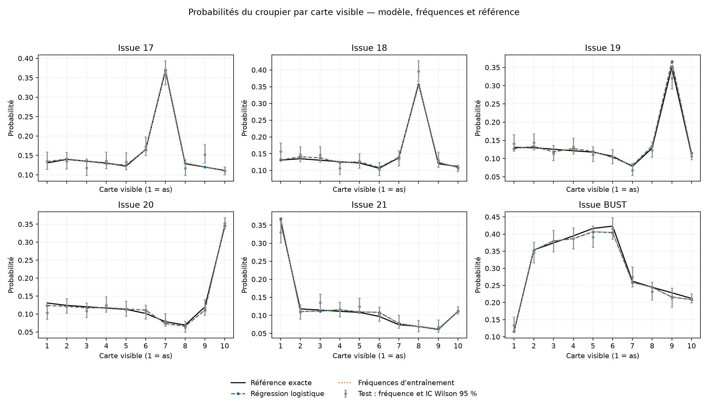
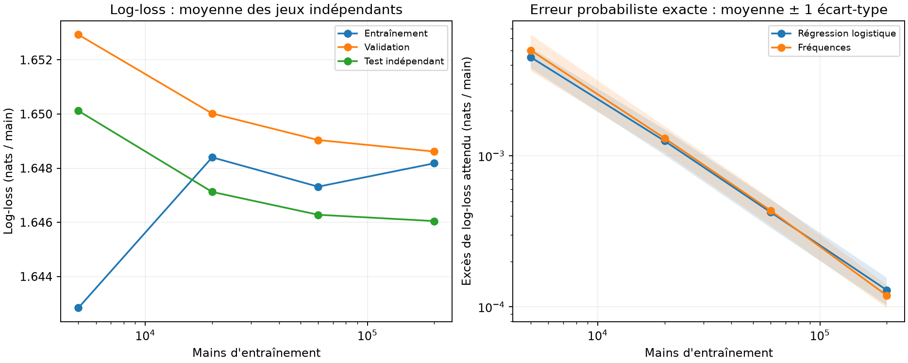
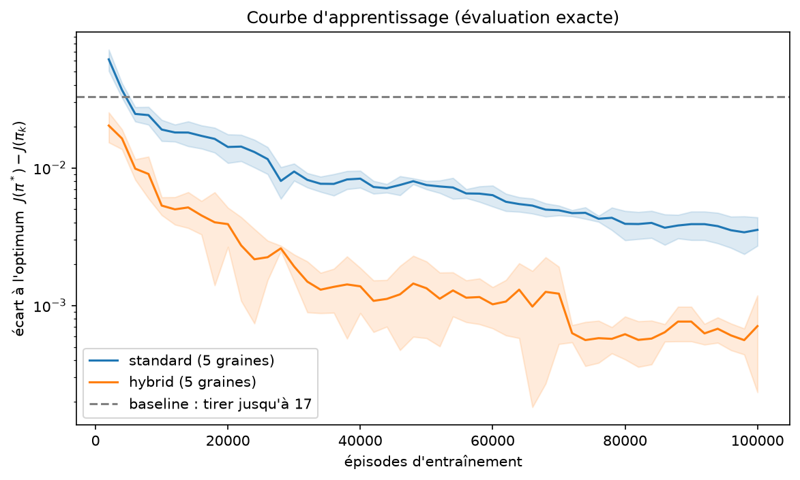
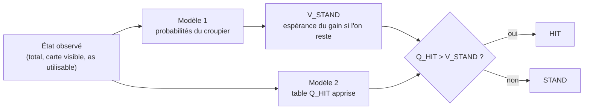
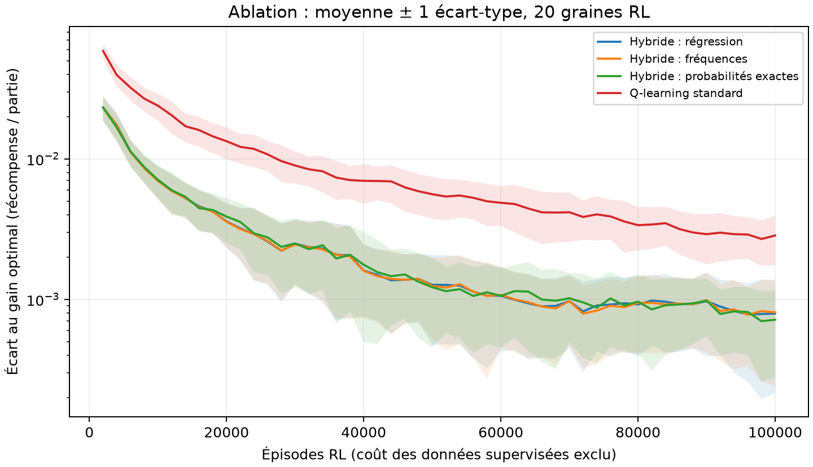

# Blackjack : prédire le croupier pour apprendre à jouer plus vite

Projet de Machine Learning 2 réalisé par Alessandro Daouk et Wassim Ghnaya.

Ce dépôt étudie une manière de combiner apprentissage supervisé et apprentissage par
renforcement. Un premier modèle apprend, à partir de mains simulées, la loi du résultat
final du croupier en fonction de sa carte visible. Un second modèle, un Q-learning, apprend
la valeur de l'action « tirer une carte ». L'agent hybride qui en résulte calcule la valeur
de l'action « rester » à partir des prédictions du premier modèle et n'apprend par
renforcement que la valeur de l'action « tirer ». Toutes les expériences sont
reproductibles : les graines, les données agrégées, les modèles entraînés et leurs
empreintes sont versionnés.

## Table des matières

1. [Question et réponse en bref](#1-question-et-réponse-en-bref)
2. [Installation et démonstration](#2-installation-et-démonstration)
3. [Le jeu étudié](#3-le-jeu-étudié)
4. [Les données](#4-les-données)
5. [Modèle 1 : prédiction du croupier par apprentissage supervisé](#5-modèle-1--prédiction-du-croupier-par-apprentissage-supervisé)
6. [Modèle 2 : Q-learning](#6-modèle-2--q-learning)
7. [Combiner les deux modèles dans un agent hybride](#7-combiner-les-deux-modèles-dans-un-agent-hybride)
8. [Protocole expérimental](#8-protocole-expérimental)
9. [Résultats](#9-résultats)
10. [Discussion et limites](#10-discussion-et-limites)
11. [Reproduire les expériences](#11-reproduire-les-expériences)
12. [Organisation du dépôt](#12-organisation-du-dépôt)
13. [Auteurs et contributions](#13-auteurs-et-contributions)

## 1. Question et réponse en bref

**Question.** Lorsqu'un agent dispose d'une estimation des probabilités de résultat du
croupier, apprend-il une bonne politique de jeu avec moins d'épisodes d'apprentissage
par renforcement qu'un Q-learning classique, qui doit apprendre seul la valeur des deux
actions ?

**Démarche.** Nous avons procédé en trois étapes :

1. simuler des mains de croupier et entraîner un classifieur probabiliste qui prédit,
   pour chaque carte visible, la probabilité que le croupier termine à 17, 18, 19, 20, 21
   ou dépasse 21 ;
2. entraîner un Q-learning standard, puis une variante hybride dans laquelle la valeur de
   « rester » est calculée à partir de ces probabilités et n'est jamais apprise ;
3. comparer les politiques obtenues par leur gain espéré exact, calculé analytiquement,
   sur plusieurs graines d'entraînement indépendantes et avec un protocole qui sépare
   le choix des réglages de l'évaluation finale.

**Réponse.** Les principaux résultats sont les suivants.

- À nombre égal d'épisodes de renforcement, l'agent hybride apprend nettement plus vite.
  Après 10 000 épisodes, son écart moyen au gain optimal vaut 0,0069 par partie, contre
  0,0199 pour le Q-learning standard. Après 100 000 épisodes, l'écart vaut 0,00079 contre
  0,00290, et l'hybride est meilleur sur les 20 graines de test.
- L'agent livré obtient un gain espéré exact de −0,047207 par partie, contre −0,046556
  pour la politique optimale. Même la politique optimale perd de l'argent en moyenne
  avec ces règles : l'objectif est de perdre le moins possible.
- La régression logistique n'apporte aucun avantage mesurable sur un estimateur plus
  simple, les fréquences observées dans les mêmes données. Ce n'est pas un défaut
  d'entraînement : avec une seule variable d'entrée catégorielle, les deux estimateurs
  sont mathématiquement très proches (section [5.3](#53-pourquoi-la-régression-et-les-fréquences-sont-presque-identiques)).
- L'avantage de l'hybride dépend de la manière dont on compte le coût des mains simulées
  pour entraîner le premier modèle. Si l'on impute ces mains au budget total, l'avantage
  diminue et peut disparaître (section [9.5](#95-coût-des-données-supervisées)).

Le projet montre donc qu'une estimation préalable de la valeur de « rester » accélère
l'apprentissage par renforcement. Il ne montre pas qu'un classifieur sophistiqué est
nécessaire pour obtenir cette estimation.

## 2. Installation et démonstration

Le projet utilise Python 3.12.7 et le gestionnaire [uv](https://docs.astral.sh/uv/getting-started/installation/),
qui installe la bonne version de Python et les dépendances figées dans `uv.lock`.
Les commandes ci-dessous fonctionnent sous Linux, macOS et Windows (PowerShell).

```bash
git clone https://github.com/Alessandro-Daouk/Black-Jack-RL.git
cd Black-Jack-RL
uv sync --locked
uv run --locked python -m scripts.verify_release
uv run --locked pytest -q
```

La première installation nécessite une connexion Internet ; tout le reste s'exécute
localement. Aucun entraînement n'est nécessaire pour essayer le projet, car les modèles
entraînés sont fournis. Le script `verify_release` vérifie les empreintes SHA-256 des
modèles livrés, recalcule le gain espéré exact de l'agent et contrôle que les sources
du Q-learning n'ont pas été modifiées. La suite de tests vérifie chaque composant
séparément, puis leur intégration.

Pour voir l'agent jouer cinq parties en expliquant chacune de ses décisions :

```bash
uv run --locked python -m src.play --games 5 --seed 2030 --trace
```

Pour demander à l'agent ce qu'il ferait dans une situation donnée, décrite par le total
du joueur, la carte visible du croupier (1 pour l'as) et la présence d'un as utilisable :

```bash
uv run --locked python -m src.play --state 15 10 0
```

```text
État (15, 10, 0) : STAND=-0.582872, HIT=-0.541728 -> HIT (HIT observé 1484 fois à l'entraînement)
```

Avec 15 points face à un 10, rester rapporte en moyenne −0,583 par partie et tirer
−0,542 : les deux actions perdent en moyenne, mais tirer perd moins, donc l'agent tire.
Le nombre de visites indique sur combien d'expériences repose la valeur apprise.
La commande suivante affiche seulement les probabilités prédites par le premier modèle :

```bash
uv run --locked python -m src.supervised.demo --dealer 10 --player 15
```

L'agent peut aussi être utilisé depuis Python :

```python
from src.hybrid_agent import load_agent

agent = load_agent()                  # charge les deux modèles une seule fois
decision = agent.decide((15, 10, 0))
print(decision.action_name)           # HIT
print(decision.stand_value, decision.hit_value)
```

## 3. Le jeu étudié

Nous utilisons l'environnement `Blackjack-v1` de la bibliothèque Gymnasium, avec les
options `natural=False` et `sab=False`. Les règles sont les suivantes.

- Les cartes sont tirées d'un paquet infini, c'est-à-dire avec remise. Les valeurs 1 à 9
  ont chacune une probabilité de 1/13 ; la valeur 10, qui regroupe le 10 et les figures,
  a une probabilité de 4/13. Un as vaut 11 si cela ne fait pas dépasser 21, et 1 sinon ;
  on dit alors qu'il est « utilisable » lorsqu'il compte pour 11.
- Le joueur choisit à chaque étape entre tirer une carte (HIT) et rester (STAND).
  S'il dépasse 21, il perd immédiatement.
- Lorsque le joueur reste, le croupier révèle sa carte cachée et tire tant que son
  total est inférieur à 17. Il s'arrête à 17 ou plus, y compris sur un « 17 souple »
  contenant un as compté 11.
- La partie rapporte +1 en cas de victoire, 0 en cas d'égalité et −1 en cas de défaite.
  Un blackjack naturel n'est pas payé davantage. Le partage, le doublement, l'assurance
  et le comptage des cartes ne sont pas modélisés.

À chaque décision, l'agent observe un état `(total_joueur, carte_visible, as_utilisable)`.
La carte cachée du croupier ne fait jamais partie de l'observation. Les états dans
lesquels une décision a un sens sont au nombre de 280 : 180 sans as utilisable (totaux 4
à 21) et 100 avec as utilisable (totaux 12 à 21), chacun combiné aux 10 cartes visibles.

Ce jeu est un processus de décision markovien fini dont on peut calculer la solution
exacte : chaque tirage augmente le total « dur » du joueur, donc aucun état ne peut être
revisité, et les valeurs se calculent en remontant des totaux élevés vers les totaux
faibles. La politique optimale π* obtient un gain espéré de −0,046556 par partie.
**Nous n'utilisons jamais cette solution exacte pour entraîner les modèles.** Elle sert
uniquement d'instrument de mesure : elle permet d'évaluer une politique apprise sans le
bruit d'une simulation, et de mesurer l'erreur des probabilités prédites. C'est ce qui
rend les comparaisons de ce projet précises, même lorsque les écarts entre méthodes
sont de l'ordre du millième de récompense par partie.

## 4. Les données

### 4.1 Simulation d'une main de croupier

Le premier modèle apprend à partir de mains de croupier simulées indépendamment du
joueur. Une simulation tire la carte visible et la carte cachée, puis complète la main
selon la règle d'arrêt à 17 (fichier [src/supervised/data.py](src/supervised/data.py)).
Chaque simulation produit un exemple composé d'une entrée, la carte visible de 1 à 10,
et d'une étiquette, le résultat final parmi six classes : 17, 18, 19, 20, 21 ou BUST
(dépassement de 21).

Dans un paquet infini, la main du joueur n'influence pas les cartes que tirera le
croupier. La carte visible est donc la seule information utile pour prédire son résultat,
et simuler le croupier séparément du joueur ne fait perdre aucune information.

### 4.2 Découpage en entraînement, validation et test

Le modèle livré utilise trois jeux de données indépendants, générés avec des graines
distinctes :

| Jeu | Mains | Graine | Usage |
|---|---:|---:|---|
| Entraînement | 60 000 | 42 | ajuster les paramètres du modèle |
| Validation | 12 000 | 43 | choisir l'intensité de la régularisation |
| Test | 12 000 | 123 | mesurer la qualité finale, sans aucun choix |

Le jeu de test n'est généré qu'après le choix de la régularisation, ce qui garantit qu'il
n'a influencé aucune décision. Le modèle n'est pas réentraîné sur la réunion de
l'entraînement et de la validation. L'empreinte SHA-256 de chaque jeu est enregistrée
dans [models/supervised/metadata.json](models/supervised/metadata.json), ce qui permet de
vérifier qu'une reproduction utilise exactement les mêmes données. Les mains brutes ne
sont pas versionnées, puisqu'elles se régénèrent à l'identique à partir des graines.

### 4.3 Référence exacte et incertitude irréductible

La loi exacte du résultat du croupier se calcule par récurrence sur son total
([src/supervised/reference.py](src/supervised/reference.py)). Elle n'est jamais utilisée
comme étiquette d'entraînement : elle sert uniquement à mesurer l'écart entre les
probabilités prédites et les vraies probabilités. Le tableau suivant donne, pour chaque
carte visible, l'issue la plus probable et la probabilité que le croupier dépasse 21.

| Carte visible | Issue la plus probable | Probabilité de cette issue | P(BUST) exacte | P(BUST) prédite |
|---:|---|---:|---:|---:|
| As | 21 | 0,3616 | 0,1153 | 0,1154 |
| 2 | BUST | 0,3536 | 0,3536 | 0,3528 |
| 3 | BUST | 0,3739 | 0,3739 | 0,3796 |
| 4 | BUST | 0,3945 | 0,3945 | 0,3863 |
| 5 | BUST | 0,4164 | 0,4164 | 0,4064 |
| 6 | BUST | 0,4232 | 0,4232 | 0,4041 |
| 7 | 17 | 0,3686 | 0,2623 | 0,2589 |
| 8 | 18 | 0,3593 | 0,2447 | 0,2446 |
| 9 | 19 | 0,3508 | 0,2284 | 0,2161 |
| 10 | 20 | 0,3422 | 0,2121 | 0,2086 |

Ce tableau montre que le résultat d'une main reste très incertain, même lorsque l'on
connaît parfaitement les probabilités : l'issue la plus probable ne se réalise que dans
34 à 42 % des cas. Un prédicteur parfait qui annoncerait toujours l'issue la plus probable
aurait donc une exactitude (accuracy) de 36,70 % seulement. De même, la meilleure
log-loss atteignable, égale à l'entropie de la loi du croupier, vaut 1,6481 nat par main.
Ces deux bornes indiquent ce qu'il est raisonnable d'attendre du modèle : il ne peut pas
prédire le résultat d'une main, il peut seulement en estimer correctement les probabilités.

### 4.4 Données du Q-learning

Le Q-learning n'utilise pas de jeu de données fixé à l'avance. Il apprend en jouant des
parties dans l'environnement Gymnasium ; un « épisode » correspond à une partie complète.
La graine d'un entraînement détermine à la fois les cartes distribuées et les choix
aléatoires d'exploration, ce qui rend chaque entraînement reproductible à l'identique.

## 5. Modèle 1 : prédiction du croupier par apprentissage supervisé

### 5.1 Le modèle

La carte visible est encodée en « one-hot », c'est-à-dire sous la forme d'un vecteur
$x \in \lbrace 0,1 \rbrace^{10}$ qui contient un seul 1 à la position de la carte. Une régression
logistique multinomiale associe à chaque classe $k$ un vecteur de poids $w_k$ et un
biais $b_k$, puis transforme les scores obtenus en probabilités par la fonction softmax :

```math
\hat P(D = k \mid d) = \frac{\exp(w_k^\top x + b_k)}{\sum_{j=1}^{6} \exp(w_j^\top x + b_j)}.
```

Les paramètres sont choisis en maximisant la vraisemblance des données d'entraînement,
ce qui revient à minimiser la log-loss moyenne, à laquelle on ajoute une pénalité
quadratique sur les poids pour éviter des probabilités trop extrêmes. Le paramètre $C$
de scikit-learn est l'inverse de l'intensité de cette pénalité : plus $C$ est petit, plus
la régularisation est forte. Le problème d'optimisation est convexe mais n'a pas de
solution explicite ; il est résolu numériquement par l'algorithme L-BFGS
([src/supervised/model.py](src/supervised/model.py)).

### 5.2 Choix de la régularisation

Cinq valeurs de $C$ ont été essayées. Pour chacune, le modèle est entraîné sur le jeu
d'entraînement puis évalué sur le jeu de validation ; la valeur retenue est celle qui
minimise la log-loss de validation.

| C | 0,01 | 0,1 | 1 | 10 | 100 |
|---|---:|---:|---:|---:|---:|
| Log-loss de validation | 1,641715 | **1,641194** | 1,641195 | 1,641195 | 1,641195 |

La valeur C = 0,1 est retenue, mais les écarts entre C = 0,1 et C = 100 n'apparaissent
qu'à la sixième décimale. Le modèle est donc pratiquement insensible à la régularisation,
sauf lorsqu'elle devient très forte (C = 0,01). La section suivante explique pourquoi.

### 5.3 Pourquoi la régression et les fréquences sont presque identiques

Un estimateur plus simple consiste à compter, pour chaque carte visible, la proportion
de mains d'entraînement qui se terminent dans chaque classe. Nous l'appelons
« estimateur par fréquences » et l'utilisons comme référence.

Avec une seule variable catégorielle encodée en one-hot, la régression logistique peut
représenter n'importe quelle loi conditionnelle $P(D \mid d)$ : elle dispose d'assez de
paramètres pour fixer librement les six probabilités de chacune des dix cartes. Dans ce
cas, la solution du maximum de vraisemblance sans régularisation est exactement la table
des fréquences. La régularisation rapproche légèrement les dix lois les unes des autres,
mais avec 4 500 à 18 400 mains d'entraînement selon la carte, cet effet est minime : la plus grande
différence entre les probabilités du modèle livré et les fréquences vaut 0,0026.
La régression logistique se comporte donc ici comme un estimateur par fréquences
légèrement lissé. Elle deviendrait réellement utile avec plusieurs variables d'entrée,
par exemple pour un paquet fini où les cartes déjà sorties modifient les probabilités.

### 5.4 De la prédiction à la valeur de « rester »

Si le joueur reste avec un total $p$, son gain dépend seulement du résultat final $D$ du
croupier : il gagne si le croupier dépasse 21 ou termine sous $p$, fait égalité si le
croupier termine à $p$, et perd sinon. On note $R(p, D) \in \lbrace -1, 0, +1 \rbrace$ ce gain.
La valeur de « rester » est son espérance sous la loi prédite :

```math
\hat V_{\mathrm{STAND}}(p, d) = \sum_{k} \hat P(D = k \mid d) \, R(p, k).
```

Comme il n'existe que dix cartes visibles, cette valeur est calculée une fois pour toutes
au chargement du modèle ([src/supervised/values.py](src/supervised/values.py)).
L'as utilisable ne modifie pas cette valeur une fois le total fixé.

Une erreur sur les probabilités se traduit directement en erreur sur cette valeur.
Si $\varepsilon_{TV}$ désigne la plus grande distance en variation totale entre la loi
prédite et la loi exacte, l'erreur sur $\hat V_{\mathrm{STAND}}$ est au plus
$2\,\varepsilon_{TV}$ (lemme démontré dans [docs/modele2.pdf](docs/modele2.pdf), section 6).
Pour le modèle livré, $\varepsilon_{TV} = 0{,}0229$, ce qui borne l'erreur par 0,0457 ;
l'erreur maximale effectivement mesurée vaut 0,0387.

### 5.5 Mesures de qualité

Nous évaluons des probabilités, pas seulement des prédictions de classe. Les mesures
utilisées sont les suivantes ; pour toutes, une valeur plus faible est meilleure, sauf
pour l'exactitude.

- **Log-loss** : moyenne de $-\log \hat P(\text{vraie classe})$, en nats par main. Elle
  pénalise fortement une faible probabilité attribuée à l'issue qui se réalise.
- **Score de Brier multiclasse** : somme, sur les six classes, des carrés des écarts entre
  la probabilité prédite et l'indicatrice de la vraie classe, moyennée sur les mains.
- **Excès exact de log-loss** : différence entre la log-loss espérée du modèle et celle de
  la loi exacte, calculée analytiquement et pondérée par la fréquence réelle des cartes
  visibles. C'est une divergence de Kullback-Leibler ; elle vaut 0 pour un prédicteur
  parfait et ne dépend pas du bruit d'un jeu de test fini.
- **Exactitude (accuracy)** et **F1 macro** : qualité de la classe la plus probable. Ces
  mesures sont rapportées par souci de complétude, mais elles n'évaluent pas les
  probabilités dont l'agent a besoin.

### 5.6 Résultats sur le jeu de test

| Estimateur | Log-loss | Brier | Exactitude | Excès exact de log-loss |
|---|---:|---:|---:|---:|
| Régression logistique (C = 0,1) | 1,651587 | 0,778452 | 36,49 % | 0,000429 |
| Fréquences d'entraînement | 1,651642 | 0,778478 | 36,49 % | 0,000449 |
| Loi exacte | 1,651709 | 0,778430 | 36,49 % | 0 |

Les trois estimateurs ont la même exactitude parce qu'ils désignent la même classe la
plus probable pour chacune des dix cartes. La loi exacte obtient une log-loss de test
légèrement moins bonne que le modèle : elle minimise la log-loss *en espérance*, mais pas
nécessairement sur un échantillon fini de 12 000 mains. C'est pourquoi nous utilisons
l'excès exact, qui n'a pas ce bruit, pour comparer les estimateurs. La différence
appariée de log-loss entre régression et fréquences vaut −0,000055, avec un intervalle
de confiance approximatif à 95 % de [−0,000125 ; +0,000014] qui contient zéro.
Aucun des deux estimateurs n'est donc significativement meilleur que l'autre.



*Pour chaque issue, la figure compare la loi exacte (noir), la régression logistique
(bleu), les fréquences d'entraînement (orange) et les fréquences observées dans le jeu
de test avec leur intervalle de Wilson à 95 % (gris). Ces intervalles sont calculés point
par point et ne forment pas une bande de confiance simultanée.*

Le modèle ne présente pas de surapprentissage notable : sa log-loss vaut 1,6480 sur
l'entraînement, 1,6412 sur la validation et 1,6516 sur le test. Ces écarts sont du même
ordre que les fluctuations d'un échantillon à l'autre, ce qui est attendu pour un modèle
qui n'estime que soixante probabilités à partir de 60 000 exemples.

### 5.7 Effet de la quantité de données

Pour mesurer la sensibilité du modèle à la quantité de données, nous avons répété
l'entraînement sur cinq jeux de données indépendants et quatre tailles d'entraînement.
Dans chaque répétition, la régularisation est choisie sur une validation de 12 000 mains
et la qualité est mesurée sur un test de 24 000 mains. Le protocole complet est décrit
à la [section 8.3](#83-expériences-complémentaires-définies-avant-leur-exécution).

| Mains d'entraînement | Excès exact moyen (régression) | Écart-type entre jeux | Excès exact moyen (fréquences) | Prédiction théorique 25/n |
|---:|---:|---:|---:|---:|
| 5 000 | 0,004507 | 0,000697 | 0,005007 | 0,005000 |
| 20 000 | 0,001257 | 0,000243 | 0,001310 | 0,001250 |
| 60 000 | 0,000424 | 0,000090 | 0,000434 | 0,000417 |
| 200 000 | 0,000129 | 0,000027 | 0,000119 | 0,000125 |

L'erreur diminue proportionnellement à l'inverse du nombre de mains, comme le prévoit
la théorie asymptotique de l'estimation par maximum de vraisemblance. Pour des
fréquences, l'excès moyen de log-loss vaut approximativement le nombre de paramètres
libres divisé par deux fois la taille de l'échantillon, soit $10 \times 5 / (2n) = 25/n$.
Les mesures sont en accord avec cette prédiction, ce qui confirme que l'erreur restante
provient uniquement de la taille finie des données. À 60 000 mains, la différence
moyenne entre régression et fréquences vaut −0,0000106, avec un intervalle approximatif
de [−0,0000411 ; +0,0000199] : là encore, aucun avantage de la régression n'est établi.



*À gauche, la log-loss moyenne sur les cinq jeux pour l'entraînement, la validation et
le test. À droite, l'excès exact de log-loss en échelle logarithmique, avec une bande
de ± 1 écart-type entre jeux.*

Le modèle entraîné sur 200 000 mains n'a pas remplacé le modèle livré : cette étude
mesure une sensibilité et ne sert pas à choisir un nouveau modèle sur des données de test.

## 6. Modèle 2 : Q-learning

### 6.1 Principe

Le Q-learning apprend, pour chaque état $s$ et chaque action $a$, une estimation $Q(s, a)$
du gain espéré lorsque l'on joue $a$ dans $s$ puis que l'on continue de jouer au mieux.
Après chaque transition de $s$ vers $s'$ avec la récompense $r$, l'estimation est
rapprochée d'une cible :

```math
Q(s, a) \leftarrow Q(s, a) + \alpha \big( y - Q(s, a) \big),
\qquad
y = \begin{cases} r & \text{si la partie est terminée,} \\ r + \max_{a'} Q(s', a') & \text{sinon.} \end{cases}
```

La partie étant courte et le gain final seul important, aucun facteur d'actualisation
n'est appliqué ($\gamma = 1$). Le pas d'apprentissage vaut $\alpha = 1/N(s,a)^\omega$, où
$N(s, a)$ compte les mises à jour déjà effectuées ; avec $\omega = 1$, l'estimation est
exactement la moyenne des cibles observées. Pendant l'apprentissage, l'agent joue une
action au hasard avec la probabilité $\varepsilon$ et sinon la meilleure action connue.
Cette probabilité d'exploration décroît d'un facteur 0,99995 à chaque épisode, à partir de
1, jusqu'à un plancher $\varepsilon_{\min}$. Le code se trouve dans
[src/q_learning.py](src/q_learning.py).

La version de base, appelée **Q-learning standard**, apprend ainsi les deux actions.
La politique évaluée est toujours la politique gloutonne, qui choisit l'action de plus
grande valeur sans aucune exploration. Les fondements mathématiques de ce modèle (processus
de décision markovien, équations de Bellman, convergence et effet d'une erreur du
modèle 1) sont détaillés dans [docs/modele2.pdf](docs/modele2.pdf).

### 6.2 Évaluation exacte d'une politique

Simuler 10 000 parties pour évaluer une politique donne une incertitude d'environ ± 0,02
sur le gain moyen, alors que les écarts entre méthodes sont de l'ordre de 0,001. Nous
calculons donc le gain espéré exact $J(\pi)$ d'une politique en parcourant le graphe des
états, qui est acyclique, à partir de la loi exacte des cartes et de la distribution
initiale de Gymnasium ([src/evaluate.py](src/evaluate.py)). L'écart $J^* - J(\pi)$ mesure
ce que la politique perd par rapport à l'optimum. Ce calcul n'intervient jamais dans les
mises à jour de l'apprentissage ; il est seulement enregistré tous les 2 000 épisodes
pour tracer les courbes d'apprentissage.

### 6.3 Réglage des hyperparamètres

Le script [src/tune.py](src/tune.py) teste six valeurs de $\varepsilon_{\min}$
(0,05 ; 0,1 ; 0,2 ; 0,4 ; 0,6 ; 1) et trois valeurs de $\omega$ (1 ; 0,8 ; 0,6) pour chacune
des deux méthodes, sur trois graines réservées à ce réglage (100 à 102), soit
108 entraînements de 100 000 épisodes. Les réglages retenus, appelés **TUNED**, sont :

- pour le Q-learning standard, $\varepsilon_{\min} = 0{,}4$ et $\omega = 1$ ;
- pour l'agent hybride, $\varepsilon_{\min} = 1$ et $\omega = 1$.

Le réglage antérieur, appelé **CONFIG**, utilisait $\varepsilon_{\min} = 0{,}05$ pour les
deux méthodes. Avec $\varepsilon_{\min} = 1$, l'agent hybride explore en jouant
entièrement au hasard pendant l'apprentissage. Cela n'empêche pas d'apprendre la
meilleure politique, car le Q-learning est une méthode « hors politique » : sa cible
utilise la meilleure action suivante, quelle que soit l'action effectivement jouée.
Ce réglage a été effectué avec la loi exacte du croupier pour l'hybride.

### 6.4 Premières expériences

Le notebook [train_model2.ipynb](train_model2.ipynb) compare, sur cinq graines
(0 à 4), le Q-learning standard à un agent hybride qui utilise la loi exacte du
croupier. Après 100 000 épisodes, l'écart moyen à l'optimum vaut 0,00354 pour le
standard et 0,00071 pour l'hybride, et les politiques coïncident avec la politique
optimale sur 95,1 % et 98,8 % des 280 états.



*Moyenne et ± 1 écart-type sur cinq graines, en échelle logarithmique. La ligne
pointillée correspond à la stratégie simple « tirer tant que le total est inférieur à 17 ».*

Le notebook étudie aussi ce qui se passe lorsque la loi exacte est remplacée par des
fréquences estimées sur $n$ mains de croupier. Après 100 000 épisodes, sans compter le
coût des $n$ mains, l'écart moyen vaut 0,0193 pour $n = 100$, 0,0047 pour $n = 1\,000$,
0,0015 pour $n = 10\,000$ et 0,0005 pour $n = 100\,000$. L'hybride n'est donc utile que si
les probabilités sont estimées avec assez de données. Ces premières expériences ont
motivé le modèle 1 et les campagnes décrites dans la suite. Leurs mesures sont dans
[results/q_learning/](results/q_learning/).

## 7. Combiner les deux modèles dans un agent hybride

### 7.1 Idée

Les deux actions n'ont pas la même difficulté. La valeur de « rester » ne dépend que de
la loi du croupier : une fois cette loi estimée, elle se calcule directement, sans
apprentissage par renforcement. La valeur de « tirer » dépend au contraire des décisions
futures du joueur et doit être apprise. L'agent hybride confie donc la première au
modèle 1 et la seconde au Q-learning.



### 7.2 Apprentissage

Le modèle 1 est entraîné en premier, puis figé. Le Q-learning met ensuite à jour la seule
valeur de « tirer », avec une cible dans laquelle la valeur de « rester » est fournie
par le modèle 1 :

```math
y = \begin{cases} r & \text{si la partie est terminée,} \\ r + \max\big(Q_{\mathrm{HIT}}(s'),\ \hat V_{\mathrm{STAND}}(s')\big) & \text{sinon.} \end{cases}
```

La valeur de « rester » n'est jamais modifiée par l'apprentissage. La section 5 de
[docs/modele2.pdf](docs/modele2.pdf), rédigée par Wassim Ghnaya, explique pourquoi cette
construction peut accélérer l'apprentissage. La cible est moins bruitée, car l'une des deux valeurs
comparées est une espérance calculée et non une moyenne d'échantillons. Le biais de
surestimation dû au maximum est réduit. Enfin, l'agent n'a plus qu'une table à apprendre
au lieu de deux.

### 7.3 Décision

Pendant une partie, l'agent compare la valeur apprise de « tirer » à la valeur calculée
de « rester » et choisit « tirer » si et seulement si la première est strictement plus
grande ; en cas d'égalité, il reste. Aucune exploration n'a lieu pendant le jeu. La
classe `HybridAgent` ([src/hybrid_agent.py](src/hybrid_agent.py)) assemble les deux
modèles. Au chargement, elle vérifie l'empreinte SHA-256 du fichier du modèle 1 et la
cohérence de la table de valeurs de « rester », afin d'empêcher d'associer une table
apprise avec un autre prédicteur que celui utilisé pendant l'entraînement.

## 8. Protocole expérimental

### 8.1 Critère d'évaluation et unité statistique

Le critère principal est le gain espéré exact $J$ de la politique gloutonne obtenue à la
fin de l'entraînement, ou de manière équivalente son écart $J^* - J$ à l'optimum.
L'unité statistique est l'entraînement : deux entraînements qui ne diffèrent que par la
graine donnent des politiques différentes, et c'est cette variabilité que les
comparaisons doivent prendre en compte. Lorsque plusieurs méthodes sont entraînées avec
les mêmes graines, nous comparons les différences graine par graine (comparaison appariée).

### 8.2 Séparation des graines

Chaque étape utilise des graines qui lui sont propres, de sorte qu'aucun résultat utilisé
pour une décision ne sert ensuite à l'évaluer.

| Étape | Graines |
|---|---|
| Données du modèle 1 livré | entraînement 42, validation 43, test 123 |
| Étude de la quantité de données (répétition i = 0 à 4) | entraînement 10000 + 3i, validation 10001 + 3i, test 10002 + 3i |
| Réglage de $\varepsilon_{\min}$ et $\omega$ | 100 à 102 |
| Premières expériences du notebook | 0 à 4 |
| Choix entre CONFIG et TUNED (validation) | 200 à 219 |
| Comparaison finale des méthodes (test) | 0 à 19 |
| Ablation de l'estimateur de probabilités | 400 à 419 |
| Entraînement de l'agent livré | 0 |
| Parties d'évaluation de l'agent livré | 2027 |

Les graines 0 à 4 avaient déjà servi aux premières expériences du notebook ; elles n'ont
servi à aucun choix de réglage ni de modèle.

### 8.3 Expériences complémentaires définies avant leur exécution

L'étude de la quantité de données (section 5.7) et l'ablation de l'estimateur de
probabilités (section 9.4) ont été définies par écrit avant d'être lancées, dans
[docs/protocole_complementaire.md](docs/protocole_complementaire.md). Ce document fixe
les tailles de données, les graines, la règle de choix de la régularisation, les méthodes
comparées, le contraste principal et la manière de rapporter l'incertitude. Son
empreinte SHA-256 est enregistrée dans les résultats de ces deux campagnes : le fichier
doit donc rester inchangé pour que l'on puisse vérifier que le protocole suivi est bien
celui qui a été écrit à l'avance. Les résultats antérieurs du projet étaient déjà connus
à ce moment ; il ne s'agit donc pas d'une préinscription au sens strict.

### 8.4 Statistiques

- Pour la comparaison entre CONFIG et TUNED, nous utilisons un test exact de permutation
  des signes sur les différences appariées. Ce test suppose que, sous l'hypothèse nulle,
  la distribution de chaque différence est symétrique autour de zéro.
- Pour les expériences complémentaires, nous rapportons la moyenne, l'écart-type et un
  intervalle de confiance approximatif à 95 % fondé sur la loi de Student, calculé entre
  graines ou entre jeux de données indépendants.
- Les comparaisons secondaires sont descriptives et ne font pas l'objet d'une correction
  pour comparaisons multiples.
- Un intervalle qui contient zéro signifie que la différence n'est pas établie ; il ne
  prouve pas que les deux méthodes sont équivalentes. Aucun test d'équivalence n'a été
  prévu.

## 9. Résultats

Tous les entraînements de cette section utilisent 100 000 épisodes de renforcement et
le modèle 1 livré, figé. Chaque campagne a son propre dossier dans [results/](results/),
avec les mesures brutes (CSV), un résumé (JSON) et un rapport généré automatiquement.

### 9.1 Choix du réglage sur la validation

Le choix entre CONFIG et TUNED pour l'hybride supervisé a été fait sur les vingt graines
de validation, selon une règle fixée à l'avance : retenir le réglage de meilleur gain
moyen, et CONFIG en cas d'égalité. TUNED obtient un gain moyen de −0,047222 contre
−0,048243 pour CONFIG, et il est meilleur sur les vingt graines (p = 1,9 × 10⁻⁶).
TUNED est donc retenu.

### 9.2 Comparaison des méthodes sur le test

Les trois méthodes ont ensuite été entraînées avec les deux réglages sur vingt nouvelles
graines de test, soit 120 entraînements. L'« hybride exact » utilise la vraie loi du
croupier au lieu du modèle 1 ; il sert de référence pour isoler l'effet de l'erreur
d'estimation.

| Méthode | Gain moyen, CONFIG | Gain moyen, TUNED | Écart à l'optimum, TUNED | États différents de π*, TUNED |
|---|---:|---:|---:|---:|
| Hybride, modèle 1 | −0,048083 | −0,047347 | 0,000791 | 4,5 |
| Hybride, loi exacte | −0,048624 | −0,047371 | 0,000815 | 4,2 |
| Q-learning standard | −0,050667 | −0,049459 | 0,002904 | 11,5 |

Avec le réglage TUNED, l'hybride qui utilise le modèle 1 dépasse le Q-learning standard
de 0,002113 par partie en moyenne et le dépasse sur les vingt graines (p = 1,9 × 10⁻⁶).
Aucune différence n'est mise en évidence avec l'hybride qui utilise la loi exacte : la
différence moyenne vaut +0,000024 (meilleur sur 6 graines, égal sur 5, moins bon sur 9 ; p = 0,77).
Le réglage TUNED améliore l'hybride supervisé sur 17 graines sur 20 (p = 0,0019).

Le tableau suivant montre la vitesse d'apprentissage, mesurée par l'écart moyen à
l'optimum après un nombre donné d'épisodes, avec le réglage TUNED.

| Épisodes de renforcement | 10 000 | 20 000 | 50 000 | 100 000 |
|---|---:|---:|---:|---:|
| Hybride, modèle 1 | 0,00690 | 0,00374 | 0,00171 | 0,00079 |
| Hybride, loi exacte | 0,00688 | 0,00352 | 0,00177 | 0,00081 |
| Q-learning standard | 0,01994 | 0,01320 | 0,00593 | 0,00290 |

À chaque étape, l'écart du Q-learning standard est environ trois à quatre fois plus grand
que celui des hybrides (rapport de 2,9 à 3,7). Le Q-learning standard a besoin de 100 000 épisodes pour
atteindre un écart que les hybrides atteignent entre 20 000 et 50 000 épisodes.

### 9.3 L'agent livré

L'agent livré ([models/hybrid/agent_tuned.npz](models/hybrid/agent_tuned.npz)) est
l'hybride TUNED entraîné avec la graine 0, la même que celle du premier agent ; cette
graine n'a pas été choisie parmi les meilleures graines de test. Son gain espéré exact vaut
−0,047207 par partie, soit un écart de 0,000651 à l'optimum.

Sur 10 000 nouvelles parties (graine 2027), il obtient 4 225 victoires, 1 005 égalités
et 4 770 défaites, soit un gain moyen observé de −0,0545 avec un intervalle de confiance
approximatif à 95 % de [−0,0731 ; −0,0359]. Cet intervalle, large de 0,037, est
environ cinquante-sept fois plus grand que l'écart entre l'agent et l'optimum : c'est
pourquoi les comparaisons de ce projet reposent sur le gain exact et non sur des parties
simulées.

Le premier hybride entraîné, avec le réglage CONFIG, est conservé dans
[models/hybrid/agent_config.npz](models/hybrid/agent_config.npz) avec ses résultats
dans [results/hybrid/agent_config/](results/hybrid/agent_config/). Son gain exact vaut
−0,047765. La campagne de comparaison le reproduit à l'identique, ce qui vérifie que les
entraînements sont déterministes.

### 9.4 La régression est-elle nécessaire ?

Cette ablation compare quatre méthodes sur vingt nouvelles graines (400 à 419), soit
80 entraînements : l'hybride avec la régression logistique, l'hybride avec les fréquences
calculées sur exactement les mêmes 60 000 mains, l'hybride avec la loi exacte et le
Q-learning standard. Les réglages TUNED ont été fixés avant cette campagne.

| Méthode | Gain moyen | Écart-type entre graines |
|---|---:|---:|
| Hybride, régression logistique | −0,047349 | 0,000575 |
| Hybride, fréquences | −0,047364 | 0,000568 |
| Hybride, loi exacte | −0,047272 | 0,000436 |
| Q-learning standard | −0,049405 | 0,001101 |

Le contraste principal, régression moins fréquences, vaut +0,0000158 par partie avec un
intervalle approximatif de [−0,0000197 ; +0,0000513]. Les deux hybrides obtiennent
exactement le même gain sur 18 des 20 graines. **Cette expérience ne met en évidence
aucun bénéfice propre de la régression logistique**, ce qui est cohérent avec
l'explication de la section 5.3. En revanche, l'hybride avec régression dépasse le
Q-learning standard de 0,00206 par partie, avec un intervalle de [0,00143 ; 0,00268],
et il est meilleur sur 18 graines sur 20. Cela représente environ 0,2 unité de mise
perdue en moins pour 100 parties, une amélioration réelle mais modeste dans un jeu qui
reste défavorable au joueur.



*Moyenne et ± 1 écart-type sur vingt graines, en échelle logarithmique. Les courbes des
trois hybrides sont presque superposées. La bande représente la dispersion entre
entraînements et non l'incertitude sur la moyenne.*

### 9.5 Coût des données supervisées

Les comparaisons précédentes donnent le même nombre d'épisodes de renforcement à toutes
les méthodes, mais l'hybride bénéficie en plus des mains simulées pour entraîner le
modèle 1. Pour en tenir compte, on peut fixer un budget total de 100 000 simulations et
retirer du budget de l'hybride les mains utilisées par le modèle 1.

| Méthode | Mains de croupier comptées | Épisodes restants | Écart moyen à l'optimum |
|---|---|---:|---:|
| Hybride, modèle 1 | 60 000 (entraînement) | 40 000 | 0,001740 |
| Hybride, modèle 1 | 84 000 (entraînement, validation et test) | 16 000 | 0,004528 |
| Q-learning standard | aucune | 100 000 | 0,002904 |

Si l'on compte seulement les mains d'entraînement, l'hybride reste meilleur. Si l'on
compte aussi les mains de validation et de test, le Q-learning standard repasse devant.
Cette comptabilité reste approximative : une main de croupier et une partie complète
n'ont pas le même coût de calcul, et le coût du réglage des hyperparamètres n'est imputé
à aucune méthode. La conclusion dépend donc de la ressource que l'on considère comme rare.

### 9.6 Limite atteignable avec le modèle 1

Avec un nombre infini d'épisodes, l'hybride convergerait vers la meilleure politique
compatible avec les valeurs de « rester » estimées par le modèle 1. Cette politique
limite ne diffère de la politique optimale que dans un seul des 280 états et ne perd que
0,000022 par partie. L'erreur résiduelle du modèle 1 a donc un effet négligeable sur les
décisions. L'écart restant de l'agent livré (0,000651) vient essentiellement du nombre
fini d'épisodes de renforcement.

## 10. Discussion et limites

**Réponse à la question.** Fournir au Q-learning une estimation de la valeur de « rester »
accélère nettement l'apprentissage : à budget de renforcement égal, l'hybride atteint
en 20 000 à 50 000 épisodes la qualité que le Q-learning standard atteint en 100 000.
Cet avantage provient de l'information apportée par les mains simulées, pas de la forme
particulière du classifieur : une simple table de fréquences fournit la même information.

**Limites.**

- Toutes les conclusions portent sur un seul environnement : paquet infini, arrêt du
  croupier sur 17 souple, actions limitées à tirer et rester. Elles ne s'étendent pas
  sans nouvelle étude à un paquet fini, à d'autres règles ou à un casino réel.
- Les campagnes comptent vingt graines de renforcement et cinq jeux de données
  supervisés. Les intervalles de confiance sont approximatifs, en particulier pour le
  contraste entre régression et fréquences, où la plupart des différences sont nulles.
- La variabilité du modèle 1 est étudiée séparément ; elle n'est pas propagée dans les
  campagnes de renforcement, qui utilisent toutes le même modèle 1 figé.
- Les réglages TUNED ont été choisis avec la loi exacte pour l'hybride, sur un nombre
  limité de graines et de valeurs candidates.
- Les jeux de test supervisés et les graines de test sont désormais connus. Tout nouveau
  choix de modèle devrait utiliser de nouvelles graines de validation et de test.
- La précision des probabilités, le résultat d'une partie et le gain d'une politique sont
  trois critères distincts. Un bon agent perd tout de même plus de parties qu'il n'en
  gagne, car le gain espéré de la politique optimale est négatif.

## 11. Reproduire les expériences

Toutes les commandes s'exécutent depuis la racine du dépôt après `uv sync --locked`.
Elles écrivent dans `models/reproduction/` et `results/reproduction/`, deux dossiers
ignorés par Git, afin de ne jamais écraser les résultats publiés. Les durées indiquées
sont des ordres de grandeur sur un ordinateur portable récent.

**Modèle 1** (moins d'une minute) :

```bash
uv run --locked python -m src.supervised.train --model-dir models/reproduction/supervised --results-dir results/reproduction/supervised
```

**Agent hybride** (quelques secondes pour l'entraînement, davantage pour l'évaluation sur 10 000 parties) :

```bash
uv run --locked python -m src.train_hybrid --preset tuned --agent models/reproduction/agent_tuned.npz --results-dir results/reproduction/hybrid --episodes 100000 --seed 0
uv run --locked python -m src.evaluate_hybrid --agent models/reproduction/agent_tuned.npz --output results/reproduction/hybrid/evaluation.json --games 10000 --seed 2027
```

Ces commandes utilisent le modèle 1 livré. Pour utiliser celui reproduit à l'étape
précédente, ajouter `--model models/reproduction/supervised/dealer_model.joblib` aux deux
commandes. L'entraînement refuse d'écraser un agent ou un dossier de résultats existant ;
l'option `--overwrite` autorise ce remplacement et supprime alors l'ancienne évaluation,
qui ne correspondrait plus à l'agent.

**Campagnes de comparaison** (plusieurs minutes chacune ; `--jobs` fixe le nombre de
processus parallèles) :

```bash
uv run --locked python -m src.compare_hybrid --output-dir results/reproduction/config_vs_tuned --jobs 2
uv run --locked python -m src.supervised.learning_curve --output results/reproduction/learning_curve --jobs 2
uv run --locked python -m src.compare_frequencies --output results/reproduction/frequencies_ablation --jobs 2
```

La première commande reproduit la comparaison CONFIG/TUNED (160 entraînements), la
deuxième l'étude de la quantité de données et la troisième l'ablation de l'estimateur
de probabilités (80 entraînements). La figure de l'ablation peut être recréée à partir
des mesures publiées, sans entraînement, avec `uv run --locked python -m scripts.make_summary_figures`.

**Premières expériences du modèle 2.** `uv run --locked python -m src.tune` relance les
108 entraînements du réglage et réécrit `results/q_learning/tuning.csv`. Le notebook
`train_model2.ipynb` s'ouvre après `uv sync --locked --extra notebook`, qui installe le
noyau Jupyter ; son exécution réécrit les fichiers de `results/q_learning/` et
`models/q_learning/`.

Un modèle réentraîné sur un autre système peut ne pas être identique octet par octet,
car la sérialisation dépend des versions des bibliothèques : il faut alors comparer les
tables et les scores plutôt que les fichiers binaires. L'intégration continue GitHub
est configurée pour exécuter les tests, la vérification des modèles et la démonstration
sous Linux et sous Windows à chaque envoi de modifications.

## 12. Organisation du dépôt

```text
src/
  environment.py          Règles du jeu et transitions
  stand_value.py          Loi exacte du croupier et valeur de « rester »
  q_learning.py           Q-learning standard et hybride, réglages CONFIG et TUNED
  evaluate.py             Gain espéré exact et politique optimale
  tune.py                 Réglage de ε_min et ω
  supervised/             Modèle 1 : simulation, entraînement, évaluation, courbes
  hybrid_agent.py         Assemblage des deux modèles et décision
  train_hybrid.py         Entraînement de l'agent hybride avec le modèle 1 figé
  evaluate_hybrid.py      Évaluation d'un agent sur des parties simulées
  compare_hybrid.py       Comparaison CONFIG/TUNED et des trois méthodes
  compare_frequencies.py  Ablation de l'estimateur de probabilités
  play.py                 Démonstration en ligne de commande
models/
  supervised/             Modèle 1 livré, probabilités exportées et métadonnées
  hybrid/                 Agent livré (agent_tuned.npz) et premier agent (agent_config.npz)
  q_learning/             Table Q_HIT produite par le notebook
  manifest.json           Empreintes SHA-256 des modèles livrés
results/
  supervised/             Modèle 1 livré, puis étude de la quantité de données
  q_learning/             Réglage et premières expériences du modèle 2
  hybrid/                 Agents livrés, comparaison CONFIG/TUNED et ablation
docs/
  modele2.tex, modele2.pdf      Fondements mathématiques du modèle 2 et de l'hybride
  protocole_complementaire.md   Protocole figé des expériences complémentaires
  wassim_source.json            Provenance et empreintes du code du modèle 2
scripts/                  Vérification des modèles livrés et figure de l'ablation
tests/                    Tests unitaires et d'intégration
train_model2.ipynb        Notebook des premières expériences du modèle 2
```

Les rapports `report.md` présents dans `results/` sont produits automatiquement par les
scripts de chaque campagne ; ils décrivent les fichiers de mesures qui les accompagnent.

## 13. Auteurs et contributions

- **Wassim Ghnaya** : environnement de jeu et références exactes, Q-learning standard
  et hybride, réglage des hyperparamètres, premières expériences et ablations
  (notebook), fondements mathématiques du modèle 2 et de l'hybride
  ([docs/modele2.pdf](docs/modele2.pdf)).
- **Alessandro Daouk** : simulation des données et modèle 1, estimateur par fréquences
  et évaluation probabiliste, assemblage de l'agent hybride, campagnes de comparaison
  et d'ablation, vérification de la reproductibilité et documentation commune.
  Ce travail de développement a été assisté par des outils d'intelligence artificielle.

Le code du Q-learning a été intégré sans modification depuis la branche de Wassim
Ghnaya ; ses empreintes sont enregistrées dans
[docs/wassim_source.json](docs/wassim_source.json) et vérifiées par les tests.
L'historique Git conserve l'auteur de chaque contribution.
