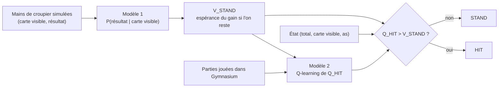

# Blackjack : une estimation du croupier aide-t-elle le Q-learning ?

Projet de Machine Learning 2 réalisé par Alessandro Daouk et Wassim Ghnaya.

Ce dépôt étudie un agent de Blackjack hybride. Un premier modèle, supervisé, estime
à partir de mains simulées la loi du résultat final du croupier selon sa carte visible ;
on en déduit la valeur de l'action « rester » (STAND). Un second modèle, un Q-learning
tabulaire, n'apprend alors que la valeur de l'action « tirer » (HIT). La question
étudiée est de savoir quand cette connaissance préalable rend l'apprentissage par
renforcement plus efficace, et si l'avantage subsiste une fois compté le coût de
l'estimation. Le dépôt contient la version historique du projet et un audit
scientifique (v2) qui corrige plusieurs démonstrations et répète les expériences sur
des données indépendantes ; les deux restent consultables et distinctes.

## Table des matières

1. [Question de recherche et résultat central](#1-question-de-recherche-et-résultat-central)
2. [Installation et démonstration](#2-installation-et-démonstration)
3. [Le jeu étudié et ses hypothèses](#3-le-jeu-étudié-et-ses-hypothèses)
4. [Architecture](#4-architecture)
5. [Données, oracle exact et baselines](#5-données-oracle-exact-et-baselines)
6. [Protocole expérimental](#6-protocole-expérimental)
7. [Résultats](#7-résultats)
8. [Coûts : épisodes RL et coût total](#8-coûts--épisodes-rl-et-coût-total)
9. [Résultat négatif : la régression n'apporte rien sur les fréquences](#9-résultat-négatif--la-régression-napporte-rien-sur-les-fréquences)
10. [Limites et menaces à la validité](#10-limites-et-menaces-à-la-validité)
11. [Reproduire les résultats](#11-reproduire-les-résultats)
12. [Organisation du dépôt et documents](#12-organisation-du-dépôt-et-documents)
13. [Auteurs, contributions et provenance](#13-auteurs-contributions-et-provenance)

## 1. Question de recherche et résultat central

**Question.** Dans quelles conditions une estimation probabiliste préalable d'une
composante de la fonction de valeur, ici la valeur de l'action terminale STAND,
améliore-t-elle l'efficacité d'apprentissage d'un Q-learning, et quand cet avantage
persiste-t-il après prise en compte du coût d'obtention de cette estimation ?

**Résultat central.** Les chiffres suivants proviennent de la campagne v2 : 28 jeux de
données supervisées indépendants, deux graines d'apprentissage par jeu, gain espéré
exact, intervalles de confiance à 95 % calculés entre jeux indépendants.

- Avec un modèle du croupier appris sur 20 000 mains et 100 000 épisodes de
  renforcement, l'hybride gagne en moyenne **0,00214 de plus par partie** que le
  Q-learning standard réglé, avec un intervalle de [0,00188 ; 0,00240]. Il est meilleur
  dans les 56 paires d'entraînements. Cela représente environ 0,2 mise perdue en moins
  pour 100 parties, dans un jeu où même la politique optimale perd 4,66 mises sur 100.
- L'avantage dépend des budgets. Il est considérable avec peu d'épisodes, puis diminue.
  Avec un modèle appris sur 1 000 mains seulement, **l'hybride devient moins bon** que le
  standard à 200 000 épisodes (−0,0020 [−0,0033 ; −0,0006]) : il converge vers la
  meilleure politique du modèle estimé, dont l'erreur dépasse alors celle du standard.
- Mesuré en secondes de calcul et en cartes distribuées, en incluant la simulation des
  mains et le choix de la régularisation, l'avantage persiste avec 20 000 mains pour des
  budgets de 2 à 20 secondes ; avec 5 000 ou 60 000 mains, il ne tient que sur une partie
  de cette plage. Il disparaît lorsque l'estimation consomme presque tout le budget, ou
  lorsque le modèle est trop imprécis.
- La régression logistique et une simple table de fréquences donnent des agents
  équivalents à ±0,001 près (test d'équivalence TOST), et, à 20 000 ou 60 000 mains,
  les fréquences coûtent environ trois fois moins de temps d'acquisition. Le classifieur n'est donc pas nécessaire dans ce problème.

Le projet ne revendique pas d'invention algorithmique : utiliser une connaissance
partielle du modèle dans un apprentissage par renforcement est une idée connue
([état de l'art](docs/etat_de_l_art.md)). Son apport est une étude de cas contrôlée,
avec un oracle exact, des bornes adaptées, des coûts mesurés et des résultats négatifs
conservés. Le jeu étudié est défavorable au joueur ; aucun agent ici ne gagne d'argent.

## 2. Installation et démonstration

Le projet utilise Python 3.12.7 et le gestionnaire [uv](https://docs.astral.sh/uv/getting-started/installation/),
qui installe la bonne version de Python et les dépendances figées dans `uv.lock`.
Les commandes ci-dessous fonctionnent sous Linux, macOS et Windows (PowerShell).

```bash
git clone https://github.com/Alessandro-Daouk/Black-Jack-RL.git
cd Black-Jack-RL
uv sync --locked
uv run --locked python -m scripts.verify_release
uv run --locked python -m scripts.verify_audit
uv run --locked pytest -q
```

La première installation nécessite une connexion Internet ; tout le reste s'exécute
localement. Aucun entraînement n'est nécessaire pour essayer le projet, car les modèles
entraînés sont fournis. `verify_release` vérifie les empreintes SHA-256 des modèles
livrés, recalcule le gain espéré exact de l'agent et contrôle que les sources du
Q-learning de Wassim Ghnaya n'ont pas été modifiées. `verify_audit` recalcule le gain
exact des 418 agents archivés de la campagne v2 et vérifie que l'analyse publiée porte
bien sur ces mesures. La suite de tests vérifie chaque composant puis leur intégration.

Pour voir l'agent jouer cinq parties en expliquant chacune de ses décisions :

```bash
uv run --locked python -m src.play --games 5 --seed 2030 --trace
```

Pour demander à l'agent ce qu'il ferait dans une situation donnée, décrite par le total
du joueur, la carte visible du croupier (1 pour l'as) et la présence d'un as utilisable :

```bash
uv run --locked python -m src.play --state 15 10 0
```

```text
État (15, 10, 0) : STAND=-0.582872, HIT=-0.541728 -> HIT (HIT observé 1484 fois à l'entraînement)
```

Avec 15 points face à un 10, rester rapporte en moyenne −0,583 par partie et tirer
−0,542 : les deux actions perdent en moyenne, mais tirer perd moins, donc l'agent tire.
Le nombre de visites indique sur combien d'expériences repose la valeur apprise.
La commande suivante affiche seulement les probabilités prédites par le premier modèle :

```bash
uv run --locked python -m src.supervised.demo --dealer 10 --player 15
```

L'agent peut aussi être utilisé depuis Python :

```python
from src.hybrid_agent import load_agent

agent = load_agent()                  # charge les deux modèles une seule fois
decision = agent.decide((15, 10, 0))
print(decision.action_name)           # HIT
print(decision.stand_value, decision.hit_value)
```

## 3. Le jeu étudié et ses hypothèses

Nous utilisons l'environnement `Blackjack-v1` de Gymnasium 1.4.0, avec les options
`natural=False` et `sab=False`. Les règles sont les suivantes.

- Les cartes sont tirées d'un paquet infini, c'est-à-dire avec remise. Les valeurs 1 à 9
  ont chacune une probabilité de 1/13 ; la valeur 10, qui regroupe le 10 et les figures,
  a une probabilité de 4/13. Un as vaut 11 si cela ne fait pas dépasser 21, et 1 sinon ;
  on dit alors qu'il est « utilisable » lorsqu'il compte pour 11.
- Le joueur choisit à chaque étape entre tirer une carte (HIT) et rester (STAND).
  S'il dépasse 21, il perd immédiatement.
- Lorsque le joueur reste, le croupier révèle sa carte cachée et tire tant que son
  total est inférieur à 17. Il s'arrête à 17 ou plus, y compris sur un « 17 souple ».
- La partie rapporte +1 en cas de victoire, 0 en cas d'égalité et −1 en cas de défaite.
  Un blackjack naturel n'est pas payé davantage. Le partage, le doublement, l'assurance
  et le comptage des cartes ne sont pas modélisés.

À chaque décision, l'agent observe un état `(total_joueur, carte_visible, as_utilisable)`.
La carte cachée du croupier n'est jamais observée. Il existe 280 états de décision
atteignables : 180 sans as utilisable (totaux 4 à 21) et 100 avec as utilisable (totaux
12 à 21), chacun combiné aux dix cartes visibles. Chaque tirage augmente strictement le
total « dur » du joueur (l'as compté 1), qui vaut au moins 2 avec deux as : aucun état
n'est revisité et une partie comporte au plus 20 décisions. Le jeu est donc un processus
de décision markovien fini et acyclique, que l'on peut résoudre exactement en remontant
des totaux élevés vers les totaux faibles, sans facteur d'actualisation (γ = 1).
La politique optimale π\* obtient un gain espéré de −0,046556 par partie.

Deux hypothèses portent toute l'étude. D'abord, dans un paquet infini, le résultat du
croupier ne dépend que de sa carte visible : la main du joueur n'apporte aucune
information. Cette propriété disparaît avec un paquet fini. Ensuite, la valeur de
STAND est l'espérance d'un gain terminal qui ne dépend plus d'aucune décision du
joueur ; c'est ce qui permet de l'estimer hors ligne.

## 4. Architecture



**Modèle 1 : loi du croupier.** Pour chaque carte visible $d$, le modèle estime la loi
$\hat P(D \mid d)$ du résultat final $D \in \lbrace 17, 18, 19, 20, 21, \mathrm{BUST}\rbrace$.
Le modèle livré est une régression logistique multinomiale sur la carte encodée en
one-hot ([src/supervised/model.py](src/supervised/model.py)), régularisée par une
pénalité quadratique dont l'intensité $1/C$ est choisie sur une validation.
Avec une seule variable catégorielle, ce modèle est *saturé* : sans pénalité, il
reproduit exactement les fréquences observées, et la pénalité ne les déplace que d'un
terme d'ordre $1/N_d$ ([docs/modele1.pdf](docs/modele1.pdf)). Les fréquences brutes et
les fréquences lissées de Jeffreys servent de comparaisons directes.

**De la loi à la valeur de rester.** Si le joueur reste avec un total $p$, son gain
$R(p, D) \in \lbrace -1, 0, +1 \rbrace$ ne dépend que de $D$. La valeur de STAND est
$\hat V_{\mathrm{STAND}}(p, d) = \sum_k \hat P(D = k \mid d)\, R(p, k)$, calculée une
fois pour toutes ([src/supervised/values.py](src/supervised/values.py)). Son erreur est
au plus deux fois la distance en variation totale entre loi estimée et loi vraie.

**Modèle 2 : Q-learning.** Le Q-learning standard apprend les deux actions. Après une
transition de $s$ vers $s'$ avec la récompense $r$, il rapproche $Q(s,a)$ de la cible
$y = r$ si la partie est finie, $y = r + \max_{a'} Q(s', a')$ sinon, avec un pas
$\alpha = 1/N(s,a)^\omega$. Pendant l'apprentissage, il joue au hasard avec la
probabilité $\varepsilon$, qui décroît d'un facteur 0,99995 par épisode jusqu'à un
plancher $\varepsilon_{\min}$ ([src/q_learning.py](src/q_learning.py), code de Wassim Ghnaya).

**Hybride.** La valeur de STAND est fournie par le modèle 1 et n'est jamais modifiée ;
seule $Q_{\mathrm{HIT}}$ est apprise, avec la cible
$y = r + \max\big(Q_{\mathrm{HIT}}(s'), \hat V_{\mathrm{STAND}}(s')\big)$. L'agent
choisit HIT si et seulement si $Q_{\mathrm{HIT}} > \hat V_{\mathrm{STAND}}$. La classe
`HybridAgent` ([src/hybrid_agent.py](src/hybrid_agent.py)) vérifie au chargement que la
table apprise correspond bien au prédicteur utilisé à l'entraînement.

**Ce que la théorie établit.** Les démonstrations sont dans [docs/modele2.pdf](docs/modele2.pdf).
Sous des hypothèses de visitation, de pas et de bruit énoncées, l'hybride converge vers
la meilleure politique **du modèle estimé**, et non vers l'optimum vrai. Si
$\eta$ est l'erreur maximale de $\hat V_{\mathrm{STAND}}$, l'erreur sur la valeur
optimale de HIT est au plus $\eta$ et la politique limite perd au plus $2\eta$ par partie ;
une borne locale, pondérée par la fréquence de visite des états, est beaucoup plus fine.
L'idée que fixer STAND réduit la variance des cibles et le biais du maximum est une
explication plausible de l'accélération, pas une garantie démontrée.

## 5. Données, oracle exact et baselines

**Données du modèle 1.** Une simulation tire la carte visible et la carte cachée du
croupier, puis complète sa main selon la règle d'arrêt à 17
([src/supervised/data.py](src/supervised/data.py)). Le modèle livré utilise 60 000 mains
d'entraînement (graine 42), 12 000 de validation (graine 43) pour choisir $C$ et 12 000
de test (graine 123), générées après ce choix. Les empreintes SHA-256 des jeux sont
enregistrées dans [models/supervised/metadata.json](models/supervised/metadata.json).
Dans la campagne v2, chaque jeu supervisé a ses propres graines d'entraînement, de
validation et de test.

**Données du Q-learning.** Le Q-learning apprend en jouant des parties dans Gymnasium ;
la graine d'un entraînement fixe les cartes et les tirages d'exploration.

**Oracle exact.** Le gain espéré exact $J(\pi)$ d'une politique se calcule en parcourant
le graphe acyclique des états ([src/evaluate.py](src/evaluate.py)). Un second oracle,
écrit indépendamment pour l'audit, propage la masse du croupier vers l'avant et résout
un système triangulaire à partir de mains explicites ([src/audit/oracle.py](src/audit/oracle.py)) ;
les deux coïncident à $10^{-14}$ près et l'oracle d'audit coïncide avec Gymnasium sur
toutes les transitions atteignables. L'oracle sert uniquement à mesurer : il n'entre
jamais dans les mises à jour des agents supervisés ou standard. Seul le bras
« STAND exacte », identifié comme un oracle privilégié, reçoit la vraie valeur de STAND.
L'évaluation exacte est indispensable : même 100 000 parties simulées donnent un
intervalle de largeur 0,012 sur le gain de la politique optimale, soit plus de cinq fois
l'écart entre l'hybride et le standard.

**Incertitude irréductible.** Le résultat d'une main reste très incertain même avec la
loi exacte : l'issue la plus probable ne se réalise que dans 34 à 42 % des cas selon la
carte visible. Un prédicteur parfait aurait une exactitude de 36,70 % et une log-loss de
1,6481 nat par main. Les scores utiles sont donc des scores de probabilités (log-loss,
Brier, divergence de Kullback-Leibler à la loi exacte), pas l'exactitude.

**Baselines de politiques**, évaluées exactement et contrôlées par 100 000 parties
Monte-Carlo chacune ([results/v2/diagnostics/baselines.csv](results/v2/diagnostics/baselines.csv)) :

| Politique | Gain exact par partie |
|---|---:|
| Toujours tirer | −1 |
| Aléatoire, HIT avec probabilité ½ | −0,3959 |
| Toujours rester | −0,1864 |
| Tirer tant que le total est inférieur à 17 | −0,0793 |
| Politique optimale π\* | −0,0466 |

## 6. Protocole expérimental

**Historique.** Les campagnes d'origine ont utilisé un seul prédicteur figé, vingt
graines de validation pour choisir entre deux réglages (CONFIG et TUNED), puis vingt
graines de test, et une ablation de l'estimateur sur vingt autres graines. Les
hyperparamètres TUNED ($\varepsilon_{\min} = 0{,}4$ pour le standard, $\varepsilon_{\min} = 1$
pour l'hybride, $\omega = 1$ pour les deux) ont été choisis par [src/tune.py](src/tune.py)
sur trois graines réservées (108 entraînements), avec la loi exacte pour l'hybride.
Avec $\varepsilon_{\min} = 1$, l'hybride explore entièrement au hasard : c'est possible
parce que la cible du Q-learning utilise la meilleure action suivante, quelle que soit
l'action jouée (apprentissage hors politique). Le protocole complémentaire historique
est figé dans [docs/protocole_complementaire.md](docs/protocole_complementaire.md).

**Audit v2.** Le protocole ([docs/protocole_v2.md](docs/protocole_v2.md)) a été écrit
avant les nouvelles mesures. Un pilote sur des graines de validation a fixé le nombre de
jeux supervisés indépendants à 28, pour viser une précision de ±0,0005 sur le critère
principal ([addendum](docs/protocole_v2_addendum.md)). Les déviations ultérieures sont
consignées dans [docs/protocole_v2_deviations.md](docs/protocole_v2_deviations.md).

- **Critère principal** : différence de gain exact entre l'hybride logistique et le
  standard réglé, à 20 000 mains et 100 000 épisodes. Une différence de **0,001 par
  partie** est fixée à l'avance comme seuil d'intérêt pratique.
- **Unité statistique** : un jeu de données supervisé indépendant. Les deux graines RL
  d'un même jeu sont moyennées après appariement des méthodes ; les intervalles portent
  sur les moyennes des jeux, ce qui propage à la fois la variabilité des données du
  croupier et celle de l'apprentissage.
- **Analyses secondaires** (9 premiers jeux, désignés avant les mesures) : tailles
  supervisées 1 000, 5 000, 20 000 et 60 000 ; budgets de 0 à 200 000 épisodes ;
  ablations de l'estimateur, de l'exploration, du pas et d'une erreur contrôlée de STAND ;
  temps d'atteinte de seuils de regret, censurés lorsqu'ils ne sont pas atteints.
- **Statistiques** : intervalle de Student sur les jeux, bootstrap des jeux entiers,
  médiane et étendue. Une équivalence n'est affirmée que par un test TOST à la marge
  de 0,001 ; un intervalle contenant zéro n'est jamais lu comme une équivalence. Les
  contrastes secondaires ne sont pas corrigés pour la multiplicité.
- **Séparation** : le choix de $C$ utilise la seule validation ; le test supervisé est
  généré après ce choix ; aucun résultat v2 n'a servi à choisir un modèle ou un réglage.
  L'agent et le prédicteur livrés sont ceux de la version historique.

## 7. Résultats

### 7.1 Réplication des résultats historiques

Les 240 entraînements des campagnes historiques et l'entraînement du modèle 1 livré ont
été relancés depuis le code d'origine. Les gains exacts, les courbes d'apprentissage et
les probabilités du modèle sont reproduits à l'identique (écart maximal nul). Après
100 000 épisodes, l'écart moyen à l'optimum valait 0,00290 pour le Q-learning standard
TUNED, 0,00079 pour l'hybride avec le modèle 1 et 0,00081 pour l'hybride avec la loi
exacte, sur vingt graines de test. Ces campagnes historiques utilisent toutes le même
prédicteur : leur reproduction prouve le déterminisme du code, tandis que la campagne v2
ci-dessous répète la comparaison avec des données supervisées indépendantes.

### 7.2 Critère principal

À 20 000 mains et 100 000 épisodes, sur 28 jeux indépendants :

| Méthode | Gain exact moyen | Intervalle à 95 % |
|---|---:|---:|
| Hybride, régression logistique | −0,047386 | [−0,047490 ; −0,047282] |
| Q-learning standard réglé | −0,049523 | [−0,049814 ; −0,049232] |
| **Différence appariée** | **+0,002137** | **[+0,001878 ; +0,002396]** |

L'intervalle bootstrap des jeux, [+0,001902 ; +0,002387], la médiane (+0,002008) et
les moyennes obtenues en retirant un jeu ([+0,002081 ; +0,002187]) confirment que ce
résultat ne dépend pas d'un jeu extrême. La borne inférieure dépasse la différence
d'intérêt pratique de 0,001.

### 7.3 Vitesse d'apprentissage


*À gauche, écart moyen au gain optimal à 20 000 mains, avec ± 1 écart-type entre jeux
(dispersion, pas intervalle de confiance). Au centre et à droite, le même écart en
fonction du temps et du nombre de cartes, coût d'estimation du modèle 1 inclus.*

L'hybride atteint en environ 10 000 épisodes l'écart que le standard atteint en 40 000,
et en 40 000 épisodes un écart de 0,0016 que le standard n'atteint qu'après environ
200 000 épisodes. Pour passer sous un regret de 0,002, les 18 entraînements hybrides y
parviennent, en 40 000 épisodes en médiane, contre 13 sur 18 pour le standard, et
seulement au dernier budget observé de 200 000 épisodes. Ce rapport de budgets dépend du seuil choisi : ce n'est pas un facteur de
vitesse universel.

### 7.4 Où l'hybride gagne et où il perd


*Différence de gain exact entre l'hybride et le standard, moyenne sur 9 jeux ; l'étoile
signale un intervalle à 95 % qui exclut zéro.*

L'hybride gagne largement tant que le budget RL est petit, quelle que soit la taille des
données du croupier. Avec 1 000 mains, il perd dès que le standard dispose d'assez
d'épisodes : l'erreur de son modèle lui impose un plancher de regret d'environ 0,003,
alors que le standard continue de converger vers l'optimum vrai. Ce plancher vaut environ
0,0007 avec 5 000 mains, 0,00013 avec 20 000 et 0,00001 avec 60 000. Une expérience
d'intervention le confirme : à expériences de jeu identiques, déplacer 5 % ou 20 % de la
vraie probabilité du croupier vers le BUST augmente le regret de l'hybride à 100 000
épisodes d'environ 0,003 et 0,030 par partie par rapport à la valeur de STAND exacte.

### 7.5 L'agent livré

L'agent livré ([models/hybrid/agent_tuned.npz](models/hybrid/agent_tuned.npz)) est
l'hybride TUNED de la version historique, entraîné 100 000 épisodes avec la graine 0 et
le modèle 1 livré. Son gain espéré exact vaut −0,047207, soit 0,000651 de moins que
l'optimum. La meilleure politique compatible avec son modèle 1 ne diffère de l'optimum
que dans l'état (12, 4, sans as), visité dans 0,9 % des parties, et ne perd que 0,000022 :
l'écart de l'agent livré vient presque entièrement du nombre fini d'épisodes.
Sur 10 000 parties simulées (graine 2027), il obtient 4 225 victoires, 1 005 égalités et
4 770 défaites. L'audit n'a pas remplacé cet agent.

## 8. Coûts : épisodes RL et coût total

Les comparaisons à nombre égal d'épisodes ignorent le coût du modèle 1. La campagne v2
le mesure séparément, sur un même ordinateur (Intel i7-1255U, un seul fil de calcul).

| Étape | 20 000 mains | 60 000 mains |
|---|---:|---:|
| Simulation des mains d'entraînement | 0,31 s | 0,92 s |
| Choix de $C$ (cinq ajustements et validation) | 0,63 s | 2,02 s |
| Fréquences | 0,0003 s | 0,0009 s |
| Acquisition complète, logistique | 1,03 s | 3,03 s |
| Acquisition complète, fréquences | 0,31 s | 0,92 s |
| 100 000 épisodes de Q-learning | 4,88 s | 4,88 s |

Une main de croupier distribue 2,9 cartes et coûte 0,015 ms ; une partie d'apprentissage
distribue 5,3 cartes et coûte 0,048 ms. **Une main de croupier n'est donc pas équivalente
à une partie**, ni en temps ni en cartes. Le calcul historique qui retranchait les mains
du croupier d'un budget de parties, et concluait que l'avantage pouvait disparaître,
reposait sur cette équivalence ; il n'est pas confirmé en unités mesurées.

À coût total égal, acquisition incluse, l'hybride à 20 000 mains dépasse le standard de
0,0024 à 0,0028 par partie pour des budgets de 2 à 5 secondes, et d'environ 0,0009 à
10–20 secondes. Il perd en revanche lorsque l'acquisition consomme le budget
(60 000 mains pour 1 seconde : −0,026) et lorsque le modèle est trop imprécis (1 000 mains,
10 à 20 secondes : −0,002). Si une table déjà apprise est réutilisée, son chargement
coûte 0,25 ms et son coût d'acquisition se partage entre tous les agents qui l'utilisent.
Le réglage des hyperparamètres (108 entraînements historiques) n'est imputé à aucune
méthode. Ces secondes dépendent de la machine et de l'implémentation : le simulateur du
croupier est une boucle Python, tandis que les parties passent par Gymnasium.
Le détail des conventions de coût est dans le [rapport](docs/rapport_scientifique.md#55-coût-de-bout-en-bout-e3).

## 9. Résultat négatif : la régression n'apporte rien sur les fréquences

Avec une seule variable d'entrée catégorielle, la régression logistique peut représenter
n'importe quelle loi conditionnelle ; sans régularisation, son maximum de vraisemblance
est exactement la table des fréquences. La régularisation ne la déplace que d'un terme
d'ordre $1/N_d$. La théorie ne prédit donc aucun avantage, et les mesures n'en montrent
aucun :

- dans la campagne v2, à 20 000 mains et 100 000 épisodes, logistique et fréquences
  donnent le même gain dans 17 paires d'entraînements sur 18 ; la différence moyenne
  vaut −0,0000034 [−0,0000111 ; +0,0000044] et le test TOST établit l'équivalence à ±0,001 ;
- dans l'ablation historique (20 graines, prédicteur unique), la différence valait
  +0,0000158 [−0,0000197 ; +0,0000513] ;
- sur le jeu de test du modèle livré, l'écart de log-loss entre les deux estimateurs
  vaut −0,000055 [−0,000125 ; +0,000014], sans conséquence sur les décisions.

La régression coûte en revanche environ trois fois plus de temps d'acquisition à 20 000
ou 60 000 mains (dix fois plus à 1 000 mains), à cause du choix de $C$ sur une validation. Elle pourrait devenir utile avec plusieurs variables, par
exemple dans un paquet fini où les cartes déjà sorties modifient les probabilités ; ce
cas n'est pas étudié ici.

**Correction de la loi en 25/n.** La version historique affirmait que l'excès moyen de
log-loss des fréquences valait environ 25/n. C'est inexact : à toute taille finie, une
case peut rester vide avec une probabilité positive, et la divergence de Kullback-Leibler
est alors infinie, de sorte que son espérance l'est aussi. La valeur 25/n est la moyenne
du terme quadratique du développement et l'espérance exacte, asymptotiquement, des
fréquences lissées (Jeffreys, Laplace). Des simulations le confirment : à 1 000 mains,
49 tirages sur 2 000 donnent un KL brut infini, tandis que $n \times$ KL de Jeffreys vaut
24,85 [24,62 ; 25,09] ([docs/modele1.pdf](docs/modele1.pdf)).

## 10. Limites et menaces à la validité

- **Un seul environnement.** Paquet infini, croupier s'arrêtant sur 17 souple, deux
  actions, une action terminale dont la loi ne dépend que d'une variable. Avec des
  cartes équiprobables (rapport, §5.8), l'avantage de l'hybride subsiste aux petits
  budgets mais n'est plus établi à 100 000 épisodes (+0,0003 [−0,0001 ; +0,0008]) :
  l'amplitude mesurée sur Blackjack-v1 n'est pas une constante de la méthode. Cette
  variante ne démontre aucune généralisation à un paquet fini, à d'autres règles ou à
  un casino.
- **Hyperparamètres historiques.** Les réglages ont été choisis sur trois graines, avec
  la loi exacte pour l'hybride, puis conservés sans nouveau réglage afin de ne rien
  choisir sur les données de test.
- **Temps mesurés.** Un ordinateur portable non isolé, une session et une implémentation ;
  les cartes distribuées sont une unité plus stable mais ne mesurent pas le calcul.
- **Précision des analyses secondaires.** Neuf jeux seulement ; intervalles non
  simultanés ; tailles supervisées emboîtées dans un même jeu ; grille de budgets grossière
  au-delà de 100 000 épisodes.
- **Bornes théoriques.** La borne locale de regret est informative pour la politique
  limite ; la borne qui inclut l'erreur d'apprentissage d'un agent fini est vraie mais
  très lâche, car les plus grandes erreurs se trouvent dans des états rarement visités.
- **Statut des protocoles.** Les résultats historiques étaient connus lorsque les
  protocoles ont été écrits : il s'agit de protocoles internes datés, pas de
  préinscriptions externes.

## 11. Reproduire les résultats

Les trois commandes de vérification de la [section 2](#2-installation-et-démonstration)
constituent une reproduction rapide, sans entraînement, en moins d'une minute.
La reproduction complète de l'audit (environ 1 h 30), celle des campagnes historiques,
la recompilation des PDF, l'environnement de référence et les durées mesurées sont
décrits dans [docs/reproductibilite.md](docs/reproductibilite.md). Les gains exacts sont
déterministes ; seules les durées mesurées varient d'une exécution à l'autre.
L'intégration continue exécute les tests, les deux vérifications et la démonstration
sous Linux et Windows, et compile les documents mathématiques sous Linux.

## 12. Organisation du dépôt et documents

```text
src/
  environment.py, stand_value.py, q_learning.py, evaluate.py   Modèle 2 (Wassim Ghnaya)
  tune.py                 Réglage de ε_min et ω
  supervised/             Modèle 1 : simulation, entraînement, évaluation, courbes
  hybrid_agent.py         Assemblage des deux modèles et décision
  train_hybrid.py, evaluate_hybrid.py, compare_hybrid.py, compare_frequencies.py
  play.py                 Démonstration en ligne de commande
  audit/                  Audit v2 : oracle indépendant, campagnes, analyse
models/                   Modèles livrés et manifeste d'empreintes
results/
  supervised/, q_learning/, hybrid/   Résultats historiques
  v2/                     Mesures de l'audit : environnement de départ, diagnostics,
                          pilote, campagne finale, réplication, variante, analyse
experiments/v2/           Configuration figée de la campagne finale
docs/                     Documents listés ci-dessous
scripts/                  Vérifications, figures, compilation des PDF
tests/                    Tests unitaires et d'intégration
```

Les dossiers de résultats historiques sont conservés tels qu'ils ont été produits, avec
leurs rapports générés automatiquement. Certaines de leurs affirmations ont été corrigées
depuis, notamment la loi en 25/n pour les fréquences brutes et le « budget total de
simulations » qui additionnait mains de croupier et parties : en cas de désaccord, ce
README, le rapport et les PDF font foi. Dans `results/v2/`, chaque campagne contient un
`provenance.json` (configuration, commit, versions, empreintes des sources) et un
`completion.json` qui atteste qu'elle s'est terminée ; `analysis/` est entièrement
régénéré à partir des mesures brutes. Ces fichiers sont conservés octet par octet
(règle de `.gitattributes`) pour que leurs empreintes restent valables sous Windows.

| Document | Contenu |
|---|---|
| [docs/modele1.pdf](docs/modele1.pdf) | Fondements statistiques du modèle 1, KL, lissage, objectif exact |
| [docs/modele2.pdf](docs/modele2.pdf) | MDP, convergence, bornes de regret, limites des garanties |
| [docs/rapport_scientifique.md](docs/rapport_scientifique.md) | Rapport complet de l'audit v2 |
| [docs/etat_de_l_art.md](docs/etat_de_l_art.md) | Positionnement bibliographique |
| [docs/protocole_v2.md](docs/protocole_v2.md) | Protocole écrit avant les mesures, avec son [addendum](docs/protocole_v2_addendum.md) et ses [déviations](docs/protocole_v2_deviations.md) |
| [docs/reproductibilite.md](docs/reproductibilite.md) | Environnement, commandes, durées, régénération |

## 13. Auteurs, contributions et provenance

- **Wassim Ghnaya** : environnement de jeu et références exactes, Q-learning standard
  et hybride, réglage des hyperparamètres, premières expériences et ablations
  (notebook), fondements mathématiques initiaux du modèle 2 et de l'hybride.
- **Alessandro Daouk** : simulation des données et modèle 1, estimateur par fréquences
  et évaluation probabiliste, assemblage de l'agent hybride, campagnes de comparaison
  et d'ablation, vérification de la reproductibilité, fondements mathématiques du
  modèle 1 et documentation commune.

Le développement, puis l'audit scientifique v2 (corrections des démonstrations, oracle
indépendant, campagnes v2, analyse et documentation), ont été assistés par des outils
d'intelligence artificielle. Le code du Q-learning a été intégré sans modification depuis
la branche de Wassim Ghnaya ; ses empreintes sont enregistrées dans
[docs/wassim_source.json](docs/wassim_source.json) et vérifiées par les tests. Les
versions antérieures des documents mathématiques sont conservées au commit `9c3d631`.
L'historique Git conserve l'auteur de chaque contribution. Aucune licence n'est fournie :
son choix revient aux auteurs.
