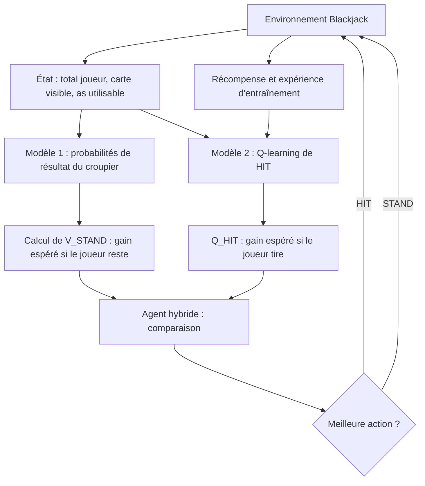

# Blackjack AI — Projet complet de Machine Learning

> **Répartition : je développe le modèle 1 (prédiction des résultats du croupier) ; mon binôme développe le modèle 2 (Q-learning).**
> **Équipe :** 2 étudiants · **Durée :** 3 jours · **Livrable :** dépôt GitHub reproductible, modèles entraînés, expériences et démonstration locale.

## 1. Présentation et question de recherche

Nous construisons un système capable de prendre des décisions au **blackjack simplifié** à l'aide de deux méthodes de Machine Learning complémentaires :

- **Modèle 1 — apprentissage supervisé (ma partie) :** estime les probabilités que le croupier termine à 17, 18, 19, 20, 21 ou dépasse 21 (*bust*), à partir de sa carte visible.
- **Modèle 2 — apprentissage par renforcement :** apprend la valeur de **tirer une carte** (`HIT`) dans chaque situation du joueur.
- **Agent hybride :** convertit les prédictions du modèle 1 en gain espéré de **rester** (`STAND`), puis compare ce gain à la valeur de `HIT` apprise par le modèle 2.

**Question scientifique :** l'utilisation du prédicteur supervisé permet-elle à l'agent d'apprendre plus rapidement ou d'obtenir un meilleur gain moyen qu'un Q-learning classique ?

Nous ne supposons pas d'avance que l'hybride gagnera : cette hypothèse sera évaluée expérimentalement.

## 2. Règles et environnement

Pour terminer en trois jours, nous utilisons `Blackjack-v1` de **Gymnasium** dans une configuration simple :

```python
import gymnasium as gym

env = gym.make("Blackjack-v1", natural=False, sab=False)
```

Les règles de cette version de départ :

- Le joueur choisit `HIT` (tirer) ou `STAND` (rester).
- Le croupier tire tant que son total vaut moins de 17 et s'arrête à partir de 17, y compris avec un 17 souple.
- Les cartes sont tirées dans un **paquet infini**, donc avec remise : as = 1, cartes 2 à 9 = leur valeur, 10 / valet / dame / roi = 10.
- Un as peut compter 11 lorsqu'il ne provoque pas de dépassement de 21 ; sinon il compte 1.
- Dépasser 21 fait perdre la main (*bust*).
- Récompenses standard du jeu configuré : victoire `+1`, égalité `0`, défaite `-1`.
- Nous n'implémentons pas split, double, assurance, comptage des cartes, ni bonus de blackjack naturel.

**Observation de l'agent :** `(player_sum, dealer_showing, usable_ace)` : total du joueur, valeur de la carte visible du croupier, présence d'un as utilisable. **La carte cachée n'est jamais transmise à l'agent**.

Les deux personnes devront utiliser exactement les mêmes règles pour simuler le croupier, entraîner les modèles et évaluer l'agent.

## 3. Architecture commune



| Élément | Entrées | Sortie | Responsable |
|---|---|---|---|
| Générateur de données croupier | Règles du blackjack, graine | Exemples `(carte_visible, résultat_final)` | **Moi, modèle 1** |
| Modèle supervisé | Carte visible du croupier `1…10` | Distribution sur `17,18,19,20,21,BUST` | **Moi, modèle 1** |
| Calcul `V_STAND` | Total du joueur + distribution | Valeur numérique de rester | **Moi, modèle 1** |
| Q-learning | État + interactions avec l'environnement | `Q_HIT(s)` | Binôme, modèle 2 |
| Agent hybride | `V_STAND(s)` + `Q_HIT(s)` | `HIT` ou `STAND` | Intégration commune |
| Expérimentation | Stratégies, graines, parties de test | Courbes et indicateurs | Ensemble |

---

# PARTIE PRINCIPALE — MON TRAVAIL : MODÈLE 1

## 4. Comprendre le modèle 1

### 4.1. Ce que le modèle doit apprendre

Le croupier montre une carte de valeur `d` (`d ∈ {1, …, 10}`). Nous voulons prédire la **distribution de probabilité de son score final** :

\[
P(D=k\mid d),\quad k\in\{17,18,19,20,21,\mathrm{BUST}\}.
\]

Par exemple, pour `d = 10`, la sortie aura la forme suivante **sans supposer de valeurs avant l'entraînement** :

```text
Carte visible : 10
17    -> probabilité prédite
18    -> probabilité prédite
19    -> probabilité prédite
20    -> probabilité prédite
21    -> probabilité prédite
BUST  -> probabilité prédite
```

La somme de ces six nombres doit être approximativement égale à `1.0`.

**Important :** le modèle ne prédit ni l'action du joueur ni une victoire garantie. Il prédit uniquement les issues possibles du **croupier**. Une autre fonction transforme ensuite ces probabilités en valeur de `STAND`.

### 4.2. Pourquoi c'est du supervised learning

Nous générons des exemples dont nous connaissons l'issue réelle par simulation :

| Entrée : carte visible | Étiquette : score final |
|---:|---|
| 10 | 20 |
| 6 | BUST |
| 1 (as) | 18 |
| 4 | 17 |

Chaque ligne correspond à **une simulation complète et indépendante** du tour du croupier. Le modèle apprend la relation statistique entre l'entrée et la classe finale, au lieu d'appliquer une règle codée pour choisir entre `HIT` et `STAND`.

### 4.3. Décision sur les caractéristiques

Une **seule variable d'entrée** suffit : `dealer_showing`, la carte visible du croupier.

Dans la version à paquet infini, la carte cachée n'est pas observable et la main du joueur n'altère pas les probabilités de tirage du croupier. Ajouter la carte cachée constituerait une fuite d'information. Ajouter le total du joueur n'est pas nécessaire pour prédire le résultat du croupier ; il sera utilisé séparément pour calculer le gain de rester.

Les valeurs `1` à `10` sont des **catégories** et pas une relation linéaire simple. Il est donc pertinent de les encoder en *one-hot* pour une régression logistique multinomiale, ou de tester une forêt aléatoire.

## 5. Générer le dataset du croupier

### 5.1. Distribution des cartes

À chaque tirage dans le paquet infini :

- chaque valeur `1` à `9` apparaît avec une probabilité `1/13` ;
- la valeur `10` apparaît avec une probabilité `4/13`, puisque 10, valet, dame et roi comptent tous 10.

L'échantillonnage doit respecter ces proportions. **Ne pas** choisir uniformément un nombre entre 1 et 10 pour reproduire un vrai tirage de carte.

### 5.2. Simulation d'une main du croupier

Pour une seule observation :

1. Tirer la carte visible du croupier.
2. Tirer une carte cachée, sans la transmettre à l'agent.
3. Calculer la somme de sa main en tenant correctement compte des as.
4. Tant que son total est inférieur à 17, tirer une nouvelle carte.
5. Enregistrer `17`, `18`, `19`, `20`, `21` ou `BUST`.
6. Recommencer des dizaines de milliers de fois avec une graine fixée.

Le résultat final sert d'**étiquette d'entraînement**, mais le modèle n'a accès qu'à la carte visible en entrée.

### 5.3. Exemple de générateur reproductible

Fichier recommandé : `src/dealer_data.py`.

```python
import numpy as np

DECK = np.array([1, 2, 3, 4, 5, 6, 7, 8, 9, 10, 10, 10, 10])
BUST = 22  # Représentation interne de la classe BUST
CLASSES = [17, 18, 19, 20, 21, BUST]


def draw(rng):
    return int(rng.choice(DECK))


def hand_value(cards):
    # Chaque as compte d'abord 1.
    total = sum(cards)
    # Si possible, un seul as est revalorisé de 1 à 11.
    if 1 in cards and total + 10 <= 21:
        total += 10
    return total


def simulate_dealer(rng):
    visible = draw(rng)
    hidden = draw(rng)
    cards = [visible, hidden]

    while hand_value(cards) < 17:
        cards.append(draw(rng))

    total = hand_value(cards)
    final = BUST if total > 21 else total
    return visible, final


def generate_dataset(n_samples=60_000, seed=42):
    rng = np.random.default_rng(seed)
    samples = [simulate_dealer(rng) for _ in range(n_samples)]
    X = np.array([[visible] for visible, _ in samples], dtype=int)
    y = np.array([final for _, final in samples], dtype=int)
    return X, y
```

Cette simulation est prévue pour reproduire les règles de base de Gymnasium ; elle doit être **validée** par tests, et comparée si possible à une implémentation indépendante de référence. L'exemple garde volontairement un code court pour faciliter les vérifications.

### 5.4. Séparer entraînement et test

Proposition initiale : `60 000` observations pour l'entraînement, et `12 000` observations de test avec **une autre graine**. Générer le jeu de test indépendamment du jeu d'entraînement :

```python
X_train, y_train = generate_dataset(n_samples=60_000, seed=42)
X_test, y_test = generate_dataset(n_samples=12_000, seed=123)
```

Il n'est pas gênant que plusieurs exemples aient la même carte visible et le même résultat : chaque ligne représente une nouvelle manche simulée. En revanche, il est nécessaire de garantir **l'indépendance des tirages** entre entraînement et test.

## 6. Choisir et entraîner le modèle supervisé

### 6.1. Modèles à comparer

**Choix principal recommandé :** un `OneHotEncoder` suivi d'une `LogisticRegression` multinomiale via `scikit-learn`. Le modèle reste léger, produit des probabilités et s'entraîne rapidement sur CPU.

**Variante si le temps le permet :** `RandomForestClassifier`, afin d'avoir un second algorithme supervisé à comparer.

**Baseline indispensable :** fréquence empirique des six résultats pour chaque carte visible, calculée uniquement sur l'entraînement. Cette méthode non ML est très forte pour ce problème à seulement 10 valeurs d'entrée ; elle permet de vérifier si le modèle ML apporte quelque chose de plus.

### 6.2. Exemple d'entraînement

Fichier recommandé : `src/dealer_model.py`.

```python
import joblib
from sklearn.pipeline import Pipeline
from sklearn.preprocessing import OneHotEncoder
from sklearn.linear_model import LogisticRegression
from src.dealer_data import generate_dataset, CLASSES

X_train, y_train = generate_dataset(60_000, seed=42)

model = Pipeline([
    ("encoder", OneHotEncoder(handle_unknown="ignore")),
    ("classifier", LogisticRegression(max_iter=1_000)),
])
model.fit(X_train, y_train)

assert list(model.classes_) == CLASSES, "Ordre des classes inattendu"
joblib.dump(model, "models/dealer_model.joblib")
```

La création du dossier `models/` est à prévoir dans le vrai script. Selon la version de scikit-learn, certains paramètres ou avertissements peuvent évoluer ; fixer les versions dans `requirements.txt` après les premiers essais.

### 6.3. Contrat de prédiction pour le modèle 2

Le format de sortie doit être **fixé dès le premier jour**, pour que le binôme puisse développer son Q-learning sans attendre la fin de mon entraînement.

**Convention choisie :**

```python
CLASSES = [17, 18, 19, 20, 21, 22]  # 22 représente BUST
```

Interface publique suggérée :

```python
def predict_dealer_probabilities(dealer_showing: int) -> dict[int, float]:
    """Retourne {17: p17, 18: p18, ..., 21: p21, 22: p_bust}."""
```

Exemple d'implémentation après chargement du fichier `.joblib` :

```python
import joblib

CLASSES = [17, 18, 19, 20, 21, 22]
model = joblib.load("models/dealer_model.joblib")


def predict_dealer_probabilities(dealer_showing: int) -> dict[int, float]:
    if not 1 <= dealer_showing <= 10:
        raise ValueError("La carte visible doit être comprise entre 1 et 10")

    probabilities = model.predict_proba([[dealer_showing]])[0]
    return {
        int(cls): float(prob)
        for cls, prob in zip(model.classes_, probabilities)
    }
```

Le modèle livré doit toujours contenir les **six classes**, dans un ordre documenté. Pour une distribution, chaque probabilité doit être entre 0 et 1 et leur somme proche de 1. Une vérification de ces invariants fait partie des tests d'intégration.

## 7. Transformer la prédiction en valeur de `STAND`

C'est la **connexion essentielle** entre mon modèle et le modèle 2.

Quand le joueur choisit `STAND`, il garde son total `p` et attend le score final `d` du croupier. Sa récompense est :

\[
R(p,d)=
\begin{cases}
+1 & \text{si } d=\mathrm{BUST} \text{ ou } p>d,\\
0 & \text{si } p=d,\\
-1 & \text{si } p<d.
\end{cases}
\]

Pour un joueur **non bust**, la valeur de rester est donc :

\[
\boxed{V_{\mathrm{STAND}}(p, d_{\mathrm{visible}})=
\sum_{k\in\{17,18,19,20,21,\mathrm{BUST}\}}
P(D=k\mid d_{\mathrm{visible}})\,R(p,k)}
\]

Cette valeur est comprise entre `-1` et `+1` lorsque les probabilités sont correctes.

### Exemple expliqué sans chiffres inventés

Le joueur a `15` et le croupier montre `10`. En restant à 15, le joueur perd si le croupier termine à 17, 18, 19, 20 ou 21, et gagne uniquement si le croupier dépasse 21. Par conséquent :

\[
V_{\mathrm{STAND}}(15,10)
= (+1)\,P(\mathrm{BUST}\mid10)
+(-1)\,[1-P(\mathrm{BUST}\mid10)]
=2P(\mathrm{BUST}\mid10)-1.
\]

Le calcul utilise **les probabilités prédites**, et non un accès au résultat caché de la manche.

### Fonction Python proposée

Fichier recommandé : `src/stand_value.py`.

```python
CLASSES = [17, 18, 19, 20, 21, 22]
BUST = 22


def stand_value(player_sum: int, probabilities: dict[int, float]) -> float:
    if player_sum > 21:
        return -1.0

    if set(probabilities) != set(CLASSES):
        raise ValueError("Les 6 issues du croupier sont requises")

    if any(p < 0 or p > 1 for p in probabilities.values()):
        raise ValueError("Probabilités invalides")

    if abs(sum(probabilities.values()) - 1.0) > 1e-6:
        raise ValueError("Les probabilités doivent sommer à 1")

    expected_reward = 0.0
    for dealer_final, probability in probabilities.items():
        if dealer_final == BUST or player_sum > dealer_final:
            reward = 1
        elif player_sum == dealer_final:
            reward = 0
        else:
            reward = -1
        expected_reward += probability * reward

    return float(expected_reward)
```

Le binôme pourra appeler cette fonction directement avec le total du joueur et la sortie de `predict_dealer_probabilities()`.

## 8. Évaluer scientifiquement mon modèle

Le **taux de classification correcte** ne doit pas être notre seule métrique : le résultat du croupier est aléatoire, et même un excellent prédicteur ne peut pas deviner chaque manche. Ce qui nous intéresse surtout, ce sont de **bonnes probabilités**.

### 8.1. Mesures importantes

| Métrique | Ce qu'elle évalue |
|---|---|
| `Log-loss` multiclasse | Une mauvaise probabilité attribuée au vrai résultat est pénalisée fortement |
| Score de Brier multiclasse | Écart quadratique entre probabilités prédites et résultat observé |
| Courbes / tableaux de calibration | Cohérence entre probabilités annoncées et fréquences réelles |
| Accuracy | Indicateur complémentaire, mais moins important ici |
| Erreur sur `V_STAND` | Conséquence pratique des erreurs de probabilité pour l'agent hybride |

Le score de Brier multiclasse peut être défini explicitement pour notre rapport :

\[
\mathrm{Brier}=\frac{1}{N}\sum_{i=1}^{N}\sum_{k=1}^{6}
\bigl(\hat P_{ik}-\mathbf 1[y_i=k]\bigr)^2.
\]

Il faut comparer les performances du classificateur à celles d'une distribution **par fréquences** calculée sur le jeu d'entraînement. Cette comparaison est particulièrement pertinente étant donné la simplicité de l'entrée.

### 8.2. Tests recommandés

1. Vérifier que `draw()` produit environ quatre fois plus de 10 que de chacune des autres valeurs sur un grand échantillon.
2. Vérifier `hand_value([1, 6]) == 17`, `hand_value([1, 1, 9]) == 21`, `hand_value([1, 10, 10]) == 21` et `hand_value([10, 10, 5]) == 25`.
3. Vérifier que toutes les simulations du croupier se terminent par l'une des six étiquettes attendues.
4. Vérifier que chaque carte visible de 1 à 10 produit un dictionnaire de six probabilités sommant à 1.
5. Tester `stand_value()` sur des distributions artificielles : `100 % BUST` doit donner `+1` pour une main valide ; `100 % sur 20` donne `-1` pour une main à 18 et `0` pour une main à 20.
6. Comparer la distribution du modèle à des fréquences observées dans un jeu de test indépendant.
7. Vérifier que les fichiers `dealer_model.joblib` sont bien chargés par le script de démonstration et par le code du binôme.

### 8.3. Référence probabiliste et limites

Avec seulement **10 cartes visibles** et un paquet infini, on peut obtenir une très bonne approximation des distributions du croupier par un grand nombre de simulations, voire les calculer exactement par récursion. C'est une **limite intéressante à discuter** : l'apprentissage supervisé n'est pas nécessairement la solution la plus efficace à ce sous-problème. Notre contribution est d'expérimenter son intégration à un agent RL, pas de prétendre qu'il découvre une probabilité inaccessible.

Pour l'expérience d'ablation, comparer l'agent hybride avec :

- mon modèle supervisé pour calculer `V_STAND` ;
- une référence par grandes simulations Monte-Carlo indépendantes ou un calcul exact, en la nommant correctement ;
- et un Q-learning standard qui apprend les deux actions sans modèle 1.

Il faut noter le **nombre de simulations utilisées pour entraîner mon prédicteur**, afin de comparer honnêtement les budgets de calcul.

---

## 9. Modèle 2 — Q-learning (travail du binôme)

Le modèle 2 utilise l'observation `(player_sum, dealer_showing, usable_ace)` et apprend la valeur de `HIT`.

Après une action `HIT`, il observe la récompense `r`, le nouvel état `s'` et si la manche est terminée. Sa mise à jour tabulaire est :

\[
Q_{\mathrm{HIT}}(s)\leftarrow Q_{\mathrm{HIT}}(s)
+\alpha\left[y-Q_{\mathrm{HIT}}(s)\right]
\]

avec

\[
y=\begin{cases}
r & \text{si l'épisode est terminé},\\
r+\gamma\max(Q_{\mathrm{HIT}}(s'),V_{\mathrm{STAND}}(s')) & \text{sinon}.
\end{cases}
\]

L'agent compare ensuite :

\[
\pi(s)=\begin{cases}
\mathrm{HIT} & \text{si }Q_{\mathrm{HIT}}(s)>V_{\mathrm{STAND}}(s),\\
\mathrm{STAND} & \text{sinon}.
\end{cases}
\]

Pendant l'entraînement, le binôme utilise aussi de l'exploration (par exemple epsilon-greedy). Il doit implémenter en parallèle un **Q-learning classique** apprenant `HIT` **et** `STAND`, pour avoir une référence sans modèle 1.

**Paramètres de départ à tester :** `alpha=0.1`, `gamma=1.0`, `epsilon_start=1.0`, `epsilon_min=0.05`, entraînement de l'ordre de `100 000` épisodes puis ajustement après mesure. Ce sont des valeurs initiales, pas un résultat garanti.

## 10. Intégration des deux contributions

**Format contractuel à échanger dès le jour 1 :**

```python
state = (player_sum, dealer_showing, usable_ace)

# Ce que je fournis :
probs = predict_dealer_probabilities(dealer_showing)  # {17:p, 18:p, ..., 22:p_bust}
v_stand = stand_value(player_sum, probs)              # float dans [-1, 1]

# Ce que fournit mon binôme :
q_hit = q_agent.value_hit(state)                      # float, valeur estimée de HIT

# Décision commune :
action = "HIT" if q_hit > v_stand else "STAND"
```

À adapter au codage réel de l'environnement : dans Gymnasium, `HIT` et `STAND` correspondent à des **identifiants d'action** (`1` et `0`, respectivement). Ne pas mélanger textes et entiers entre modules.

**Règle d'intégration :** le modèle 1 est entraîné **avant** le lancement du Q-learning hybride, puis son fichier est chargé comme un prédicteur fixe. Ainsi, le Q-learning apprend face à une estimation `V_STAND` stable. Nous pouvons explorer une version mise à jour du prédicteur seulement si le système de base fonctionne déjà.

### Gestion d'une indisponibilité temporaire

Le binôme doit pouvoir avancer avant la fin du modèle 1 : je lui fournis dès le début un `stand_value()` fonctionnel et une fonction provisoire qui retourne des probabilités **calculées sur une petite simulation de référence** ou des fréquences d'entraînement. Le remplacement par le modèle appris ne change pas la signature des fonctions. Une distribution uniforme n'est acceptable que comme *stub* de test d'intégration, jamais comme résultat présenté ou comme baseline compétitive.

## 11. Protocole d'évaluation du projet

| Stratégie | Fonction |
|---|---|
| Joueur simple « tirer jusqu'à 17 » | Baseline facile à expliquer |
| Q-learning tabulaire classique (`HIT` + `STAND`) | Baseline RL sans mon modèle |
| Hybride (`Q_HIT` + mon `V_STAND`) | Système proposé |
| Hybride avec probabilités de référence | Ablation de la qualité du prédicteur |

**Mesures :** gain moyen par manche, proportions de victoires / égalités / défaites, courbe de gain moyen pendant l'entraînement, dispersion sur plusieurs graines et temps d'exécution.

Protocole conseillé :

1. Faire plusieurs entraînements avec des graines distinctes, par exemple cinq si le temps le permet.
2. À intervalles réguliers, évaluer sans exploration sur des manches de test indépendantes.
3. Conserver le **même budget d'épisodes RL** entre les méthodes comparées, puis communiquer séparément le coût des simulations nécessaires au modèle 1.
4. Tester les modèles finaux sur un nombre conséquent de manches, par exemple 10 000 par graine.
5. Tracer les gains moyens et leur dispersion, sans conclure sur la seule base d'une petite différence de score.
6. Vérifier si l'hybride apprend plus vite et si sa performance finale est réellement différente du Q-learning standard.

## 12. Répartition des trois jours

| Jour | **Moi — modèle 1** | Binôme — modèle 2 | Travail commun |
|---|---|---|---|
| **J1** | Générateur du croupier, premières données, baseline par fréquences, signature `predict_dealer_probabilities()` | Environnement Gymnasium, Q-learning standard initial | Définir les conventions d'états, labels, actions et récompenses |
| **J2** | Entraînement, qualité des probabilités, export `.joblib`, fonction `stand_value()` et tests | Apprentissage de `Q_HIT`, intégration de `V_STAND` | Tester une partie complète avec l'hybride et corriger les interfaces |
| **J3** | Comparaison modèle supervisé / fréquences / référence, graphiques de calibration, analyses | Évaluation RL et courbes d'apprentissage | Ablation, rapport, README, modèle préentraîné et démonstration locale |

**Ne pas attendre le jour 3 pour intégrer** : une version minimale de `predict_dealer_probabilities()` et `stand_value()` doit être utilisable dès le jour 1.

## 13. Organisation du dépôt GitHub

```text
blackjack-ai/
├── README.md
├── requirements.txt
├── .gitignore
├── src/
│   ├── __init__.py
│   ├── dealer_data.py       # MOI : générateur de données
│   ├── dealer_model.py      # MOI : entraînement, prédiction, sauvegarde
│   ├── stand_value.py       # MOI : conversion en V_STAND
│   ├── q_learning.py        # BINÔME : Q-learning standard et Q_HIT
│   ├── hybrid_agent.py      # ENSEMBLE : décision HIT / STAND
│   ├── train.py             # Point d'entrée d'entraînement
│   ├── evaluate.py          # Comparaison et métriques
│   └── demo.py              # Partie de démonstration
├── models/
│   ├── dealer_model.joblib  # MOI : modèle 1 préentraîné
│   └── q_hit_table.pkl      # BINÔME : Q-table préentraînée
├── results/
│   ├── dealer_metrics.csv   # MOI : log-loss, Brier, calibration
│   ├── comparison.csv       # ENSEMBLE : stratégies comparées
│   └── learning_curve.png   # ENSEMBLE : évolution des scores
├── notebooks/
│   └── analysis.ipynb
└── tests/
    ├── test_dealer_data.py  # MOI
    ├── test_stand_value.py  # MOI
    └── test_q_learning.py   # BINÔME
```

Dépendances envisagées : `gymnasium`, `numpy`, `pandas`, `scikit-learn`, `matplotlib`, `joblib`, `pytest`. Les versions seront **figées après validation** sur les machines utilisées.

### Commandes attendues dans le README

```bash
pip install -r requirements.txt
python -m src.dealer_data    # si un point d'entrée est ajouté
python -m src.dealer_model   # entraîner et sauvegarder le modèle 1
python -m src.train          # entraîner le Q-learning et l'hybride
python -m src.evaluate       # générer les métriques comparatives
python -m src.demo           # jouer avec l'agent préentraîné
pytest                      # exécuter les tests
```

Les modules devront effectivement exposer ces points d'entrée avant de publier ces commandes ; le code montré plus haut constitue un **exemple de développement**, pas encore une application complète exécutable.

## 14. Mes livrables précis pour le modèle 1

À remettre au binôme :

- `src/dealer_data.py` : simulation des tirages et dataset reproductible ;
- `src/dealer_model.py` : apprentissage, sauvegarde et fonction de prédiction ;
- `src/stand_value.py` : calcul documenté du gain de `STAND` ;
- `models/dealer_model.joblib` : modèle entraîné et rechargeable ;
- `tests/test_dealer_data.py` et `tests/test_stand_value.py` : tests minimaux ;
- `results/dealer_metrics.csv` : comparaisons probabilistes sur test indépendant ;
- une brève note sur les paramètres, les graines et les limites du modèle.

### Ma checklist de démarrage, dans l'ordre

- [ ] Faire fonctionner `draw()`, `hand_value()` et `simulate_dealer()`.
- [ ] Vérifier les règles des as et la fréquence d'apparition de la carte de valeur 10.
- [ ] Générer un dataset d'entraînement et de test indépendant.
- [ ] Construire une baseline par fréquences conditionnelles.
- [ ] Entraîner le classificateur et exporter les probabilités de ses six classes.
- [ ] Évaluer la log-loss, le Brier et la calibration.
- [ ] Développer et tester `stand_value()`.
- [ ] Faire valider la signature des deux fonctions par le binôme.
- [ ] Exporter le modèle et tester son chargement depuis un autre script.
- [ ] Comparer les prédictions à une grande simulation de référence.

## 15. Risques, limites et bonnes pratiques

- **Tâche très simple :** seulement dix valeurs d'entrée. Une table de fréquences peut être compétitive ou supérieure à un modèle supervisé ; ne pas cacher ce résultat.
- **Aucune fuite d'information :** ni carte cachée ni résultat final réel ne doivent être disponibles lors de la décision.
- **Même simulateur :** valider l'accord des règles avec l'environnement Gymnasium (notamment les as et l'arrêt du croupier à 17).
- **Probabilités, pas prédictions fermes :** une accuracy élevée ne prouve pas une bonne calibration.
- **Dépendance à l'architecture :** une erreur de `V_STAND` peut influencer les décisions du Q-learning ; tester la fonction indépendamment.
- **Budget expérimental :** rapporter les simulations consommées par le prédicteur pour une comparaison équitable.
- **Reproductibilité :** version des dépendances, graines, paramètres, modèles sauvegardés et commandes explicites.
- **Périmètre :** priorité au CPU et à une démo locale. Une interface web ou un serveur n'est qu'un bonus.

## 16. Conclusion

Le projet associe un **modèle supervisé qui estime les résultats du croupier** et un **modèle de renforcement qui apprend à tirer**. Leur combinaison permet de choisir entre `HIT` et `STAND` à partir de gains espérés comparables.

**Ma responsabilité principale** est de livrer un prédicteur de probabilités *fiable, évalué et intégrable*, ainsi que la fonction `V_STAND`. Le reste du projet évaluera de façon honnête si cette aide apporte un bénéfice par rapport à un Q-learning autonome.
