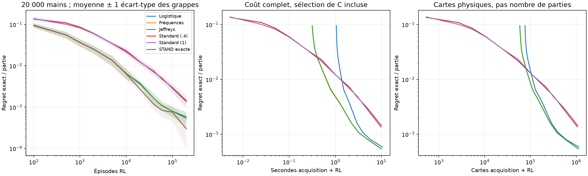
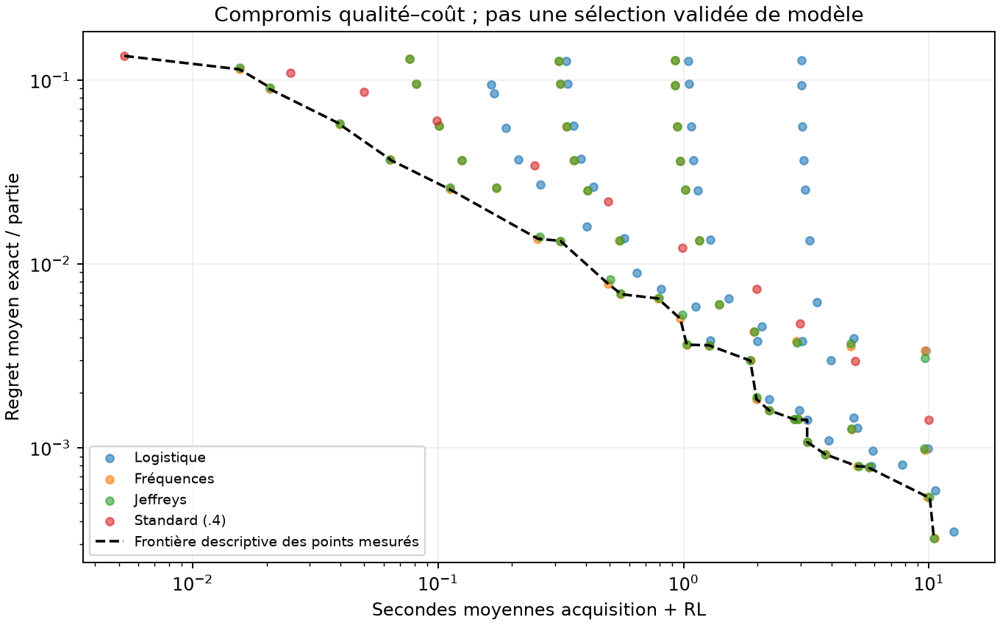
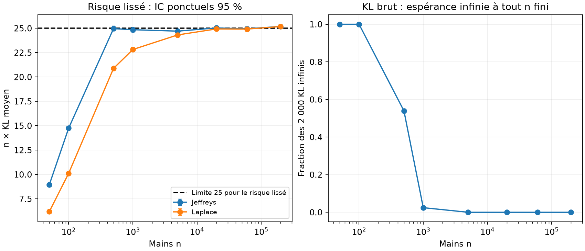
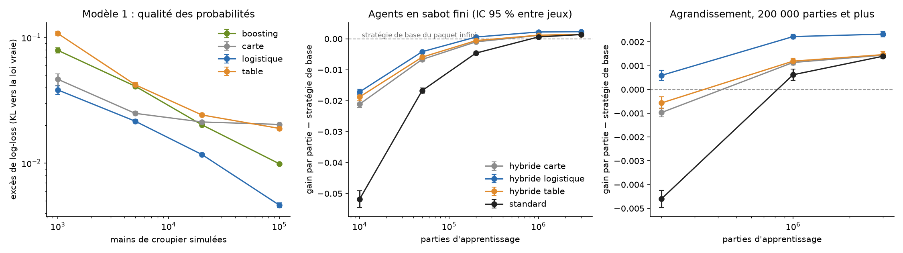

# Annexes du rapport scientifique

Ces annexes détaillent les mesures résumées dans le [rapport](rapport_scientifique.md).
Les sections du rapport y renvoient par leur lettre ; les chiffres sont ceux des fichiers
de [results/](../results/), sans arrondi supplémentaire.

## A. Contrôles de l'oracle et réplication de la première campagne

La première campagne du projet (comparaison CONFIG/TUNED, 160 entraînements ; ablation des
estimateurs, 80 entraînements ; entraînement du modèle 1 livré) a été relancée depuis ses
modules inchangés ([results/2_campagne_principale/replication/](../results/2_campagne_principale/replication/)).
**[observé]** Les 240 gains exacts finaux et les 12 000 points des courbes sont reproduits
avec un écart maximal de 0,0 (tolérance prévue 10⁻⁹) ; les probabilités du modèle 1
réentraîné sont identiques à celles du modèle livré (écart 0,0, tolérance 10⁻⁷). Cette
réplication établit le déterminisme du code, pas la validité des conclusions : la première
campagne utilisait un unique prédicteur et des graines connues. Le critère principal (§5.2)
en est la réplication indépendante.

Contrôles Monte-Carlo de l'oracle indépendant (100 000 parties par politique, graines
35000 à 35004) :

| Politique | J exact | Moyenne Monte-Carlo | IC 95 % | z |
|---|---:|---:|---:|---:|
| Toujours STAND | −0,18637 | −0,18672 | [−0,19264 ; −0,18080] | −0,12 |
| Toujours HIT | −1 | −1 | sans objet | sans objet |
| Aléatoire ½ | −0,39590 | −0,39149 | [−0,39704 ; −0,38594] | +1,56 |
| HIT si total < 17 | −0,07929 | −0,08370 | [−0,08954 ; −0,07786] | −1,48 |
| Optimale | −0,04656 | −0,04733 | [−0,05322 ; −0,04144] | −0,26 |

Les cinq écarts restent dans ±2 erreurs-types **[observé]**. L'oracle indépendant
reproduit J* et les gains de politiques aléatoires du premier oracle à 10⁻¹⁴ près,
et coïncide avec Gymnasium sur toutes les transitions HIT atteignables (tests).
Même avec 100 000 parties, l'intervalle Monte-Carlo de la politique optimale (largeur
0,012) est plus de cinq fois plus large que l'écart moyen entre l'hybride et le standard :
c'est la raison de l'évaluation exacte.

## B. Efficacité en épisodes : contrastes et temps d'atteinte

Regret moyen J* − J sur les 9 jeux secondaires (deux graines RL chacun), 20 000 mains pour
les hybrides :

| Épisodes | 1 000 | 5 000 | 10 000 | 20 000 | 40 000 | 100 000 | 200 000 |
|---|---:|---:|---:|---:|---:|---:|---:|
| Hybride, STAND exacte (oracle) | 0,0367 | 0,0135 | 0,0064 | 0,0027 | 0,0012 | 0,0008 | 0,0003 |
| **Hybride logistique** | 0,0365 | 0,0135 | 0,0065 | 0,0038 | 0,0016 | 0,0008 | 0,0006 |
| Hybride fréquences | 0,0365 | 0,0134 | 0,0065 | 0,0036 | 0,0016 | 0,0008 | 0,0005 |
| Q-learning standard réglé | 0,0861 | 0,0343 | 0,0219 | 0,0123 | 0,0073 | 0,0030 | 0,0014 |
| Q-learning standard commun (ε 1) | 0,0827 | 0,0345 | 0,0235 | 0,0125 | 0,0070 | 0,0028 | 0,0014 |
| RL à modèle appris | 0,0811 | 0,0342 | 0,0224 | 0,0134 | 0,0070 | 0,0027 | 0,0015 |
| Dyna-Q | 0,0978 | 0,0389 | 0,0251 | 0,0152 | 0,0096 | 0,0039 | 0,0020 |
| Expected SARSA | 0,0910 | 0,0570 | 0,0451 | 0,0266 | 0,0106 | 0,0042 | 0,0024 |
| Contrôle Monte-Carlo | 0,1046 | 0,0761 | 0,0637 | 0,0435 | 0,0245 | 0,0114 | 0,0065 |

Contrastes sur les 28 jeux, IC à 95 % (hybride logistique moins référence) :

| Référence | 10 000 épisodes | 40 000 | 100 000 |
|---|---:|---:|---:|
| Q-learning standard réglé | | | +0,0021 [+0,0019 ; +0,0024] |
| RL à modèle appris | +0,0153 [+0,0139 ; +0,0167] | +0,0055 [+0,0049 ; +0,0062] | +0,0022 [+0,0018 ; +0,0026] |
| Dyna-Q | +0,0183 [+0,0165 ; +0,0200] | +0,0075 [+0,0068 ; +0,0082] | +0,0033 [+0,0028 ; +0,0037] |
| Double Q-learning | +0,0219 [+0,0200 ; +0,0238] | +0,0073 [+0,0066 ; +0,0080] | +0,0031 [+0,0028 ; +0,0034] |
| Expected SARSA | +0,0377 [+0,0362 ; +0,0393] | +0,0087 [+0,0080 ; +0,0095] | +0,0034 [+0,0029 ; +0,0038] |
| Contrôle Monte-Carlo | +0,0550 [+0,0525 ; +0,0575] | +0,0231 [+0,0217 ; +0,0245] | +0,0103 [+0,0095 ; +0,0111] |

**[observé]** L'hybride bat toutes les références qui apprennent en jouant, à tous les
budgets mesurés. Aucune d'elles ne bat le Q-learning standard réglé : à 100 000 épisodes,
Expected SARSA fait −0,0013 [−0,0018 ; −0,0007], Dyna-Q −0,0011 [−0,0016 ; −0,0006],
Double Q −0,0010 [−0,0014 ; −0,0005], Monte-Carlo −0,0081 [−0,0089 ; −0,0073] ; le RL à
modèle appris fait jeu égal, −0,0001 [−0,0006 ; +0,0004], intervalle contenu dans ±0,001.

Cette dernière comparaison est la plus instructive. Un RL à modèle complet, qui exploite
chaque partie au mieux par planification exacte, n'apprend pas plus vite que le Q-learning
standard : sa difficulté est d'estimer STAND à partir des seules parties où l'agent reste.
L'hybride reçoit justement cette estimation de l'extérieur, d'une source bon marché. Son
avantage vient donc de l'**information** supplémentaire, pas d'une meilleure exploitation
des parties jouées. Le Double Q-learning, qui retire le biais du maximum, fait moins bien
que le standard : ce n'est pas le retrait du biais seul qui produit le gain
**[non démontré]** pour le mécanisme.

Temps d'atteinte, premier point de la grille sous le seuil ; les échecs sont censurés
à 200 000 épisodes et ne sont pas comptés comme des réussites :

| Seuil de regret | Logistique 20 000 mains : réussites, médiane | Standard réglé : réussites, médiane parmi réussites |
|---|---|---|
| 0,01 | 18/18, 10 000 | 18/18, 40 000 |
| 0,005 | 18/18, 20 000 | 18/18, 60 000 |
| 0,002 | 18/18, 40 000 | 13/18, 200 000 |
| 0,001 | 17/18, 100 000 | 7/18, 200 000 |

**[observé]** Pour atteindre un regret de 0,002, l'hybride a besoin d'environ
40 000 épisodes et le standard d'au moins 200 000 dans 13 runs sur 18, et de plus de
200 000 dans les cinq autres. Le rapport des budgets dépend du seuil et de la taille
supervisée ; il ne constitue pas un facteur universel de vitesse. La grille est
grossière (100 000 puis 200 000) et le regret n'est pas monotone : un run de
l'hybride franchit 0,001 puis repasse au-dessus au dernier point.

## C. Coûts de bout en bout

Coûts mesurés (moyennes sur les jeux, en secondes sur un Intel i7-1255U, un thread) :

| Poste | 1 000 mains | 5 000 | 20 000 | 60 000 |
|---|---:|---:|---:|---:|
| Simulation des mains d'entraînement | 0,015 | 0,076 | 0,307 | 0,919 |
| Sélection de C (5 ajustements + scores) | 0,058 | 0,165 | 0,634 | 2,018 |
| Ajustement retenu seul | 0,009 | 0,032 | 0,128 | 0,414 |
| Fréquences | 0,0001 | 0,0001 | 0,0003 | 0,0009 |
| Acquisition logistique complète (avec validation) | 0,165 | 0,332 | 1,031 | 3,028 |
| Production logistique, C déjà fixé | 0,025 | 0,109 | 0,435 | 1,333 |
| Acquisition fréquences | 0,016 | 0,077 | 0,307 | 0,920 |
| Cartes d'entraînement | 2 901 | 14 522 | 58 120 | 174 279 |

Construction de la table STAND : environ 0,1 ms ; chargement d'une table archivée :
0,25 ms. Un épisode RL coûte 0,048 ms (4,88 s pour 100 000 épisodes, écart-type
0,12 s entre runs) et distribue 5,33 cartes ; une main de croupier coûte 0,015 ms et
2,90 cartes. **Une main de croupier n'est donc équivalente à une partie ni en temps
(≈ 0,32 partie) ni en cartes (≈ 0,55 partie).** L'évaluation exacte d'une politique, hors
du coût d'apprentissage, prend environ 0,3 ms.

Contrastes au même coût total (dernier point de la grille dont le coût mesuré respecte
le budget ; acquisition incluse pour l'hybride ; pas d'interpolation) :

| Budget | 1 000 mains, logistique | 20 000 mains, logistique | 20 000 mains, fréquences | 60 000 mains, fréquences |
|---|---:|---:|---:|---:|
| 0,5 s | +0,0081 [+0,0036 ; +0,0127] | inaccessible | −0,0010 [−0,0075 ; +0,0055] | inaccessible |
| 1 s | +0,0051 [+0,0011 ; +0,0091] | inaccessible | +0,0076 [+0,0039 ; +0,0113] | **−0,0260 [−0,0407 ; −0,0113]** |
| 2 s | +0,0021 [+0,0004 ; +0,0038] | +0,0024 [+0,0006 ; +0,0043] | +0,0043 [+0,0029 ; +0,0057] | +0,0049 [+0,0035 ; +0,0064] |
| 5 s | −0,0001 [−0,0017 ; +0,0014] | +0,0028 [+0,0020 ; +0,0035] | +0,0028 [+0,0021 ; +0,0034] | +0,0029 [+0,0023 ; +0,0036] |
| 10 s | **−0,0018 [−0,0031 ; −0,0005]** | +0,0009 [+0,0003 ; +0,0016] | +0,0012 [+0,0005 ; +0,0019] | +0,0010 [+0,0003 ; +0,0016] |
| 20 s | **−0,0020 [−0,0033 ; −0,0006]** | +0,0008 [+0,0004 ; +0,0013] | +0,0009 [+0,0005 ; +0,0012] | +0,0011 [+0,0007 ; +0,0015] |

« Inaccessible » signifie que l'acquisition seule dépasse le budget pour au moins une
paire. Au-delà d'environ 10 s, la grille des deux bras s'arrête à 200 000 épisodes :
le budget n'est plus entièrement utilisé et le contraste devient celui à épisodes égaux.

En cartes distribuées, la logistique à 20 000 mains (avec les 17 400 cartes de
validation nécessaires au choix de C) ne bat pas le standard à 100 000 cartes
(−0,0032 [−0,0077 ; +0,0012]), alors que les fréquences le battent
(+0,0085 [+0,0051 ; +0,0119]) ; à partir de 250 000 cartes, les deux hybrides gagnent.

**Conventions de coût.** (a) *Production*, C déjà fixé : simulation + ajustement retenu
+ table + RL. (b) *Acquisition avec sélection* : (a) + validation + tous les ajustements
candidats ; c'est la convention des figures. (c) *Validation scientifique* : (b) + test
supervisé (0,18 s et 34 900 cartes à 12 000 mains) + métriques ; ce coût documente la
qualité et n'est pas requis pour produire un agent. (d) *Réutilisation* d'une table déjà
apprise : 0,25 ms de chargement, l'acquisition étant amortie sur M agents. Le réglage
des hyperparamètres RL (108 entraînements de 100 000 épisodes, soit environ 8,8 minutes au
rythme mesuré ici) n'est imputé à aucune méthode. Mémoire : pic RSS du processus 184 Mio,
imports et ajustements compris ; tables Q, compteurs et visites : 23 Kio. Aucune mesure
d'énergie fiable n'était disponible ; aucune n'est rapportée.

**[observé]** Le compromis qualité–coût dépend de la ressource rare et du budget ;
la conclusion est propre à cette implémentation, où le simulateur du croupier est une
boucle Python et l'environnement RL passe par les enveloppes de Gymnasium.

## D. Ablations et bornes

Contrastes à 20 000 mains et 100 000 épisodes, 9 jeux (logistique moins référence) :

| Référence | Différence et IC 95 % | IC 90 % | p TOST (±0,001) | Paires + / = / − |
|---|---:|---:|---:|---:|
| Fréquences | −0,0000034 [−0,0000111 ; +0,0000044] | [−0,0000096 ; +0,0000029] | < 10⁻¹⁷ | 0 / 17 / 1 |
| Jeffreys | identique aux fréquences | | < 10⁻¹⁷ | 0 / 17 / 1 |
| STAND exacte | −0,0000396 [−0,0002922 ; +0,0002130] | [−0,0002433 ; +0,0001641] | 1,1·10⁻⁵ | 7 / 5 / 6 |
| Standard commun (ε 1) | +0,0020450 [+0,0015512 ; +0,0025387] | | | 18 / 0 / 0 |
| Hybride ε_min 0,05 | +0,0012757 [+0,0005438 ; +0,0020076] | | | 18 / 0 / 0 |
| Hybride ω 0,8 | +0,0009273 [+0,0002019 ; +0,0016526] | | | 14 / 0 / 4 |
| STAND bruitée ρ = 0,05 | +0,0030734 [+0,0024683 ; +0,0036785] | | | 18 / 0 / 0 |
| STAND bruitée ρ = 0,20 | +0,0297556 [+0,0286987 ; +0,0308124] | | | 18 / 0 / 0 |

- **Estimateur [observé].** Logistique, fréquences et Jeffreys donnent des politiques
  presque toujours identiques ; l'équivalence à ±0,001 est établie par TOST. La logistique
  coûte en revanche environ trois fois plus de temps d'acquisition à 20 000 ou 60 000 mains
  (dix fois plus à 1 000), à cause de la sélection de C. Ce résultat négatif est conforme
  à la théorie du modèle saturé **[démontré]**. À 100 000 épisodes, l'hybride logistique
  n'est pas non plus distinguable de l'hybride à STAND exacte (équivalence à ±0,001).
- **Échantillonnage direct [démontré et vérifié].** Estimer STAND par la moyenne directe
  des gains R(p, D_i) sur les mêmes mains est algébriquement identique aux fréquences :
  écart maximal mesuré 2,2·10⁻¹⁶. Ce n'est pas une méthode supplémentaire.
- **Erreur de modèle → politique [observé, lien causal par intervention].** Mélanger
  la vraie loi avec une masse ρ sur BUST, à données RL identiques, augmente le regret
  limite de 0 à 0,0034 (ρ = 0,05) et 0,0317 (ρ = 0,20) et le regret final de 0,0037 et
  0,0307. L'hybride n'est utile que si l'erreur de STAND est petite devant les marges
  de décision.
- **Exploration [observé].** Avec ε_min = 0,05, l'hybride visite moins les états rares
  (minimum 12 visites HIT par état en moyenne contre 33) et perd 0,0013 par partie. Le
  standard commun (ε 1) et le standard réglé (ε 0,4) ont des regrets voisins à 100 000
  épisodes (0,0028 et 0,0030) : l'avantage de l'hybride n'est pas dû à un réglage plus
  favorable de son exploration.
- **Pas d'apprentissage [observé].** ω = 0,8 dégrade l'hybride (−0,0009), comme le
  réglage l'indiquait ; aucune valeur n'a été choisie sur ces résultats.
- **Bornes [observé].** À 20 000 mains, η ≈ 0,053, donc la borne globale 2η ≈ 0,105 est
  inutilisable ; la borne locale pondérée par l'occupation vaut 0,0012 pour un regret
  limite réel de 0,00013 : environ 90 fois plus fine que 2η mais encore 9 fois trop large.
  La borne pour un agent fini (2η + δ·E[T]) vaut 0,29 en moyenne pour un regret réel de
  0,0006 : elle est vraie mais non informative, car l'erreur maximale sur Q_HIT (≈ 0,12)
  se situe dans des états rarement visités. L'identité regret = occupation × désavantage
  est vérifiée à 1,7·10⁻¹⁷ près sur les 418 agents.
- **États sensibles [observé].** Pour le prédicteur livré, la politique limite ne
  diffère de l'optimum que dans l'état (12, 4, sans as), visité avec probabilité 0,0088
  par partie ; cinq états seulement sont ambigus selon la borne locale, contre 24 selon
  la borne globale.

## E. Statistiques des probabilités catégorielles

Simulations multinomiales directes de la loi jointe (2 000 répétitions par taille,
instrument mathématique utilisant la loi exacte, sans entraînement d'agent) :

| n mains | KL brut infini | n × KL Jeffreys, IC 95 % | n × KL Laplace |
|---:|---:|---:|---:|
| 50 | 2 000 / 2 000 | 8,95 [8,85 ; 9,05] | 6,19 |
| 500 | 1 079 / 2 000 | 24,96 [24,72 ; 25,21] | 20,88 |
| 1 000 | 49 / 2 000 | 24,85 [24,62 ; 25,09] | 22,82 |
| 5 000 | 0 / 2 000 | 24,71 [24,48 ; 24,93] | 24,32 |
| 60 000 | 0 / 2 000 | 24,95 [24,73 ; 25,16] | 24,92 |
| 200 000 | 0 / 2 000 | 25,19 [24,97 ; 25,41] | 25,18 |

**[démontré et observé]** Le risque lissé tend vers 25/n ; aux petites tailles il est
nettement inférieur (le lissage contracte vers l'uniforme). Pour les fréquences brutes,
aucune moyenne finie n'est rapportée : l'absence de zéro observé à n ≥ 5 000 ne rend pas
l'espérance finie. La statistique de Pearson à 1 000 tirages pour la carte 6 a pour
moyenne 4,98 et variance 10,80 (limites χ²₅ : 5 et 10).

Le prédicteur livré a pour objectif scikit-learn vérifié dans le source installé ;
le résidu de la relation stationnaire est 1,5·10⁻⁷ et le gradient normalisé du biais
7,9·10⁻⁹. Sur les 55 sélections de C, la valeur 0,1 est retenue 28 fois. Parmi les
candidats C ≥ 0,1, les log-loss de validation diffèrent d'au plus 4·10⁻⁴ nat à 20 000
mains et 8·10⁻⁵ nat à 60 000 : le choix de C est instable mais sans conséquence
mesurable sur le gain. Seul C = 0,01 est nettement moins bon aux petites tailles.

## F. Robustesse : cartes uniformes

Variante contrôlée du MDP : les dix valeurs de cartes deviennent équiprobables (1/10
au lieu de 4/13 pour le 10), avec les mêmes règles, états et gains. L'oracle est
recalculé pour cette loi (J* = −0,031375) et contrôlé par 100 000 parties
Monte-Carlo : −0,0271 [−0,0329 ; −0,0213], intervalle qui contient J*. Neuf jeux de
20 000 mains (graines 71000 + 10i), deux graines RL par jeu (81000 + 10i + j), mêmes
hyperparamètres, sans nouveau réglage.

**[observé]** Au contraste prévu (100 000 épisodes), l'hybride à fréquences n'est pas
nettement meilleur que le standard : +0,00032 [−0,00012 ; +0,00076], et le TOST conclut
même à l'équivalence à ±0,001 (p = 0,004). La description par budget (exploratoire)
montre le même profil qu'avec les cartes de Blackjack-v1, mais une convergence plus rapide
du standard :

| Épisodes | 1 000 | 5 000 | 20 000 | 60 000 | 100 000 | 200 000 |
|---|---:|---:|---:|---:|---:|---:|
| Regret, hybride fréquences | 0,0524 | 0,0073 | 0,0028 | 0,0007 | 0,0006 | 0,0003 |
| Regret, standard réglé | 0,1536 | 0,0370 | 0,0056 | 0,0014 | 0,0009 | 0,0005 |
| Différence (IC 95 %, non simultané) | +0,101 [+0,083 ; +0,119] | +0,030 [+0,020 ; +0,039] | +0,0027 [+0,0006 ; +0,0048] | +0,0007 [−0,0000 ; +0,0015] | +0,0003 [−0,0001 ; +0,0008] | +0,0002 [+0,0001 ; +0,0004] |

L'avantage aux petits budgets est donc robuste à ce changement de loi ; son amplitude
au budget de 100 000 épisodes ne l'est pas, ce qui interdit de présenter l'écart mesuré
sur Blackjack-v1 comme une constante de la méthode. Pourquoi le standard converge plus
vite ici n'a pas été étudié **[non démontré]**.

## G. Planification et réglage sans STAND exacte

Les cartes d'une main de croupier suivent la même loi que celles du joueur. En estimant
cette loi par les fréquences des cartes visibles du jeu supervisé, HIT se calcule par
programmation dynamique, sans jouer une seule partie. Deux variantes : STAND fournie par le
même modèle logistique que l'hybride, ou STAND déduite de la règle d'arrêt du croupier,
supposée connue.

| Mains de croupier | 1 000 | 5 000 | 20 000 | 60 000 |
|---|---:|---:|---:|---:|
| Regret, planification avec STAND logistique | 0,00285 | 0,00074 | 0,00013 | 0,00002 |
| Regret, planification complète | 0,00058 | 0,00011 | 0,00003 | 0,00000 |

(9 premiers jeux ; à 20 000 mains sur les 28 jeux : 0,00014 et 0,00003.)

**[observé, exploratoire]** À 20 000 mains, la planification avec la même STAND que
l'hybride fait mieux que l'hybride après 100 000 épisodes de +0,00069 [+0,00057 ; +0,00081] ;
la planification complète, de +0,00080 [+0,00068 ; +0,00091]. Le regret de la première est
très proche du plancher de l'hybride (rapport §5.4) : la planification atteint, sans jouer, à peu
près la qualité vers laquelle l'hybride converge. Dans ce Blackjack, les transitions de HIT
se déduisent de la loi des cartes et de l'arithmétique du total : ne pas les modéliser est
un choix d'étude, pas une contrainte du problème. L'hybride se justifie quand seule l'action
terminale est modélisable, ou quand le modèle de STAND exploite une information que la
modélisation des transitions n'a pas ; le rapport (§6) étudie ce second cas.

**Réglage de l'hybride sans STAND exacte.** Le réglage de l'hybride utilisait la loi exacte
du croupier. Refait sur les mêmes graines (100 à 102) avec un modèle logistique estimé sur
20 000 nouvelles mains par graine, il choisit la même configuration (ε_min = 1, ω = 1 ;
regret moyen 0,00055) : ce privilège n'a pas biaisé le choix.

## H. L'agent livré

L'agent livré ([agent_tuned.npz](../models/hybrid/agent_tuned.npz)) est l'hybride réglé,
entraîné 100 000 épisodes avec la graine 0 et le modèle 1 livré (60 000 mains). Son gain
exact vaut −0,047207, soit 0,000651 sous l'optimum. La meilleure politique compatible avec
son modèle 1 ne diffère de π\* que dans l'état (12, 4, sans as), visité dans 0,9 % des
parties, et ne perd que 0,000022 : l'écart de l'agent vient presque entièrement du nombre
fini d'épisodes. Sur 10 000 parties simulées (graine 2027), il obtient 4 225 victoires,
1 005 égalités et 4 770 défaites.

## I. Sabot fini : détail des agents tabulaires et linéaires

### I.1 Agents tabulaires

Quatre agents, tous en Q-learning tabulaire sur les 1 400 états : le **standard** apprend
STAND et HIT ; trois **hybrides** apprennent HIT et reçoivent STAND d'un modèle 1 estimé sur
100 000 mains : carte, table, ou logistique évaluée sur la composition exacte des cartes non
vues à chaque décision. Réglage sur la grille ε_min ∈ {0,1 ; 0,4 ; 1} × ω ∈ {1 ; 0,8}, trois
graines, données et sabots d'évaluation distincts : ε_min = 1 pour le standard, 0,4 pour les
hybrides, ω = 1 partout. 9 jeux × 2 graines RL, 3 millions de parties.

Gain par manche moins celui de la stratégie de base :

| Parties | 10 000 | 50 000 | 200 000 | 1 M | 3 M |
|---|---:|---:|---:|---:|---:|
| Standard | −0,0518 | −0,0167 | −0,0046 | +0,0006 | +0,0014 |
| Hybride carte | −0,0211 | −0,0067 | −0,0010 | +0,0011 | +0,0014 |
| Hybride table | −0,0188 | −0,0059 | −0,0006 | +0,0012 | +0,0015 |
| **Hybride logistique** | −0,0171 | −0,0042 | **+0,0006** | **+0,0022** | **+0,0023** |

Contrastes, IC à 95 % incluant l'erreur d'évaluation, paires gagnantes sur 18 :

| Contraste | 200 000 | 1 M | 3 M |
|---|---:|---:|---:|
| Logistique − standard | +0,0052 [+0,0045 ; +0,0059], 18 | +0,0016 [+0,0011 ; +0,0021], 18 | **+0,0009 [+0,0004 ; +0,0014], 18** |
| Logistique − table | +0,0012 [+0,0007 ; +0,0017], 18 | +0,0010 [+0,0006 ; +0,0015], 18 | **+0,0009 [+0,0004 ; +0,0014], 18** |
| Logistique − carte | +0,0016 [+0,0010 ; +0,0021], 17 | +0,0011 [+0,0006 ; +0,0016], 18 | **+0,0009 [+0,0004 ; +0,0014], 18** |
| Table − standard | +0,0040 [+0,0034 ; +0,0047], 18 | +0,0006 [+0,0001 ; +0,0010], 16 | +0,0001 [−0,0002 ; +0,0003], 10 |
| Carte − standard | +0,0036 [+0,0031 ; +0,0042], 18 | +0,0005 [+0,0001 ; +0,0009], 16 | +0,0000 [−0,0004 ; +0,0005], 9 |

**[observé]**

1. **Même profil qu'en paquet infini aux petits budgets.** Tous les hybrides apprennent
   beaucoup plus vite que le standard : +0,03 à 10 000 parties, +0,004 à 0,005 à 200 000.
2. **Les hybrides tabulaires rejoignent le standard.** À 3 millions de parties, carte et
   table ne se distinguent plus du standard, et leurs intervalles sont inclus dans ±0,001.
   Leur STAND n'utilise au mieux que l'information de l'état : le standard finit par
   l'apprendre en jouant, comme en paquet infini.
3. **L'hybride logistique garde un avantage.** C'est le seul agent dont le gain moyen
   dépasse celui de la stratégie de base dès 200 000 parties (+0,0006, mais
   [−0,0002 ; +0,0014] une fois l'erreur d'évaluation incluse ; établi à partir de 1 million :
   +0,0022 [+0,0015 ; +0,0030]). Il bat les trois autres agents dans les 18 paires à
   3 millions de parties, d'environ 0,0009 par manche. Sa politique dépend de la composition exacte du
   sabot à travers STAND, ce qu'aucun agent tabulaire ne peut représenter. Cet avantage vient
   donc de l'information sur la composition, pas forcément de la séparation entre STAND et
   HIT : l'annexe I.2 le teste en donnant la même information au Q-learning.
4. **La qualité du modèle 1 se traduit en gain.** L'ordre des agents à 3 millions de
   parties suit l'excès de KL de leur modèle (logistique, puis table et carte, indistinctes), et
   l'écart logistique − table est le même que l'écart logistique − carte. C'est ce qui
   manquait au paquet infini, où tous les estimateurs donnaient la même politique.

### I.2 À information égale : la séparation accélère, l'information fixe le niveau

La comparaison de l'annexe I n'est pas équitable : l'hybride logistique voit la composition exacte
du sabot, le standard seulement sa classe de compte. Deux agents **linéaires** reçoivent la
même information que la logistique. Chaque (total, carte visible, as) a une valeur linéaire
dans la composition standardisée des cartes non vues (proportions des dix valeurs et taille
du sabot, 12 coefficients par case) :

- le **standard linéaire** apprend ainsi STAND et HIT ;
- l'**hybride logistique linéaire** apprend ainsi HIT et reçoit STAND de la logistique.

Les coefficients sont mis à jour par moindres carrés récursifs par case, avec une
régularisation ridge de poids 1. C'est l'analogue en régression du pas 1/N tabulaire, qui
moyenne les cibles ; ω ne s'y applique pas, seul ε_min est réglé (1 pour le standard
linéaire, 0,1 pour l'hybride). Une première version par gradient normalisé apprenait
beaucoup trop lentement sur un essai préliminaire hors plan (une graine, d'autres sabots
d'évaluation) ; elle a été remplacée avant la campagne. Mêmes jeux, graines, sabots et
budgets qu'à l'annexe I ; les quatre agents tabulaires ont été reproduits à l'identique.

| Parties | 10 000 | 50 000 | 200 000 | 1 M | 3 M |
|---|---:|---:|---:|---:|---:|
| Standard (tabulaire, rappel) | −0,0518 | −0,0167 | −0,0046 | +0,0006 | +0,0014 |
| Hybride logistique (rappel) | −0,0171 | −0,0042 | +0,0006 | +0,0022 | +0,0023 |
| Standard linéaire | −0,0759 | −0,0261 | −0,0056 | +0,0033 | +0,0051 |
| **Hybride logistique linéaire** | −0,0357 | −0,0080 | **+0,0016** | **+0,0049** | **+0,0053** |

*Gain par manche moins celui de la stratégie de base.*

| Contraste | 10 000 | 200 000 | 1 M | 3 M |
|---|---:|---:|---:|---:|
| Standard linéaire − standard | −0,0241 [−0,0270 ; −0,0213], 0 | −0,0010 [−0,0017 ; −0,0003], 3 | +0,0027 [+0,0020 ; +0,0034], 18 | **+0,0037 [+0,0030 ; +0,0044], 18** |
| Hybride logistique − standard linéaire | +0,0588 [+0,0564 ; +0,0612], 18 | +0,0062 [+0,0054 ; +0,0069], 18 | −0,0011 [−0,0017 ; −0,0005], 1 | **−0,0028 [−0,0034 ; −0,0022], 0** |
| Hybride logistique linéaire − standard linéaire | +0,0403 [+0,0373 ; +0,0432], 18 | +0,0072 [+0,0064 ; +0,0080], 18 | +0,0016 [+0,0012 ; +0,0020], 18 | +0,0002 [−0,0000 ; +0,0005], 16 |
| Hybride logistique linéaire − hybride logistique | −0,0185 [−0,0205 ; −0,0165], 0 | +0,0010 [+0,0004 ; +0,0017], 16 | +0,0027 [+0,0021 ; +0,0033], 18 | +0,0030 [+0,0024 ; +0,0036], 18 |

*IC à 95 % incluant l'erreur d'évaluation, puis paires gagnantes sur 18.*

### I.3 Prolongation jusqu'à 10 millions de parties

*Exploratoire. Mêmes jeux, première graine RL de chaque jeu, mêmes réglages et sabots
d'évaluation que l'annexe I.2 ; à 3 millions de parties, les 18 gains retrouvent exactement ceux
de la campagne. Code : `src/shoe/extend.py`, sorties : [results/5_sabot_fini/prolongation/](../results/5_sabot_fini/prolongation/).*

| Parties | 3 M | 6 M | 10 M |
|---|---:|---:|---:|
| Standard linéaire, gain − stratégie de base | +0,0051 | +0,0057 | +0,0058 |
| Hybride logistique linéaire, gain − stratégie de base | +0,0053 | +0,0056 | +0,0056 |
| Hybride logistique linéaire − standard linéaire | +0,0003 [−0,0000 ; +0,0006] | −0,0001 [−0,0004 ; +0,0002] | −0,0001 [−0,0004 ; +0,0002] |

*Moyennes sur 9 jeux ; IC à 95 % incluant l'erreur d'évaluation.*

**[observé, exploratoire]** Le standard linéaire n'avait pas convergé à 3 millions de parties ; il
progresse encore de 0,0007 par manche jusqu'à 6 millions, puis plafonne. L'hybride linéaire, déjà
proche de son niveau, ne gagne plus que 0,0003. À 6 et 10 millions de parties, les deux agents sont
indiscernables : la séparation de STAND n'a changé que la vitesse, pas le niveau atteint.

**[observé]**

1. **L'avantage durable de l'hybride logistique était un effet d'information.** Le standard linéaire, qui voit
   la même composition que la logistique, démarre plus lentement que tous les agents
   tabulaires (12 coefficients par case au lieu d'une valeur par classe de compte), puis les
   dépasse tous à partir de 1 million de parties. À 3 millions, il bat l'hybride logistique de
   0,0028 par manche dans les 18 paires. L'hybride logistique est limité par son Q_HIT
   tabulaire, qui ne voit que la classe de compte.
2. **À information égale, on retrouve exactement le profil du paquet infini.** L'hybride
   logistique linéaire apprend beaucoup plus vite que le standard linéaire (+0,040 à
   10 000 parties, +0,0072 à 200 000, +0,0016 à 1 million), puis le rejoint : à 3 millions,
   l'écart vaut +0,0002, intervalle inclus dans ±0,001. Fixer STAND accélère
   l'apprentissage ; le niveau final dépend de l'information que l'agent peut représenter.
3. **Combiner les deux donne le meilleur agent sur tout le parcours.** L'hybride logistique
   linéaire est en tête de 200 000 à 1 million de parties et fait jeu égal avec le standard
   linéaire à 3 millions. Il gagne alors +0,0053 par manche sur la stratégie de base, soit
   12 % de l'avantage de la maison, sans changer la mise.

**Coûts.** Pour 3 millions de parties, le temps d'apprentissage RL vaut 31 s pour le
standard, 33 s pour les hybrides tabulaires et 52 s pour l'hybride logistique, qui évalue
son modèle à chaque décision. Simuler 100 000 mains de croupier prend 0,29 s ; ajuster la
logistique avec la sélection de C, 69 s, contre 0,17 s pour la table et 12 s pour le
boosting. Les agents linéaires coûtent environ 1,5 fois leurs équivalents tabulaires
(94 s contre 65 s pour le standard, 106 s contre 63 s pour l'hybride logistique, dans la
seconde exécution). Ces temps ont été mesurés sur une autre machine que ceux du §5.5 (macOS,
15 cœurs), avec 9 à 15 processus en parallèle, et la seconde exécution a été interrompue par
des mises en veille : seuls les rapports entre agents d'une même exécution sont indicatifs. **En temps, l'avantage n'est donc
pas établi** : l'acquisition logistique coûte plus que l'apprentissage complet du standard,
dont le gain au-delà de 3 millions de parties n'a pas été mesuré. Une sélection de C moins
coûteuse (une seule valeur, ou une grille plus courte) réduirait ce coût ; elle n'a pas été
mesurée.

**Limites propres à cette extension.** Les données supervisées viennent de sabots entamés au
hasard, pas des sabots rencontrés en jouant : la loi des variables n'est pas exactement celle
de l'apprentissage RL. La mise ne varie pas, alors que l'essentiel de l'intérêt du comptage
au Blackjack vient de la taille des mises ; seules les décisions de jeu profitent ici de la
composition. Un seul jeu de cartes, sans double ni partage.

## J. Correspondance des expériences

| Section | Contenu | Module | Sorties |
|---|---|---|---|
| §5.1, annexe A | Réplication de la première campagne (E1) | `src.audit.replicate` | `results/2_campagne_principale/replication/` |
| §5.1, §5.6, annexes A, D, E | Oracle, baselines, bornes, KL | `src.audit.diagnostics` | `results/2_campagne_principale/diagnostics/` |
| §4 | Pilote et plan figé | `src.audit.pilot`, `src.audit.campaign` | `results/2_campagne_principale/pilote/`, `results/2_campagne_principale/plan_fige.json` |
| §5.2–5.6, annexes B à D | Campagne principale (E2 à E5) | `src.audit.campaign`, `src.audit.analyze` | `results/2_campagne_principale/entrainements/`, `results/2_campagne_principale/analyse/` |
| §5.7, annexe F | Cartes uniformes (E6) | `src.audit.variant` | `results/3_cartes_uniformes/` |
| §5.3, §5.7, annexe G | Planification, Double Q, réglage sans privilège (E8) | `src.audit.complements` | `results/4_autres_methodes/planification_double_q/` |
| §5.2–5.3, annexe B | Expected SARSA, Monte-Carlo, Dyna-Q, RL à modèle appris, variance (E9) | `src.audit.baselines` | `results/4_autres_methodes/autres_algorithmes/` |
| §6.5 | Confirmation préenregistrée du sabot fini | `src.shoe.confirm` | `results/6_confirmation_sabot/` |
| §6, annexe I | Sabot fini (E10) | `src.shoe.campaign` | `results/5_sabot_fini/` |
