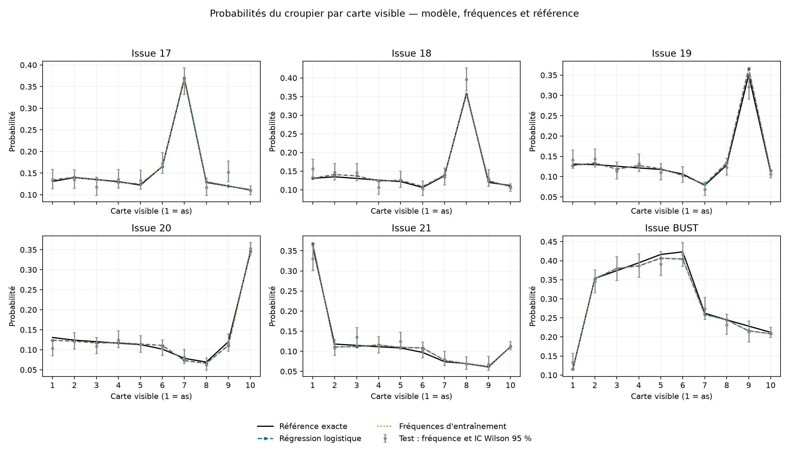
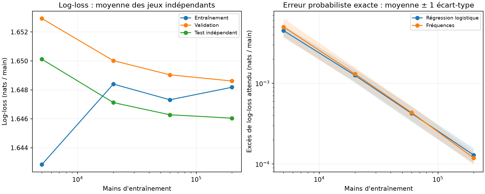
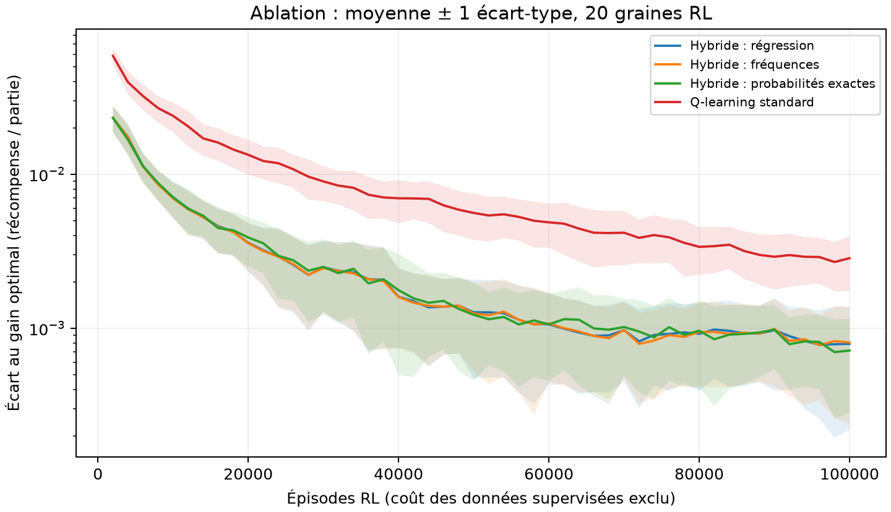

# Prédiction du croupier et Q-learning : rapport intégré

**Auteurs : Alessandro et Wassim.** Les contributions et l'historique du code sont
décrits dans [integration.md](integration.md). Les [commandes de reproduction](reproduction.md)
et l'[index des résultats](../results/README.md) permettent de vérifier chaque campagne.

## 1. Question et conclusion

Nous étudions si un prédicteur des probabilités du croupier peut fournir la valeur
de STAND à un agent qui apprend seulement la valeur de HIT, et ainsi réduire le
besoin d'apprentissage RL par rapport à un Q-learning apprenant les deux actions.

L'hybride livré fonctionne et approche l'optimum de l'environnement. À 100 000
épisodes RL, il obtient un meilleur gain moyen que le standard dans les deux campagnes.
Cependant, la conclusion dépend du coût compté pour simuler les données supervisées.
L'ablation complémentaire ne met pas en évidence d'avantage net de la régression
logistique sur de simples fréquences empiriques apprises sur les mêmes données.
L'apport observé concerne donc l'utilisation d'une estimation préalable de STAND ;
ces expériences ne démontrent pas une nécessité du classificateur logistique.

## 2. Environnement et information disponible

Gymnasium `Blackjack-v1`, `natural=False`, `sab=False`. Le paquet est infini :
les cartes sont tirées avec remise ; chacune des valeurs 1 à 9 a probabilité 1/13,
la valeur 10 a probabilité 4/13. Le croupier s'arrête à 17, y compris sur un 17 souple.
Le joueur peut HIT ou STAND ; récompense finale −1, 0 ou +1. Pas de double,
split, assurance, bonus de blackjack ni comptage des cartes.

L'état observable est `(total_joueur, carte_visible, as_utilisable)`. La carte cachée
du croupier ne fait jamais partie des entrées. Dans un paquet infini, la main du joueur
ne change pas les probabilités du croupier : sa seule carte visible suffit au prédicteur.
Les 280 états atteignables utilisés pour comparer les politiques sont explicitement
définis dans `src/evaluate.py`.

## 3. Méthodes

### Prédicteur supervisé

Une simulation complète et indépendante du croupier produit un exemple : carte
visible en entrée, résultat parmi 17, 18, 19, 20, 21, BUST en étiquette. Les entrées
ont dix valeurs catégorielles, encodées en one-hot. Le modèle est une régression
logistique multinomiale régularisée, optimisée par L-BFGS.

Le modèle livré utilise 60 000 mains train (graine 42), 12 000 validation (43) et
12 000 test (123). C est choisi sur la log-loss de validation parmi 0.01, 0.1, 1,
10, 100 ; C=0.1 est retenu. Aucun refit sur validation. Les fréquences empiriques
utilisent exactement le même train. Les étiquettes proviennent des simulations,
pas des probabilités exactes.

Il s'agit d'une estimation de dix distributions de six classes, un problème de
faible dimension. La baseline par fréquences estime directement les mêmes distributions.
Le modèle ne peut pas supprimer l'aléa d'une main individuelle.

### Valeur de STAND et Q-learning

Pour un total joueur p et une carte visible d, la valeur estimée de STAND est
la somme, sur les six issues k, de `P_estimée(k | d) × récompense(p, k)`.
La récompense vaut +1 si le croupier dépasse 21 ou termine sous p, 0 en cas
d'égalité, −1 sinon. L'as utilisable ne modifie pas cette valeur une fois le total fixé.

Le Q-learning standard met à jour HIT et STAND. L'hybride maintient STAND figé
et met à jour seulement HIT, avec la cible `r` si la manche termine, sinon
`r + max(Q_HIT(suivant), V_STAND(suivant))`. Gamma=1 et pas d'apprentissage
`alpha=1/N**omega`, avec omega=1. À l'évaluation, l'agent choisit HIT si sa valeur
est strictement supérieure à STAND ; en cas d'égalité, STAND.

Wassim a réglé eps_min et omega sur les graines 100–102 avec la loi exacte pour
l'hybride. TUNED utilise eps_min=1 pour les hybrides, 0.4 pour le standard.
L'exploration entièrement aléatoire de l'hybride pendant l'entraînement est compatible
avec le Q-learning hors politique ; la politique évaluée est toujours gloutonne.

### Références exactes

La loi du croupier est calculable par récurrence. Elle sert à mesurer les erreurs
du prédicteur et à construire l'hybride exact de référence. L'évaluation J calcule
le gain espéré d'une politique dans la vraie dynamique, avec la distribution initiale
de Gymnasium. Pour une politique fixée, ce calcul n'a pas le bruit d'un test Monte-Carlo.
La politique optimale π* est calculée par programmation dynamique : J*=−0.0465559771.
L'hybride exact après un nombre fini d'épisodes n'est pas une borne supérieure ; π* l'est.
L'évaluation J est enregistrée pendant l'apprentissage sans servir aux mises à jour.

## 4. Métriques et incertitudes

- **Log-loss** : pénalité moyenne −log(probabilité de la vraie classe), en nats/main ; plus faible est meilleur.
- **Brier multiclasse** : somme des six erreurs quadratiques par main, puis moyenne,
  sans division par six. Plus faible est meilleur. Log-loss et Brier évaluent la
  qualité probabiliste ; ce ne sont pas des mesures exclusives de calibration.
- **Excès exact de log-loss** : divergence KL entre vraie distribution et prédiction,
  moyennée selon la distribution réelle des cartes visibles. Zéro correspond à la loi exacte.
- **Accuracy** : proportion d'issues correctement prédites en choisissant la classe la plus probable.
- **F1 macro** : moyenne non pondérée des six F1 ; chaque F1 combine précision et rappel.
  Accuracy et F1 ne mesurent pas la qualité des probabilités utilisées par l'hybride.
- **J et écart J*−J** : gain attendu par partie et distance au gain optimal. Plus grand J est meilleur.
- **Variabilité** : distinguer le bruit des parties simulées, celui des entraînements RL
  et celui des jeux supervisés. Leurs intervalles ne sont pas interchangeables.

Les nouvelles campagnes rapportent des IC approximatifs de Student entre graines
indépendantes, ou sur les différences appariées. La première campagne contient des
permutations exactes de signes : leur validité suppose une échangeabilité des traitements
dans les paires, ou une symétrie des différences sous H0, pas seulement l'égalité des
moyennes. Les comparaisons secondaires sont descriptives, sans correction de multiplicité.
Une absence de différence détectée ne prouve pas l'équivalence.

Références : [métriques scikit-learn](https://scikit-learn.org/stable/modules/model_evaluation.html),
[validation](https://scikit-learn.org/stable/modules/cross_validation.html),
[permutations appariées SciPy](https://docs.scipy.org/doc/scipy/reference/generated/scipy.stats.permutation_test.html).

## 5. Résultats du prédicteur livré

Source : [première expérience](../results/supervised/report.md), train/validation/test ci-dessus.

| Estimateur | Log-loss test | Brier test | Accuracy test | Excès exact de log-loss |
|---|---:|---:|---:|---:|
| Régression logistique | 1.651587 | 0.778452 | 36.49 % | 0.000429 |
| Fréquences train | 1.651642 | 0.778478 | 36.49 % | 0.000449 |
| Loi exacte | 1.651709 | 0.778430 | 36.49 % | 0 |

La loi exacte minimise la perte en espérance, pas nécessairement sur chaque petit
échantillon : son score test peut être légèrement moins bon par fluctuation.
La différence appariée de log-loss régression−fréquences vaut −0.000055,
IC normal approximatif à 95 % [−0.000125, +0.000014] : pas d'avantage net démontré.
L'erreur maximale parmi les 60 probabilités est 0.019042 (1.9042 point de pourcentage),
l'erreur maximale de V_STAND est 0.038708 unité de récompense.

La figure compare les probabilités et les fréquences de test, avec IC de Wilson
point par point ; ces intervalles ne constituent pas une bande simultanée à 95 %.

## 6. Quantité de données et surapprentissage

Source : [nouvelle étude](../results/supervised/learning_curve/report.md).
Le [protocole complémentaire](protocole_complementaire.md) fixe cinq jeux indépendants,
quatre tailles train et la sélection de C sur validation. Les tailles sont imbriquées
dans chaque jeu ; les statistiques sont calculées entre jeux à taille fixée.

| Mains train | Excès exact moyen, régression | Écart-type entre jeux | Excès exact moyen, fréquences |
|---|---:|---:|---:|
| 5 000 | 0.004507 | 0.000697 | 0.005007 |
| 20 000 | 0.001257 | 0.000243 | 0.001310 |
| 60 000 | 0.000424 | 0.000090 | 0.000434 |
| 200 000 | 0.000129 | 0.000027 | 0.000119 |

Davantage de simulations diminue nettement l'erreur probabiliste et sa dispersion.
À 60 000 mains, l'erreur moyenne sur les cinq jeux est proche de celle du modèle livré.
À cette taille, le contraste régression−fréquences sur l'excès exact vaut −0.0000106,
IC approximatif [−0.0000411, +0.0000199] : le gain spécifique de la régression reste incertain.

Pour le modèle livré, la log-loss vaut 1.6480 sur train, 1.6412 sur validation et
1.6516 sur test. Il n'y a pas de fort décrochage train/test observé. Les nouvelles
courbes et l'évaluation exacte renforcent le constat d'une faible erreur dans ce
simulateur, sans constituer une preuve d'absence universelle de surapprentissage.
Un score test inférieur au score train dans certaines répétitions est possible
par fluctuation des mains test. La validation a servi à choisir C et son score est optimiste.
Les incertitudes basées sur seulement cinq jeux doivent être interprétées avec prudence.

Le modèle à 200 000 mains n'est pas substitué au modèle livré : l'étude mesure
la sensibilité à la taille des données, sans sélectionner un nouveau couple sur les tests.

## 7. Sélection CONFIG/TUNED et agent livré

Source : [comparaison de 160 entraînements](../results/hybrid/config_vs_tuned/report.md).
Le code choisit le réglage sur les graines de validation 200–219, puis évalue six
combinaisons méthode/réglage sur les graines de test 0–19. Budget : 100 000 épisodes par run.
TUNED est meilleur sur les 20 graines de validation, puis 17 des 20 graines de test.

| Méthode | J moyen test CONFIG | J moyen test TUNED |
|---|---:|---:|
| Hybride supervisé | −0.048083 | −0.047347 |
| Hybride exact | −0.048624 | −0.047371 |
| Standard | −0.050667 | −0.049459 |

Le fichier final `agent_tuned.npz` conserve la graine 0 choisie comme référence,
sans recherche de la meilleure graine : J=−0.047206653, écart optimal 0.000650676.
Sur 10 000 parties nouvelles de graine 2027 : 4 225 victoires, 1 005 égalités,
4 770 défaites ; gain observé −0.0545, IC approximatif [−0.0731, −0.0359].
Cet intervalle est beaucoup plus large que les écarts de méthodes : les comparaisons
reposent sur J exact et sur la variabilité entre entraînements.

La politique optimale pour V_STAND estimée ne diffère de π* que sur un des 280 états
atteignables et perd 0.000021834 de gain réel. Ce résultat indique une faible erreur
de décision à convergence pour ce prédicteur. La différence entre cette politique
limite et une politique apprise à budget fini n'est pas garantie positive dans le vrai jeu.

## 8. Ablation : la régression est-elle nécessaire ?

Source : [80 nouveaux entraînements](../results/hybrid/frequencies_ablation/report.md),
graines 400–419. Les deux estimateurs réutilisent le même train de 60 000 mains.
Les paramètres sont fixés avant cette campagne et les résultats ne modifient pas
le choix du modèle livré. Budget identique : 100 000 épisodes RL par entraînement.

| Méthode | J moyen | Écart-type entre graines |
|---|---:|---:|
| Hybride régression | −0.04734860 | 0.00057511 |
| Hybride fréquences | −0.04736438 | 0.00056830 |
| Hybride exact | −0.04727247 | 0.00043551 |
| Standard TUNED | −0.04940536 | 0.00110089 |

Le contraste principal régression−fréquences vaut +0.00001579 par partie,
IC approximatif à 95 % [−0.00001973, +0.00005130]. Les gains exacts sont égaux
sur 18 graines ; la régression est meilleure sur une et moins bonne sur une.
**Cette expérience ne démontre pas un bénéfice propre de la régression.**
L'égalité de gain ne suffit pas à affirmer que toutes les politiques sont identiques.

Le contraste régression−standard vaut +0.00205677,
IC approximatif [0.00143341, 0.00268013] ; l'hybride est meilleur sur 18 graines et
moins bon sur deux. Cela représente environ +0.206 unité de récompense pour 100 parties,
une amélioration moyenne modeste d'un jeu qui reste défavorable au joueur.

Les bandes montrent ±1 écart-type entre entraînements, pas un IC de moyenne.
Les IC appariés concernent un seul prédicteur figé ; avec beaucoup de différences
exactement nulles, l'approximation de Student du contraste régression−fréquences
doit rester descriptive. Aucun test d'équivalence n'a été prévu.

## 9. Coût des données et limites

La comparaison à budget RL égal favorise une méthode qui dispose déjà d'informations
sur STAND. La première campagne permet une autre comptabilité : budget total de
100 000 simulations, en déduisant les mains supervisées.

- Compter seulement les 60 000 mains train laisse 40 000 épisodes à l'hybride TUNED :
  écart optimal moyen 0.001740, contre 0.002904 pour le standard à 100 000 épisodes.
- Compter les 84 000 mains train/validation/test laisse 16 000 épisodes :
  écart 0.004528, cette fois supérieur à celui du standard.

Ces additions comparent des unités différentes (main du croupier, épisode joueur).
Elles n'égalisent ni le temps de calcul ni le nombre de tirages. Le coût du réglage
des hyperparamètres, des répétitions et de l'évaluation n'est pas entièrement imputé.
L'hybride exact dispose d'une information analytique ; ce n'est pas une baseline
apprenant ses probabilités avec le même budget de données.

Autres limites :

- cinq jeux supervisés et vingt graines RL par campagne, dans un seul environnement ;
- la variabilité supervisée est étudiée séparément, pas propagée dans toutes les campagnes RL ;
- les données test historiques sont désormais connues : tout nouveau choix doit utiliser
  une nouvelle validation et réserver une nouvelle évaluation finale ;
- réglages TUNED initialement choisis avec la loi exacte ; budgets et grilles limités ;
- aucune conclusion sur un paquet fini, d'autres règles ou un casino réel ;
- précision probabiliste, réussite d'une main et gain d'une politique sont des critères distincts.

## 10. Livraison

Le rendu conserve la régression et l'hybride TUNED comme système intégré reproductible,
avec le standard, les fréquences et la loi exacte comme références visibles.
Il ne revendique pas que la régression est indispensable ni qu'elle domine les fréquences.
Les [empreintes des artefacts](../models/manifest.json), les données agrégées, les
scripts et les tests sont versionnés. Les données brutes simulées sont régénérables
à partir des graines et leurs empreintes sont enregistrées.

Le prochain jalon est un essai depuis un clone sur un autre ordinateur. L'application
web pourra ensuite réutiliser `load_agent()` et `decide()` sans modifier les modèles.
