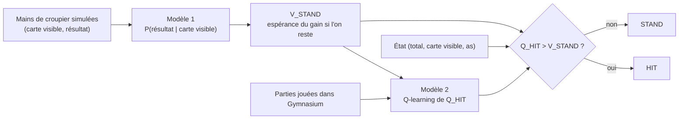

# Estimer la valeur de l'action terminale pour accélérer le Q-learning : étude contrôlée sur le Blackjack

Alessandro Daouk et Wassim Ghnaya. Les démonstrations sont dans [modele1.pdf](modele1.pdf)
et [modele2.pdf](modele2.pdf), le positionnement bibliographique dans
[etat_de_l_art.md](etat_de_l_art.md).

**Résumé.** Au Blackjack, la valeur de l'action « rester » (STAND) ne dépend que de la main
finale du croupier. On peut donc l'estimer par apprentissage supervisé sur des mains de
croupier simulées, puis la fixer dans un Q-learning qui n'apprend plus que la valeur de
« tirer » (HIT). Nous mesurons ce que cette architecture hybride apporte et coûte, avec un
oracle exact qui calcule le gain espéré de chaque politique sans bruit de simulation.

- En paquet infini, l'hybride atteint en 10 000 parties le regret que le Q-learning standard
  atteint en 40 000. À 100 000 parties, il gagne +0,00214 par partie [+0,00188 ; +0,00240]
  sur 28 jeux de données indépendants. Il bat aussi Double Q-learning, Expected SARSA,
  le contrôle Monte-Carlo, Dyna-Q et un RL à modèle appris par l'expérience.
- L'avantage survit au coût réel de l'estimation. Il s'inverse en revanche quand le modèle du
  croupier est trop imprécis et que l'apprentissage dure assez longtemps : l'hybride converge
  vers l'optimum de son modèle, pas vers l'optimum vrai.
- Dans ce cadre, la régression logistique n'apporte rien sur une table de fréquences, et une
  planification qui modélise aussi HIT fait mieux que l'hybride.
- En sabot fini, la loi du croupier dépend des cartes déjà sorties et le problème supervisé
  devient réel. La régression logistique sur la composition du sabot y bat nettement les
  tables et le gradient boosting, et l'hybride qui l'utilise garde après 3 millions de parties
  un avantage (+0,0009 par manche, 18 paires sur 18) que les hybrides à table perdent.

Chaque conclusion porte l'une des quatre étiquettes suivantes : **[démontré]** sous les
hypothèses énoncées, **[observé]** sur les graines et budgets indiqués, **[plausible]** mais
non testé, **[non démontré]** ou infirmé dans ce cadre.

## 1. Introduction

Un agent d'apprentissage par renforcement apprend en agissant, et chaque interaction a un
coût. Lorsqu'une partie de la fonction de valeur peut être estimée sans agir, faut-il
l'estimer et la fixer, ou laisser le renforcement tout apprendre ? Le Blackjack se prête
à cette question : l'action STAND termine la partie, et sa valeur est l'espérance d'un gain
qui ne dépend que de la main finale du croupier. Cette main se simule sans jouer.

**Question.** Dans quelles conditions une estimation supervisée préalable de la valeur de
l'action terminale améliore-t-elle l'efficacité d'un Q-learning tabulaire, et cet avantage
persiste-t-il quand on compte le coût d'obtention de l'estimation ?

**Contributions.**

1. Une étude contrôlée de cette architecture, évaluée par un oracle exact indépendant,
   avec un plan imbriqué qui propage la variabilité des données supervisées et des graines
   RL (§4–5).
2. Des bornes de regret adaptées à une seule récompense terminale perturbée (2η et une
   borne locale pondérée par l'occupation), confrontées aux mesures (§3, §5.6).
3. Une comparaison à six autres algorithmes : Q-learning standard, Double Q-learning,
   Expected SARSA, contrôle Monte-Carlo, Dyna-Q, RL à modèle appris par l'expérience, ainsi
   qu'une planification à partir des mêmes mains de croupier (§5.3, §5.9).
4. Des coûts mesurés en secondes et en cartes distribuées, acquisition comprise, et les
   régions où l'hybride perd (§5.4–5.5).
5. Une extension en sabot fini où le modèle 1 dispose d'une information que l'état RL n'a
   pas, et où le choix de l'estimateur supervisé compte (§6).

L'idée de combiner un modèle partiel et un apprentissage de valeurs n'est pas nouvelle
(Dyna, connaissances partielles du modèle, après-états) : aucune priorité n'est revendiquée.

## 2. Cadre

Environnement `Blackjack-v1` de Gymnasium 1.4.0, `natural=False`, `sab=False`, cartes
avec remise (1 à 9 : 1/13 chacune ; 10 : 4/13), croupier s'arrêtant sur tout 17.
États `(total, carte visible, as utilisable)` : 280 états de décision atteignables,
au plus 20 décisions par partie, graphe acyclique, γ = 1. Gain optimal exact
J* = −0,046556 : la meilleure politique perd en moyenne.

**Oracle.** Le jeu se résout exactement par récurrence sur le graphe. Le gain espéré J(π)
de toute politique est calculé par un oracle indépendant de l'apprentissage
(`src/audit/oracle.py`), contrôlé par un second oracle et par Monte-Carlo (§5.1). Le regret
d'une politique est J* − J(π).

**Pourquoi séparer les deux actions.** Rester termine la partie : sa valeur est
l'espérance d'un gain qui ne dépend que de la main finale du croupier, laquelle ne
dépend que de sa carte visible dans un paquet infini. Elle se prête donc à un
apprentissage supervisé sur des mains simulées, sans jouer de partie : dix lois à six
issues. Tirer mène à un nouvel état où le joueur décidera encore ; sa valeur dépend de
la politique future et relève du renforcement. Le prix est connu d'avance : l'erreur
de l'estimation devient permanente, l'agent ne pouvant pas la corriger en jouant.

**Incertitude irréductible.** Même avec la loi exacte, l'issue la plus probable du
croupier ne se réalise que dans 34 à 42 % des cas selon la carte visible : un
prédicteur parfait a une exactitude de 36,70 % et une log-loss de 1,6481 nat par main.
Les scores utiles sont donc des scores de probabilités (log-loss, KL vers la loi vraie),
pas l'exactitude.

**Politiques de référence**, évaluées exactement et contrôlées par 100 000 parties
Monte-Carlo chacune ([baselines.csv](../results/2_campagne_principale/diagnostics/baselines.csv)) :

| Politique | Gain exact par partie |
|---|---:|
| Toujours tirer | −1 |
| Aléatoire, HIT avec probabilité ½ | −0,3959 |
| Toujours rester | −0,1864 |
| Tirer tant que le total est inférieur à 17 | −0,0793 |
| Politique optimale π\* | −0,0466 |

**Différence pratique minimale : 0,001 par partie.** Elle vaut 2,1 % de l'avantage de la
maison et correspond à peu près au coût d'**une seule** décision erronée de la stratégie
optimale : sur les 280 états, une erreur isolée coûte 0,00082 en médiane, et 132 erreurs
isolées coûtent au moins 0,001. Le gain d'une partie ayant un écart-type de 0,95, il
faudrait environ 3,5 millions de parties simulées pour estimer un gain à ±0,001 : un tel
écart est invisible sans l'oracle exact.

## 3. Méthodes

### 3.1 Modèle 1 : loi du croupier

Classes : issue finale du croupier parmi {17, 18, 19, 20, 21, BUST}. Entrée : carte visible.
Estimateurs, tous ajustés sur les mêmes mains simulées :

| Estimateur | Définition | Hyperparamètre |
|---|---|---|
| Logistique | régression multinomiale sur la carte en one-hot (scikit-learn, lbfgs) | C ∈ {0,01 ; 0,1 ; 1 ; 10 ; 100}, choisi par log-loss de validation |
| Fréquences | proportions empiriques par carte visible | aucun |
| Jeffreys | fréquences lissées, α = 1/2 | aucun |

On en déduit V̂_STAND(p, d) = Σ_D P̂(D | d) R(p, D), où R vaut +1, 0 ou −1.

### 3.2 Modèle 2 : agents RL

| Agent | STAND | Mise à jour | ε_min | ω |
|---|---|---|---:|---:|
| Hybride (logistique, fréquences, Jeffreys) | V̂_STAND figée | Q-learning sur HIT seul | 1 | 1 |
| Hybride à STAND exacte | loi vraie du croupier (**oracle privilégié**) | Q-learning sur HIT seul | 1 | 1 |
| Standard réglé | apprise | Q-learning sur les deux actions | 0,4 | 1 |
| Standard commun | apprise | Q-learning sur les deux actions | 1 | 1 |

Tous les agents utilisent un pas α = 1/N(s, a)^ω et une exploration ε-gloutonne
ε_k = max(ε_min, 0,99995^k). Les hyperparamètres ont été réglés sur les graines 100 à 102
(`src/tune.py`, grille ε_min ∈ {0,05 ; 0,1 ; 0,2 ; 0,4 ; 0,6 ; 1} × ω ∈ {1 ; 0,8 ; 0,6}),
distinctes de toutes les graines d'évaluation. Le réglage de l'hybride utilisait STAND
exacte ; refait avec un modèle estimé, il choisit la même configuration (§5.9). Le bras
« standard commun » contrôle l'effet d'une exploration différente.

**ε_min = 1 pour l'hybride.** Le comportement est alors uniforme et indépendant de Q, ce que
permet la cible hors politique du Q-learning ; la politique évaluée reste gloutonne. Une
conséquence expérimentale importante : tous les bras à ε_min = 1 qui partagent une graine
voient exactement les mêmes parties, ce qui apparie parfaitement les contrastes entre
estimateurs de STAND.

### 3.3 Autres algorithmes de référence

Pour situer l'hybride, six références utilisent le même environnement, le même nombre de
parties et, sauf mention contraire, la même grille de réglage et les mêmes graines de
réglage que le standard :

| Référence | Principe | Réglage retenu |
|---|---|---|
| Double Q-learning | deux tables, sélection et évaluation séparées | ε_min 0,2 ; ω 0,8 |
| Expected SARSA | cible = espérance sous la politique ε-gloutonne | ε_min 0,1 ; ω 0,8 |
| Contrôle Monte-Carlo | retour de fin de partie, ε-glouton | ε_min 0,05 ; ω 0,6 |
| Dyna-Q | Q-learning + 10 mises à jour simulées par pas, tirées des transitions observées | ε_min 0,2 ; ω 0,8 |
| RL à modèle appris | MDP estimé par comptage des transitions jouées, résolu exactement ; exploration uniforme | aucun |
| Planification | loi des cartes estimée sur les mêmes mains de croupier, HIT calculé par programmation dynamique, sans jouer | aucun |

Le RL à modèle appris est la limite de Dyna avec une planification complète. La
planification n'apprend rien en jouant : elle sert de borne de ce que l'on obtient en
modélisant aussi HIT.

### 3.4 Rappel théorique

Les démonstrations sont dans les PDF ; seules leurs conclusions sont reprises ici.

- **[démontré]** La régression one-hot est saturée : sans pénalité elle reproduit les
  fréquences ; avec la pénalité de scikit-learn 1.9.1 (‖W‖²/(2Cn), biais non pénalisé),
  l'écart aux fréquences vaut −W/(C·N_d) et est d'ordre 1/N_d.
- **[démontré]** L'espérance du KL des fréquences brutes est **infinie** à toute taille
  finie, car une case vide a une probabilité positive. La loi « 25/n » décrit la moyenne du
  terme quadratique et l'espérance exacte des estimateurs lissés (Jeffreys, Laplace), pas
  celle des fréquences brutes.
- **[démontré]** Erreur de STAND : |V̂ − V| ≤ 2 TV ≤ √(2 KL) par carte visible ; l'erreur
  sur Q*_HIT est au plus η = ‖V̂ − V‖∞ ; le regret de la politique limite est au plus
  2η ; une borne locale pondérée par l'occupation est souvent bien plus fine.
- **[démontré]** Sous visitation infinie, pas 1/N^ω (½ < ω ≤ 1) et bruit borné,
  l'hybride converge vers l'optimum **du modèle estimé**, pas vers l'optimum vrai.
- **[plausible]** Fixer STAND supprime le bruit de cette cible et une partie du biais
  de maximisation ; cela ne garantit ni une variance plus faible de toutes les cibles,
  ni un facteur fixe de complexité d'échantillonnage.

## 4. Protocole expérimental

Un pilote exécuté sur des graines de validation a fixé le nombre de jeux supervisés
à 28, pour viser une précision de ±0,0005 sur le critère principal. Le plan a été figé
avant la campagne finale ([final_frozen.json](../results/2_campagne_principale/plan_fige.json)).

- **Unité de réplication** : un jeu supervisé indépendant (graine 41000 + 10i), avec
  ses propres validation (6 000 mains) et test (12 000 mains). Deux graines RL par jeu
  (51000 + 10i + j). Les différences appariées entre méthodes sont moyennées sur les deux
  graines RL d'un jeu, puis les 28 (ou 9) moyennes de jeux forment l'échantillon. Les
  tailles 1 000 à 60 000 sont des préfixes d'un même jeu : elles ne sont pas indépendantes
  entre elles.
- **Critère principal** : J(logistique) − J(standard réglé) à 20 000 mains et
  100 000 épisodes, 28 jeux ; différence pratique minimale 0,001 ; précision visée ±0,0005.
- **Analyses secondaires** (9 premiers jeux) : quatre tailles, douze budgets de 0 à
  200 000 épisodes, ablations, temps d'atteinte de seuils de regret.
- **Statistiques** : IC de Student sur les grappes, bootstrap des grappes (10 000
  tirages), médiane, étendue et retrait d'une grappe ; TOST à ±0,001 pour toute
  conclusion d'équivalence. Les contrastes secondaires ne sont pas corrigés pour la
  multiplicité et sont donnés à titre descriptif.
- **Coûts** : temps muraux mesurés séquentiellement, un thread numérique, ordre des
  méthodes mélangé, chauffe préalable ; cartes réellement distribuées ; évaluations
  exactes chronométrées à part et exclues du temps RL.
- **Analyses exploratoires.** La planification (§5.9), le Double Q-learning, les autres
  références (§5.3), la décomposition de variance (§5.2), la description par budget de la
  variante à cartes uniformes (§5.8) et le sabot fini (§6) ont été ajoutés après la
  campagne principale. Ils sont signalés comme tels et ne modifient pas le critère principal.

Les données de test supervisé ne servent qu'à documenter la qualité des estimateurs ;
aucun résultat de test n'a servi à choisir un modèle ou un hyperparamètre.

## 5. Résultats en paquet infini

Toutes les valeurs ci-dessous sont régénérées à partir des sorties archivées dans
[results/](../results/) ; la correspondance entre sections, modules et dossiers est
donnée en annexe A.

### 5.1 Contrôles de l'oracle et réplication

La première campagne du projet (comparaison CONFIG/TUNED, 160 entraînements ; ablation des
estimateurs, 80 entraînements ; entraînement du modèle 1 livré) a été relancée depuis ses
modules inchangés ([results/2_campagne_principale/replication/](../results/2_campagne_principale/replication/)).
**[observé]** Les 240 gains exacts finaux et les 12 000 points des courbes sont reproduits
avec un écart maximal de 0,0 (tolérance prévue 10⁻⁹) ; les probabilités du modèle 1
réentraîné sont identiques à celles du modèle livré (écart 0,0, tolérance 10⁻⁷). Cette
réplication établit le déterminisme du code, pas la validité des conclusions : la première
campagne utilisait un unique prédicteur et des graines connues. Le critère principal (§5.2)
en est la réplication indépendante.

Contrôles Monte-Carlo de l'oracle indépendant (100 000 parties par politique, graines
35000 à 35004) :

| Politique | J exact | Moyenne Monte-Carlo | IC 95 % | z |
|---|---:|---:|---:|---:|
| Toujours STAND | −0,18637 | −0,18672 | [−0,19264 ; −0,18080] | −0,12 |
| Toujours HIT | −1 | −1 | sans objet | sans objet |
| Aléatoire ½ | −0,39590 | −0,39149 | [−0,39704 ; −0,38594] | +1,56 |
| HIT si total < 17 | −0,07929 | −0,08370 | [−0,08954 ; −0,07786] | −1,48 |
| Optimale | −0,04656 | −0,04733 | [−0,05322 ; −0,04144] | −0,26 |

Les cinq écarts restent dans ±2 erreurs-types **[observé]**. L'oracle indépendant
reproduit J* et les gains de politiques aléatoires du premier oracle à 10⁻¹⁴ près,
et coïncide avec Gymnasium sur toutes les transitions HIT atteignables (tests).
Même avec 100 000 parties, l'intervalle Monte-Carlo de la politique optimale (largeur
0,012) est plus de cinq fois plus large que l'écart moyen entre l'hybride et le standard :
c'est la raison de l'évaluation exacte.

### 5.2 Critère principal

| Mesure, 20 000 mains, 100 000 épisodes | Valeur |
|---|---:|
| J(logistique) − J(standard réglé), moyenne sur 28 jeux | **+0,0021367** |
| IC 95 % Student | [+0,0018777 ; +0,0023957] |
| IC 95 % bootstrap des grappes | [+0,0019019 ; +0,0023870] |
| Médiane, étendue des 28 différences | +0,0020079 ; [+0,0007825 ; +0,0036396] |
| Moyenne après retrait d'une grappe | [+0,0020811 ; +0,0021869] |
| Demi-largeur réalisée / visée | 0,000259 / 0,0005 |
| Paires RL où l'hybride est meilleur | 56 / 56 |

Le gain moyen absolu vaut −0,047386 [−0,047490 ; −0,047282] pour l'hybride logistique
et −0,049523 [−0,049814 ; −0,049232] pour le standard réglé. La borne inférieure de
l'intervalle dépasse la différence pratique minimale **[observé]**.

**D'où vient la variance ? (exploratoire)** Deux graines RL par jeu ne permettent pas de
séparer la variabilité des données supervisées de celle de l'apprentissage. Sur les 9
premiers jeux, 10 nouvelles graines RL par jeu (91000 + 100i + r), même protocole :

| Quantité à 100 000 épisodes | Écart-type entre jeux | Écart-type entre graines RL | Part des jeux |
|---|---:|---:|---:|
| Regret de l'hybride logistique | 0,00016 | 0,00047 | 11 % |
| Différence hybride − standard | 0,00030 | 0,00127 | 5 % |

La différence vaut +0,00210 [+0,00171 ; +0,00248], l'hybride est meilleur dans 88 paires
sur 90 **[observé]**. Le critère principal se réplique donc sur des graines nouvelles, et
presque toute sa dispersion vient de l'apprentissage RL : à 20 000 mains, l'erreur du
modèle du croupier pèse peu devant le bruit du Q-learning. Plus de graines RL par jeu
aurait été plus efficace que plus de jeux supervisés.

### 5.3 Efficacité en épisodes et comparaison aux autres algorithmes

Regret moyen J* − J sur les 9 jeux secondaires (deux graines RL chacun), 20 000 mains pour
les hybrides :

| Épisodes | 1 000 | 5 000 | 10 000 | 20 000 | 40 000 | 100 000 | 200 000 |
|---|---:|---:|---:|---:|---:|---:|---:|
| Hybride, STAND exacte (oracle) | 0,0367 | 0,0135 | 0,0064 | 0,0027 | 0,0012 | 0,0008 | 0,0003 |
| **Hybride logistique** | 0,0365 | 0,0135 | 0,0065 | 0,0038 | 0,0016 | 0,0008 | 0,0006 |
| Hybride fréquences | 0,0365 | 0,0134 | 0,0065 | 0,0036 | 0,0016 | 0,0008 | 0,0005 |
| Q-learning standard réglé | 0,0861 | 0,0343 | 0,0219 | 0,0123 | 0,0073 | 0,0030 | 0,0014 |
| Q-learning standard commun (ε 1) | 0,0827 | 0,0345 | 0,0235 | 0,0125 | 0,0070 | 0,0028 | 0,0014 |
| RL à modèle appris | 0,0811 | 0,0342 | 0,0224 | 0,0134 | 0,0070 | 0,0027 | 0,0015 |
| Dyna-Q | 0,0978 | 0,0389 | 0,0251 | 0,0152 | 0,0096 | 0,0039 | 0,0020 |
| Expected SARSA | 0,0910 | 0,0570 | 0,0451 | 0,0266 | 0,0106 | 0,0042 | 0,0024 |
| Contrôle Monte-Carlo | 0,1046 | 0,0761 | 0,0637 | 0,0435 | 0,0245 | 0,0114 | 0,0065 |

Contrastes sur les 28 jeux, IC à 95 % (hybride logistique moins référence) :

| Référence | 10 000 épisodes | 40 000 | 100 000 |
|---|---:|---:|---:|
| Q-learning standard réglé | | | +0,0021 [+0,0019 ; +0,0024] |
| RL à modèle appris | +0,0153 [+0,0139 ; +0,0167] | +0,0055 [+0,0049 ; +0,0062] | +0,0022 [+0,0018 ; +0,0026] |
| Dyna-Q | +0,0183 [+0,0165 ; +0,0200] | +0,0075 [+0,0068 ; +0,0082] | +0,0033 [+0,0028 ; +0,0037] |
| Double Q-learning | +0,0219 [+0,0200 ; +0,0238] | +0,0073 [+0,0066 ; +0,0080] | +0,0031 [+0,0028 ; +0,0034] |
| Expected SARSA | +0,0377 [+0,0362 ; +0,0393] | +0,0087 [+0,0080 ; +0,0095] | +0,0034 [+0,0029 ; +0,0038] |
| Contrôle Monte-Carlo | +0,0550 [+0,0525 ; +0,0575] | +0,0231 [+0,0217 ; +0,0245] | +0,0103 [+0,0095 ; +0,0111] |

**[observé]** L'hybride bat toutes les références qui apprennent en jouant, à tous les
budgets mesurés. Aucune d'elles ne bat le Q-learning standard réglé : à 100 000 épisodes,
Expected SARSA fait −0,0013 [−0,0018 ; −0,0007], Dyna-Q −0,0011 [−0,0016 ; −0,0006],
Double Q −0,0010 [−0,0014 ; −0,0005], Monte-Carlo −0,0081 [−0,0089 ; −0,0073] ; le RL à
modèle appris fait jeu égal, −0,0001 [−0,0006 ; +0,0004], intervalle contenu dans ±0,001.

Cette dernière comparaison est la plus instructive. Un RL à modèle complet, qui exploite
chaque partie au mieux par planification exacte, n'apprend pas plus vite que le Q-learning
standard : sa difficulté est d'estimer STAND à partir des seules parties où l'agent reste.
L'hybride reçoit justement cette estimation de l'extérieur, d'une source bon marché. Son
avantage vient donc de l'**information** supplémentaire, pas d'une meilleure exploitation
des parties jouées. Le Double Q-learning, qui retire le biais du maximum, fait moins bien
que le standard : ce n'est pas le retrait du biais seul qui produit le gain
**[non démontré]** pour le mécanisme.

Temps d'atteinte, premier point de la grille sous le seuil ; les échecs sont censurés
à 200 000 épisodes et ne sont pas comptés comme des réussites :

| Seuil de regret | Logistique 20 000 mains : réussites, médiane | Standard réglé : réussites, médiane parmi réussites |
|---|---|---|
| 0,01 | 18/18, 10 000 | 18/18, 40 000 |
| 0,005 | 18/18, 20 000 | 18/18, 60 000 |
| 0,002 | 18/18, 40 000 | 13/18, 200 000 |
| 0,001 | 17/18, 100 000 | 7/18, 200 000 |

**[observé]** Pour atteindre un regret de 0,002, l'hybride a besoin d'environ
40 000 épisodes et le standard d'au moins 200 000 dans 13 runs sur 18, et de plus de
200 000 dans les cinq autres. Le rapport des budgets dépend du seuil et de la taille
supervisée ; il ne constitue pas un facteur universel de vitesse. La grille est
grossière (100 000 puis 200 000) et le regret n'est pas monotone : un run de
l'hybride franchit 0,001 puis repasse au-dessus au dernier point.

### 5.4 Surface budget supervisé × budget RL

Différence J(hybride) − J(standard réglé), 9 jeux, IC 95 % entre crochets :

| Mains | 1 000 épisodes | 20 000 | 100 000 | 200 000 |
|---:|---:|---:|---:|---:|
| 1 000, logistique | +0,0492 | +0,0064 [+0,0043 ; +0,0085] | −0,0010 [−0,0024 ; +0,0005] | **−0,0020 [−0,0033 ; −0,0006]** |
| 1 000, fréquences | +0,0493 | +0,0073 | −0,0006 [−0,0021 ; +0,0009] | **−0,0020 [−0,0035 ; −0,0005]** |
| 5 000, logistique | +0,0487 | +0,0085 | +0,0017 [+0,0009 ; +0,0025] | +0,0004 [−0,0000 ; +0,0009] |
| 20 000, logistique | +0,0497 | +0,0085 | +0,0022 [+0,0017 ; +0,0027] | +0,0008 [+0,0004 ; +0,0013] |
| 60 000, logistique | +0,0496 | +0,0093 | +0,0022 [+0,0017 ; +0,0026] | +0,0011 [+0,0007 ; +0,0015] |

**[observé]** L'hybride gagne largement tant que le budget RL est petit, quelle que soit
la taille supervisée testée. Avec 1 000 mains, il perd dès que le standard dispose
d'assez d'épisodes ; avec 5 000 mains, l'avantage à 200 000 épisodes n'est plus établi.
Le mécanisme est celui que prévoit la théorie : le regret limite de la politique du modèle
estimé vaut en moyenne 0,0030 (1 000 mains), 0,0007 (5 000), 0,00013 (20 000) et
0,000012 (60 000). L'hybride ne peut pas descendre durablement sous ce plancher, alors
que le standard converge vers l'optimum vrai.

### 5.5 Coût de bout en bout

Coûts mesurés (moyennes sur les jeux, en secondes sur un Intel i7-1255U, un thread) :

| Poste | 1 000 mains | 5 000 | 20 000 | 60 000 |
|---|---:|---:|---:|---:|
| Simulation des mains d'entraînement | 0,015 | 0,076 | 0,307 | 0,919 |
| Sélection de C (5 ajustements + scores) | 0,058 | 0,165 | 0,634 | 2,018 |
| Ajustement retenu seul | 0,009 | 0,032 | 0,128 | 0,414 |
| Fréquences | 0,0001 | 0,0001 | 0,0003 | 0,0009 |
| Acquisition logistique complète (avec validation) | 0,165 | 0,332 | 1,031 | 3,028 |
| Production logistique, C déjà fixé | 0,025 | 0,109 | 0,435 | 1,333 |
| Acquisition fréquences | 0,016 | 0,077 | 0,307 | 0,920 |
| Cartes d'entraînement | 2 901 | 14 522 | 58 120 | 174 279 |

Construction de la table STAND : environ 0,1 ms ; chargement d'une table archivée :
0,25 ms. Un épisode RL coûte 0,048 ms (4,88 s pour 100 000 épisodes, écart-type
0,12 s entre runs) et distribue 5,33 cartes ; une main de croupier coûte 0,015 ms et
2,90 cartes. **Une main de croupier n'est donc équivalente à une partie ni en temps
(≈ 0,32 partie) ni en cartes (≈ 0,55 partie).** L'évaluation exacte d'une politique, hors
du coût d'apprentissage, prend environ 0,3 ms.

Contrastes au même coût total (dernier point de la grille dont le coût mesuré respecte
le budget ; acquisition incluse pour l'hybride ; pas d'interpolation) :

| Budget | 1 000 mains, logistique | 20 000 mains, logistique | 20 000 mains, fréquences | 60 000 mains, fréquences |
|---|---:|---:|---:|---:|
| 0,5 s | +0,0081 [+0,0036 ; +0,0127] | inaccessible | −0,0010 [−0,0075 ; +0,0055] | inaccessible |
| 1 s | +0,0051 [+0,0011 ; +0,0091] | inaccessible | +0,0076 [+0,0039 ; +0,0113] | **−0,0260 [−0,0407 ; −0,0113]** |
| 2 s | +0,0021 [+0,0004 ; +0,0038] | +0,0024 [+0,0006 ; +0,0043] | +0,0043 [+0,0029 ; +0,0057] | +0,0049 [+0,0035 ; +0,0064] |
| 5 s | −0,0001 [−0,0017 ; +0,0014] | +0,0028 [+0,0020 ; +0,0035] | +0,0028 [+0,0021 ; +0,0034] | +0,0029 [+0,0023 ; +0,0036] |
| 10 s | **−0,0018 [−0,0031 ; −0,0005]** | +0,0009 [+0,0003 ; +0,0016] | +0,0012 [+0,0005 ; +0,0019] | +0,0010 [+0,0003 ; +0,0016] |
| 20 s | **−0,0020 [−0,0033 ; −0,0006]** | +0,0008 [+0,0004 ; +0,0013] | +0,0009 [+0,0005 ; +0,0012] | +0,0011 [+0,0007 ; +0,0015] |

« Inaccessible » signifie que l'acquisition seule dépasse le budget pour au moins une
paire. Au-delà d'environ 10 s, la grille des deux bras s'arrête à 200 000 épisodes :
le budget n'est plus entièrement utilisé et le contraste devient celui à épisodes égaux.

En cartes distribuées, la logistique à 20 000 mains (avec les 17 400 cartes de
validation nécessaires au choix de C) ne bat pas le standard à 100 000 cartes
(−0,0032 [−0,0077 ; +0,0012]), alors que les fréquences le battent
(+0,0085 [+0,0051 ; +0,0119]) ; à partir de 250 000 cartes, les deux hybrides gagnent.

**Conventions de coût.** (a) *Production*, C déjà fixé : simulation + ajustement retenu
+ table + RL. (b) *Acquisition avec sélection* : (a) + validation + tous les ajustements
candidats ; c'est la convention des figures. (c) *Validation scientifique* : (b) + test
supervisé (0,18 s et 34 900 cartes à 12 000 mains) + métriques ; ce coût documente la
qualité et n'est pas requis pour produire un agent. (d) *Réutilisation* d'une table déjà
apprise : 0,25 ms de chargement, l'acquisition étant amortie sur M agents. Le réglage
des hyperparamètres RL (108 entraînements de 100 000 épisodes, soit environ 8,8 minutes au
rythme mesuré ici) n'est imputé à aucune méthode. Mémoire : pic RSS du processus 184 Mio,
imports et ajustements compris ; tables Q, compteurs et visites : 23 Kio. Aucune mesure
d'énergie fiable n'était disponible ; aucune n'est rapportée.

**[observé]** Le compromis qualité–coût dépend de la ressource rare et du budget ;
la conclusion est propre à cette implémentation, où le simulateur du croupier est une
boucle Python et l'environnement RL passe par les enveloppes de Gymnasium.

### 5.6 Ablations

Contrastes à 20 000 mains et 100 000 épisodes, 9 jeux (logistique moins référence) :

| Référence | Différence et IC 95 % | IC 90 % | p TOST (±0,001) | Paires + / = / − |
|---|---:|---:|---:|---:|
| Fréquences | −0,0000034 [−0,0000111 ; +0,0000044] | [−0,0000096 ; +0,0000029] | < 10⁻¹⁷ | 0 / 17 / 1 |
| Jeffreys | identique aux fréquences | | < 10⁻¹⁷ | 0 / 17 / 1 |
| STAND exacte | −0,0000396 [−0,0002922 ; +0,0002130] | [−0,0002433 ; +0,0001641] | 1,1·10⁻⁵ | 7 / 5 / 6 |
| Standard commun (ε 1) | +0,0020450 [+0,0015512 ; +0,0025387] | | | 18 / 0 / 0 |
| Hybride ε_min 0,05 | +0,0012757 [+0,0005438 ; +0,0020076] | | | 18 / 0 / 0 |
| Hybride ω 0,8 | +0,0009273 [+0,0002019 ; +0,0016526] | | | 14 / 0 / 4 |
| STAND bruitée ρ = 0,05 | +0,0030734 [+0,0024683 ; +0,0036785] | | | 18 / 0 / 0 |
| STAND bruitée ρ = 0,20 | +0,0297556 [+0,0286987 ; +0,0308124] | | | 18 / 0 / 0 |

- **Estimateur [observé].** Logistique, fréquences et Jeffreys donnent des politiques
  presque toujours identiques ; l'équivalence à ±0,001 est établie par TOST. La logistique
  coûte en revanche environ trois fois plus de temps d'acquisition à 20 000 ou 60 000 mains
  (dix fois plus à 1 000), à cause de la sélection de C. Ce résultat négatif est conforme
  à la théorie du modèle saturé **[démontré]**. À 100 000 épisodes, l'hybride logistique
  n'est pas non plus distinguable de l'hybride à STAND exacte (équivalence à ±0,001).
- **Échantillonnage direct [démontré et vérifié].** Estimer STAND par la moyenne directe
  des gains R(p, D_i) sur les mêmes mains est algébriquement identique aux fréquences :
  écart maximal mesuré 2,2·10⁻¹⁶. Ce n'est pas une méthode supplémentaire.
- **Erreur de modèle → politique [observé, lien causal par intervention].** Mélanger
  la vraie loi avec une masse ρ sur BUST, à données RL identiques, augmente le regret
  limite de 0 à 0,0034 (ρ = 0,05) et 0,0317 (ρ = 0,20) et le regret final de 0,0037 et
  0,0307. L'hybride n'est utile que si l'erreur de STAND est petite devant les marges
  de décision.
- **Exploration [observé].** Avec ε_min = 0,05, l'hybride visite moins les états rares
  (minimum 12 visites HIT par état en moyenne contre 33) et perd 0,0013 par partie. Le
  standard commun (ε 1) et le standard réglé (ε 0,4) ont des regrets voisins à 100 000
  épisodes (0,0028 et 0,0030) : l'avantage de l'hybride n'est pas dû à un réglage plus
  favorable de son exploration.
- **Pas d'apprentissage [observé].** ω = 0,8 dégrade l'hybride (−0,0009), comme le
  réglage l'indiquait ; aucune valeur n'a été choisie sur ces résultats.
- **Bornes [observé].** À 20 000 mains, η ≈ 0,053, donc la borne globale 2η ≈ 0,105 est
  inutilisable ; la borne locale pondérée par l'occupation vaut 0,0012 pour un regret
  limite réel de 0,00013 : environ 90 fois plus fine que 2η mais encore 9 fois trop large.
  La borne pour un agent fini (2η + δ·E[T]) vaut 0,29 en moyenne pour un regret réel de
  0,0006 : elle est vraie mais non informative, car l'erreur maximale sur Q_HIT (≈ 0,12)
  se situe dans des états rarement visités. L'identité regret = occupation × désavantage
  est vérifiée à 1,7·10⁻¹⁷ près sur les 418 agents.
- **États sensibles [observé].** Pour le prédicteur livré, la politique limite ne
  diffère de l'optimum que dans l'état (12, 4, sans as), visité avec probabilité 0,0088
  par partie ; cinq états seulement sont ambigus selon la borne locale, contre 24 selon
  la borne globale.

### 5.7 Statistiques des probabilités catégorielles

Simulations multinomiales directes de la loi jointe (2 000 répétitions par taille,
instrument mathématique utilisant la loi exacte, sans entraînement d'agent) :

| n mains | KL brut infini | n × KL Jeffreys, IC 95 % | n × KL Laplace |
|---:|---:|---:|---:|
| 50 | 2 000 / 2 000 | 8,95 [8,85 ; 9,05] | 6,19 |
| 500 | 1 079 / 2 000 | 24,96 [24,72 ; 25,21] | 20,88 |
| 1 000 | 49 / 2 000 | 24,85 [24,62 ; 25,09] | 22,82 |
| 5 000 | 0 / 2 000 | 24,71 [24,48 ; 24,93] | 24,32 |
| 60 000 | 0 / 2 000 | 24,95 [24,73 ; 25,16] | 24,92 |
| 200 000 | 0 / 2 000 | 25,19 [24,97 ; 25,41] | 25,18 |

**[démontré et observé]** Le risque lissé tend vers 25/n ; aux petites tailles il est
nettement inférieur (le lissage contracte vers l'uniforme). Pour les fréquences brutes,
aucune moyenne finie n'est rapportée : l'absence de zéro observé à n ≥ 5 000 ne rend pas
l'espérance finie. La statistique de Pearson à 1 000 tirages pour la carte 6 a pour
moyenne 4,98 et variance 10,80 (limites χ²₅ : 5 et 10).

Le prédicteur livré a pour objectif scikit-learn vérifié dans le source installé ;
le résidu de la relation stationnaire est 1,5·10⁻⁷ et le gradient normalisé du biais
7,9·10⁻⁹. Sur les 55 sélections de C, la valeur 0,1 est retenue 28 fois. Parmi les
candidats C ≥ 0,1, les log-loss de validation diffèrent d'au plus 4·10⁻⁴ nat à 20 000
mains et 8·10⁻⁵ nat à 60 000 : le choix de C est instable mais sans conséquence
mesurable sur le gain. Seul C = 0,01 est nettement moins bon aux petites tailles.

### 5.8 Robustesse : cartes uniformes

Variante contrôlée du MDP : les dix valeurs de cartes deviennent équiprobables (1/10
au lieu de 4/13 pour le 10), avec les mêmes règles, états et gains. L'oracle est
recalculé pour cette loi (J* = −0,031375) et contrôlé par 100 000 parties
Monte-Carlo : −0,0271 [−0,0329 ; −0,0213], intervalle qui contient J*. Neuf jeux de
20 000 mains (graines 71000 + 10i), deux graines RL par jeu (81000 + 10i + j), mêmes
hyperparamètres, sans nouveau réglage.

**[observé]** Au contraste prévu (100 000 épisodes), l'hybride à fréquences n'est pas
nettement meilleur que le standard : +0,00032 [−0,00012 ; +0,00076], et le TOST conclut
même à l'équivalence à ±0,001 (p = 0,004). La description par budget (exploratoire)
montre le même profil qu'avec les cartes de Blackjack-v1, mais une convergence plus rapide
du standard :

| Épisodes | 1 000 | 5 000 | 20 000 | 60 000 | 100 000 | 200 000 |
|---|---:|---:|---:|---:|---:|---:|
| Regret, hybride fréquences | 0,0524 | 0,0073 | 0,0028 | 0,0007 | 0,0006 | 0,0003 |
| Regret, standard réglé | 0,1536 | 0,0370 | 0,0056 | 0,0014 | 0,0009 | 0,0005 |
| Différence (IC 95 %, non simultané) | +0,101 [+0,083 ; +0,119] | +0,030 [+0,020 ; +0,039] | +0,0027 [+0,0006 ; +0,0048] | +0,0007 [−0,0000 ; +0,0015] | +0,0003 [−0,0001 ; +0,0008] | +0,0002 [+0,0001 ; +0,0004] |

L'avantage aux petits budgets est donc robuste à ce changement de loi ; son amplitude
au budget de 100 000 épisodes ne l'est pas, ce qui interdit de présenter l'écart mesuré
sur Blackjack-v1 comme une constante de la méthode. Pourquoi le standard converge plus
vite ici n'a pas été étudié **[non démontré]**.

### 5.9 Planification avec la loi des cartes estimée

Les cartes d'une main de croupier suivent la même loi que celles du joueur. En estimant
cette loi par les fréquences des cartes visibles du jeu supervisé, HIT se calcule par
programmation dynamique, sans jouer une seule partie. Deux variantes : STAND fournie par le
même modèle logistique que l'hybride, ou STAND déduite de la règle d'arrêt du croupier,
supposée connue.

| Mains de croupier | 1 000 | 5 000 | 20 000 | 60 000 |
|---|---:|---:|---:|---:|
| Regret, planification avec STAND logistique | 0,00285 | 0,00074 | 0,00013 | 0,00002 |
| Regret, planification complète | 0,00058 | 0,00011 | 0,00003 | 0,00000 |

(9 premiers jeux ; à 20 000 mains sur les 28 jeux : 0,00014 et 0,00003.)

**[observé, exploratoire]** À 20 000 mains, la planification avec la même STAND que
l'hybride fait mieux que l'hybride après 100 000 épisodes de +0,00069 [+0,00057 ; +0,00081] ;
la planification complète, de +0,00080 [+0,00068 ; +0,00091]. Le regret de la première est
très proche du plancher de l'hybride (§5.4) : la planification atteint, sans jouer, à peu
près la qualité vers laquelle l'hybride converge. Dans ce Blackjack, les transitions de HIT
se déduisent de la loi des cartes et de l'arithmétique du total : ne pas les modéliser est
un choix d'étude, pas une contrainte du problème. L'hybride se justifie quand seule l'action
terminale est modélisable, ou quand le modèle de STAND exploite une information que la
modélisation des transitions n'a pas ; le §6 étudie ce second cas.

**Réglage de l'hybride sans STAND exacte.** Le réglage de l'hybride utilisait la loi exacte
du croupier. Refait sur les mêmes graines (100 à 102) avec un modèle logistique estimé sur
20 000 nouvelles mains par graine, il choisit la même configuration (ε_min = 1, ω = 1 ;
regret moyen 0,00055) : ce privilège n'a pas biaisé le choix.

### 5.10 L'agent livré

L'agent livré ([agent_tuned.npz](../models/hybrid/agent_tuned.npz)) est l'hybride réglé,
entraîné 100 000 épisodes avec la graine 0 et le modèle 1 livré (60 000 mains). Son gain
exact vaut −0,047207, soit 0,000651 sous l'optimum. La meilleure politique compatible avec
son modèle 1 ne diffère de π\* que dans l'état (12, 4, sans as), visité dans 0,9 % des
parties, et ne perd que 0,000022 : l'écart de l'agent vient presque entièrement du nombre
fini d'épisodes. Sur 10 000 parties simulées (graine 2027), il obtient 4 225 victoires,
1 005 égalités et 4 770 défaites.

## 6. Extension : sabot fini

*Analyse exploratoire, ajoutée après la campagne principale ; plan, réglage et évaluation
fixés avant les entraînements finaux. Code : `src/shoe/`, sorties : [results/5_sabot_fini/](../results/5_sabot_fini/).*

### 6.1 Pourquoi un sabot fini

En paquet infini, la loi du croupier ne dépend que de sa carte visible : dix lois à six
issues, que des fréquences estiment parfaitement (§5.6) et que la planification exploite
mieux que l'hybride (§5.9). Avec un sabot fini, cette loi dépend aussi des cartes déjà
sorties. Le modèle 1 devient un vrai problème supervisé, à plusieurs variables, et il peut
fournir une information que l'état tabulaire du RL ne contient pas.

**Jeu.** Un jeu de 52 cartes, rebattu avant une manche s'il en reste moins de 20 ; mêmes
règles que Blackjack-v1, mais tirages sans remise. Le joueur voit toutes les cartes sauf la
carte cachée du croupier. **État RL** : (total, carte visible, as utilisable, classe du
compte vrai Hi-Lo) avec cinq classes (< −2, [−2 ; −0,5[, [−0,5 ; 0,5[, [0,5 ; 2[, ≥ 2),
soit 1 400 états. Cet état comprime la composition du sabot : il n'est pas markovien et les
garanties de convergence du §3.4 ne s'appliquent plus.

**Évaluation.** Il n'existe plus d'oracle exact praticable pour J. Chaque politique joue les
**mêmes** 300 000 sabots (1,92 million de manches) ; J est le gain moyen par manche. Les
contrastes sont appariés, et leur intervalle combine deux erreurs : la variabilité entre les
9 jeux de données (2 graines RL chacun) et l'erreur Monte-Carlo du jeu d'évaluation commun,
calculée sabot par sabot sur l'ensemble des runs (environ 0,0002 par contraste). La loi
exacte du croupier sachant la composition se calcule en revanche par récurrence : elle sert à
évaluer le modèle 1 (KL vers la loi vraie) et elle est contrôlée contre des mains simulées
(tests). La référence sans apprentissage est la stratégie optimale du paquet infini, qui
ignore le sabot : J = −0,04349 par manche.

### 6.2 Modèle 1 : la régression logistique devient utile

Données : mains de croupier simulées dans des sabots entamés au hasard (2 à 37 cartes déjà
vues), sans jouer de partie. Variables : carte visible et effectifs des dix valeurs parmi les
cartes non vues. Quatre estimateurs, du plus pauvre au plus riche en information :

| Estimateur | Information utilisée | Réglage |
|---|---|---|
| Carte | carte visible seule (le modèle 1 du paquet infini) | Jeffreys |
| Table | carte visible × classe de compte (l'information de l'état RL) | Jeffreys |
| Logistique | carte visible × composition (proportions des dix valeurs, taille du sabot) : une régression multinomiale par carte, ajustées ensemble | C choisi sur validation |
| Boosting | carte et composition, arbres de gradient (`HistGradientBoostingClassifier`) | nombre d'arbres choisi sur validation |

9 jeux indépendants (graines 120000 + 10i), validation 10 000 mains, test 3 000 mains dont la
loi exacte est calculée. Excès de log-loss moyen, c'est-à-dire KL vers la loi vraie :

| Mains d'entraînement | 1 000 | 5 000 | 20 000 | 100 000 |
|---|---:|---:|---:|---:|
| Carte | 0,0466 | 0,0249 | 0,0213 | 0,0203 |
| Table | 0,1078 | 0,0421 | 0,0242 | 0,0189 |
| **Logistique** | **0,0383** | **0,0216** | **0,0117** | **0,0046** |
| Boosting | 0,0792 | 0,0410 | 0,0202 | 0,0099 |

**[observé]** La logistique est la meilleure à toutes les tailles. À 100 000 mains, elle bat
la table de 0,0143 nat [0,0138 ; 0,0148] et le boosting de 0,0053 [0,0050 ; 0,0055] ; son
erreur moyenne sur V_STAND (totaux 12 à 21) vaut 0,022, contre 0,041 pour la table et 0,045
pour la carte seule. Log-loss de test à 100 000 mains : 1,6317, pour 1,6275 avec la loi exacte.

La lecture est celle du compromis biais-variance. Les deux tables plafonnent à l'information
qu'elles utilisent : la carte seule ignore le sabot, la table le résume en cinq classes, et
avec 50 cases elle est en outre la plus mauvaise aux petites tailles. Le boosting peut tout
représenter, mais il apprend la structure à partir de rien et reste deux fois moins précis
que la logistique à 100 000 mains. La logistique impose une forme, des logits linéaires dans
la composition pour chaque carte visible, qui convient bien ici. Elle reste légèrement
biaisée : quintupler les données de 20 000 à 100 000 mains ne divise son KL que par 2,5. Le
C retenu croît avec la taille (0,1 à 1 000 mains, 10 dans 6 jeux sur 9 à 100 000), comme
attendu d'une régularisation qui doit s'effacer quand les données abondent.

### 6.3 Agents : un avantage que les hybrides tabulaires n'ont pas

Quatre agents, tous en Q-learning tabulaire sur les 1 400 états : le **standard** apprend
STAND et HIT ; trois **hybrides** apprennent HIT et reçoivent STAND d'un modèle 1 estimé sur
100 000 mains : carte, table, ou logistique évaluée sur la composition exacte des cartes non
vues à chaque décision. Réglage sur la grille ε_min ∈ {0,1 ; 0,4 ; 1} × ω ∈ {1 ; 0,8}, trois
graines, données et sabots d'évaluation distincts : ε_min = 1 pour le standard, 0,4 pour les
hybrides, ω = 1 partout. 9 jeux × 2 graines RL, 3 millions de parties.

Gain par manche moins celui de la stratégie de base :

| Parties | 10 000 | 50 000 | 200 000 | 1 M | 3 M |
|---|---:|---:|---:|---:|---:|
| Standard | −0,0518 | −0,0167 | −0,0046 | +0,0006 | +0,0014 |
| Hybride carte | −0,0211 | −0,0067 | −0,0010 | +0,0011 | +0,0014 |
| Hybride table | −0,0188 | −0,0059 | −0,0006 | +0,0012 | +0,0015 |
| **Hybride logistique** | −0,0171 | −0,0042 | **+0,0006** | **+0,0022** | **+0,0023** |

Contrastes, IC à 95 % incluant l'erreur d'évaluation, paires gagnantes sur 18 :

| Contraste | 200 000 | 1 M | 3 M |
|---|---:|---:|---:|
| Logistique − standard | +0,0052 [+0,0045 ; +0,0059], 18 | +0,0016 [+0,0011 ; +0,0021], 18 | **+0,0009 [+0,0004 ; +0,0014], 18** |
| Logistique − table | +0,0012 [+0,0007 ; +0,0017], 18 | +0,0010 [+0,0006 ; +0,0015], 18 | **+0,0009 [+0,0004 ; +0,0014], 18** |
| Logistique − carte | +0,0016 [+0,0010 ; +0,0021], 17 | +0,0011 [+0,0006 ; +0,0016], 18 | **+0,0009 [+0,0004 ; +0,0014], 18** |
| Table − standard | +0,0040 [+0,0034 ; +0,0047], 18 | +0,0006 [+0,0001 ; +0,0010], 16 | +0,0001 [−0,0002 ; +0,0003], 10 |
| Carte − standard | +0,0036 [+0,0031 ; +0,0042], 18 | +0,0005 [+0,0001 ; +0,0009], 16 | +0,0000 [−0,0004 ; +0,0005], 9 |

**[observé]**

1. **Même profil qu'en paquet infini aux petits budgets.** Tous les hybrides apprennent
   beaucoup plus vite que le standard : +0,03 à 10 000 parties, +0,004 à 0,005 à 200 000.
2. **Les hybrides tabulaires rejoignent le standard.** À 3 millions de parties, carte et
   table ne se distinguent plus du standard, et leurs intervalles sont inclus dans ±0,001.
   Leur STAND n'utilise au mieux que l'information de l'état : le standard finit par
   l'apprendre en jouant, comme en paquet infini.
3. **L'hybride logistique garde un avantage.** C'est le seul agent dont le gain moyen
   dépasse celui de la stratégie de base dès 200 000 parties (+0,0006, mais
   [−0,0002 ; +0,0014] une fois l'erreur d'évaluation incluse ; établi à partir de 1 million :
   +0,0022 [+0,0015 ; +0,0030]). Il bat les trois autres agents dans les 18 paires à
   3 millions de parties, d'environ 0,0009 par manche. Sa politique dépend de la composition exacte du
   sabot à travers STAND, ce qu'aucun agent tabulaire ne peut représenter. L'écart avec le
   standard se réduit encore (0,0016 à 1 M, 0,0009 à 3 M) : qu'il subsiste à budget infini
   est **[plausible]** (la classe de politiques de l'hybride logistique est plus riche) mais
   **[non démontré]**, son plancher dépendant aussi de l'erreur du modèle.
4. **La qualité du modèle 1 se traduit en gain.** L'ordre des agents à 3 millions de
   parties suit l'excès de KL de leur modèle (logistique, puis table et carte, indistinctes), et
   l'écart logistique − table est le même que l'écart logistique − carte. C'est ce qui
   manquait au paquet infini, où tous les estimateurs donnaient la même politique.

**Coûts.** Pour 3 millions de parties, le temps d'apprentissage RL vaut 31 s pour le
standard, 33 s pour les hybrides tabulaires et 52 s pour l'hybride logistique, qui évalue
son modèle à chaque décision. Simuler 100 000 mains de croupier prend 0,29 s ; ajuster la
logistique avec la sélection de C, 69 s, contre 0,17 s pour la table et 12 s pour le
boosting. Ces temps ont été mesurés sur une autre machine que ceux du §5.5 (macOS, 15 cœurs),
avec 9 à 15 processus en parallèle : ils sont indicatifs. **En temps, l'avantage n'est donc
pas établi** : l'acquisition logistique coûte plus que l'apprentissage complet du standard,
dont le gain au-delà de 3 millions de parties n'a pas été mesuré. Une sélection de C moins
coûteuse (une seule valeur, ou une grille plus courte) réduirait ce coût ; elle n'a pas été
mesurée.

**Limites propres à cette extension.** Les données supervisées viennent de sabots entamés au
hasard, pas des sabots rencontrés en jouant : la loi des variables n'est pas exactement celle
de l'apprentissage RL. La mise ne varie pas, alors que l'essentiel de l'intérêt du comptage
au Blackjack vient de la taille des mises ; seules les décisions de jeu profitent ici de la
composition. Un seul jeu de cartes, sans double ni partage.

## 7. Discussion

**Réponse à la question centrale.** Une estimation préalable de STAND améliore
nettement l'efficacité en épisodes RL lorsque (i) l'erreur de l'estimation est petite
devant les marges de décision des états fréquemment visités, et (ii) le budget RL est
trop court pour que l'apprentissage par l'expérience ait déjà convergé. L'avantage persiste
après prise en compte du coût d'acquisition si les mains de croupier sont bon marché par
rapport aux parties, ce qui est le cas ici en temps comme en cartes. Il disparaît quand
l'erreur du modèle impose un plancher de regret supérieur à l'erreur résiduelle du standard
(1 000 mains et budgets longs), ou quand l'acquisition consomme le budget.

**D'où vient l'avantage.** La comparaison au RL à modèle appris (§5.3) est la plus
éclairante : exploiter au mieux les parties jouées ne suffit pas, car STAND n'est observée
que lorsque l'agent reste, avec un bruit de ±1 par observation. L'hybride remplace ces
observations par une source extérieure moins chère et moins bruitée. C'est un gain
d'information, pas un gain d'algorithme. Le Double Q-learning montre que retirer le biais
du maximum ne le reproduit pas.

**Ce qui est une contribution et ce qui ne l'est pas.** Combiner un estimateur
supervisé et un Q-learning n'est pas une innovation algorithmique : l'idée relève de
l'utilisation de connaissances partielles du modèle, des après-états et de la
planification avec modèle (voir [etat_de_l_art.md](etat_de_l_art.md)). En paquet infini,
la logistique n'apporte rien sur les fréquences et la planification fait mieux que
l'hybride. L'apport défendable est une étude de cas contrôlée : oracle exact indépendant,
plan imbriqué propageant la variabilité des données supervisées, six références RL,
coûts mesurés en unités explicites, régions de perte identifiées, résultats négatifs
conservés, et une extension (§6) où le modèle supervisé dispose d'une information que la
modélisation tabulaire n'a pas.

## 8. Menaces à la validité

- **Validité externe.** Deux variantes d'un même jeu à deux actions. Le sabot fini (§6)
  change la structure de l'information, mais reste un Blackjack sans double ni partage ;
  aucune généralisation à d'autres MDP n'est revendiquée.
- **Hyperparamètres.** Les réglages ont été obtenus sur trois graines ; la décroissance de ε
  (0,99995 par épisode) n'a pas été réglée. Ils pourraient ne pas être optimaux aux autres
  tailles et budgets. Aucun réglage n'a utilisé le test.
- **Temps mesurés.** Ordinateur portable non isolé, une seule session, une seule
  implémentation ; les ratios temps main/partie dépendent du code (boucle Python contre
  enveloppes Gymnasium). Les cartes sont une unité plus stable mais ne mesurent pas le
  coût de calcul de l'apprentissage. Les temps du sabot fini ont été mesurés sur une autre
  machine, avec des processus parallèles : ils ne sont pas comparables à ceux du §5.5.
- **Grille de budgets.** Les temps d'atteinte sont limités par la résolution de la grille
  (100 000 puis 200 000 épisodes) et censurés à 200 000.
- **Précision secondaire et analyses exploratoires.** Les analyses secondaires reposent sur
  9 jeux ; leurs intervalles ne sont pas simultanés. Les tailles supervisées sont des
  préfixes d'un même jeu. Les analyses ajoutées après la campagne principale (§4) sont des
  pistes, pas des confirmations.

## 9. Conclusion

L'hybride est une manière efficace, dans ce Blackjack, d'utiliser une connaissance
partielle du modèle : il réduit fortement le nombre d'épisodes RL nécessaires, bat six
algorithmes qui apprennent en jouant, et ce gain survit au coût réel d'acquisition lorsque
l'estimation est assez précise. Il n'est ni universellement meilleur ni indépendant de la
qualité du modèle : avec trop peu de données supervisées, il converge vers une politique
sous-optimale que le Q-learning standard finit par dépasser. En paquet infini, une table de
fréquences suffit et une planification complète fait mieux. En sabot fini, le choix du
modèle supervisé compte : la régression logistique sur la composition du sabot bat les
tables et le gradient boosting, et c'est le seul modèle qui donne à l'hybride un avantage
durable sur le Q-learning standard, parce qu'il lui apporte une information que l'état ne
contient pas. Ce qui rend l'hybride utile n'est pas l'algorithme, c'est l'information que
le modèle 1 ajoute et la précision avec laquelle il l'estime.

## Annexe A. Correspondance des expériences

| Section | Contenu | Module | Sorties |
|---|---|---|---|
| §5.1 | Réplication de la première campagne (E1) | `src.audit.replicate` | `results/2_campagne_principale/replication/` |
| §5.1, §5.6–5.7 | Oracle, baselines, bornes, KL | `src.audit.diagnostics` | `results/2_campagne_principale/diagnostics/` |
| §4 | Pilote et plan figé | `src.audit.pilot`, `src.audit.campaign` | `results/2_campagne_principale/pilote/`, `results/2_campagne_principale/plan_fige.json` |
| §5.2–5.6 | Campagne principale (E2 à E5) | `src.audit.campaign`, `src.audit.analyze` | `results/2_campagne_principale/entrainements/`, `results/2_campagne_principale/analyse/` |
| §5.8 | Cartes uniformes (E6) | `src.audit.variant` | `results/3_cartes_uniformes/` |
| §5.3, §5.9 | Planification, Double Q, réglage sans privilège (E8) | `src.audit.complements` | `results/4_autres_methodes/planification_double_q/` |
| §5.2–5.3 | Expected SARSA, Monte-Carlo, Dyna-Q, RL à modèle appris, variance (E9) | `src.audit.baselines` | `results/4_autres_methodes/autres_algorithmes/` |
| §6 | Sabot fini (E10) | `src.shoe.campaign` | `results/5_sabot_fini/` |
