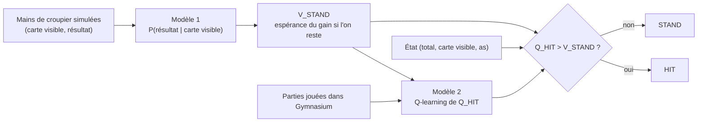
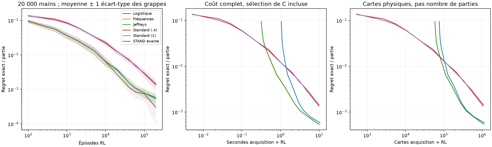
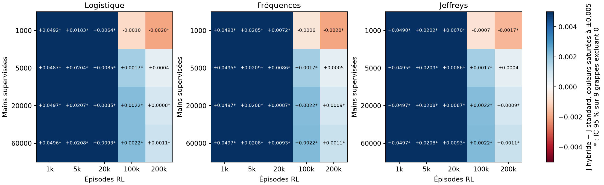
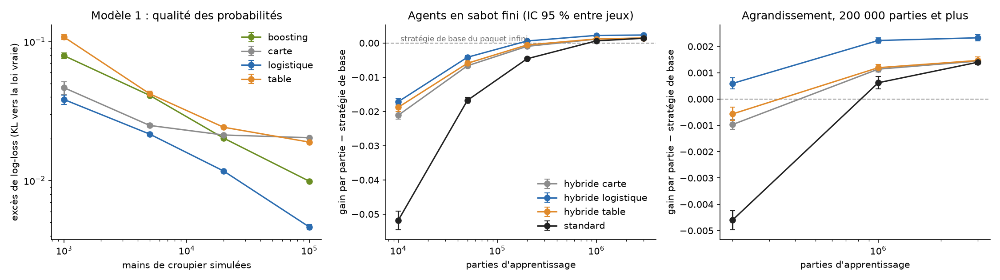

# Estimer la valeur de l'action terminale pour accélérer le Q-learning : étude contrôlée sur le Blackjack

Alessandro Daouk et Wassim Ghnaya. Démonstrations : [modele1.pdf](modele1.pdf) et
[modele2.pdf](modele2.pdf) ; détails des mesures : [annexes.md](annexes.md) ;
bibliographie : [etat_de_l_art.md](etat_de_l_art.md).

**Résumé.** Au Blackjack, la valeur de l'action « rester » (STAND) ne dépend que de la main
finale du croupier. On peut donc l'estimer par apprentissage supervisé sur des mains de
croupier simulées, puis la fixer dans un Q-learning qui n'apprend plus que la valeur de
« tirer » (HIT). Nous mesurons ce que cette architecture hybride apporte et coûte, avec un
oracle exact qui calcule le gain espéré de chaque politique sans bruit de simulation.

- En paquet infini, l'hybride atteint en 10 000 parties le regret que le Q-learning standard
  atteint en 40 000 et gagne +0,00214 par partie [+0,00188 ; +0,00240] à 100 000 parties,
  sur 28 jeux de données indépendants. Il bat aussi Double Q-learning, Expected SARSA, le
  contrôle Monte-Carlo, Dyna-Q et un RL à modèle appris par l'expérience.
- L'avantage survit au coût réel de l'estimation, mais s'inverse quand le modèle du croupier
  est trop imprécis et que l'apprentissage dure assez longtemps : l'hybride converge vers
  l'optimum de son modèle, pas vers l'optimum vrai.
- En sabot fini, la loi du croupier dépend des cartes déjà sorties : la régression
  logistique sur la composition du sabot bat alors les tables et le gradient boosting. Face
  à un Q-learning linéaire qui reçoit la même information, l'hybride apprend beaucoup plus
  vite (+0,040 par manche à 10 000 parties) puis est rejoint. Ces conclusions ont été
  confirmées sur des données et des graines neuves, selon un plan figé avant le lancement.

**Fixer STAND accélère l'apprentissage ; le niveau final dépend de l'information que l'agent
représente.** Chaque conclusion porte une étiquette : **[démontré]** sous les hypothèses
énoncées, **[observé]** sur les graines et budgets indiqués, **[plausible]** mais non testé,
**[non démontré]** ou infirmé dans ce cadre.

## 1. Introduction

Un agent d'apprentissage par renforcement apprend en agissant, et chaque interaction a un
coût. Quand une partie de la fonction de valeur peut être estimée sans agir, faut-il
l'estimer et la fixer, ou laisser le renforcement tout apprendre ? Au Blackjack, l'action
STAND termine la partie : sa valeur est l'espérance d'un gain qui ne dépend que de la main
finale du croupier, et cette main se simule sans jouer.

**Question.** Dans quelles conditions une estimation supervisée préalable de la valeur de
l'action terminale améliore-t-elle l'efficacité d'un Q-learning tabulaire, et cet avantage
persiste-t-il quand on compte le coût d'obtention de l'estimation ?

**Contributions.**

1. Une étude contrôlée, évaluée par un oracle exact indépendant, avec un plan imbriqué qui
   propage la variabilité des données supervisées et des graines RL (§4–5).
2. Des bornes de regret adaptées à une seule récompense terminale perturbée, confrontées aux
   mesures (§3.4, §5.6).
3. Une comparaison à six autres algorithmes et à une planification à partir des mêmes mains
   de croupier (§5.3, §5.7).
4. Des coûts mesurés en secondes et en cartes, acquisition comprise, et les régions où
   l'hybride perd (§5.4–5.5).
5. Une extension en sabot fini où le choix de l'estimateur supervisé compte, avec une
   référence à information égale qui sépare l'effet de l'information de celui de la
   séparation entre STAND et HIT, une borne théorique qui explique l'ordre des agents, et une
   confirmation préenregistrée (§6).

Combiner un modèle partiel et un apprentissage de valeurs n'est pas nouveau (Dyna,
connaissances partielles du modèle, après-états) : aucune priorité n'est revendiquée.

## 2. Cadre

Environnement `Blackjack-v1` de Gymnasium 1.4.0 (`natural=False`, `sab=False`), cartes avec
remise (1 à 9 : 1/13 chacune ; 10 : 4/13), croupier s'arrêtant sur tout 17, ni double ni
partage. États `(total, carte visible, as utilisable)` : 280 états atteignables, au plus 20
décisions par partie, graphe acyclique, γ = 1. Le jeu se résout exactement : un **oracle**
indépendant de l'apprentissage (`src/audit/oracle.py`) calcule le gain espéré J(π) de toute
politique, contrôlé par un second oracle, par Gymnasium et par Monte-Carlo (annexe A). Le
regret d'une politique est J* − J(π), avec J* = −0,046556 : la meilleure politique perd.

**Pourquoi séparer les deux actions.** La valeur de STAND ne dépend que de la loi de la main
finale du croupier sachant sa carte visible : dix lois à six issues, estimables sur des mains
simulées sans jouer. HIT mène à un nouvel état où le joueur décidera encore : sa valeur
dépend de la politique future et relève du renforcement. Le prix est connu d'avance : l'erreur
de l'estimation devient permanente, l'agent ne pouvant pas la corriger en jouant.

**Incertitude irréductible.** Même avec la loi exacte, l'issue la plus probable du croupier
ne se réalise que dans 34 à 42 % des cas : un prédicteur parfait a une exactitude de 36,70 %
et une log-loss de 1,6481 nat. Les scores utiles sont donc la log-loss et le KL vers la loi
vraie, pas l'exactitude.

**Repères.** Toujours tirer : −1 ; jouer au hasard : −0,3959 ; toujours rester : −0,1864 ;
tirer sous 17 : −0,0793 ; politique optimale : −0,0466 par partie. La **différence pratique
minimale** est fixée à 0,001 par partie : 2,1 % de l'avantage de la maison, à peu près le coût
d'une seule décision erronée de la stratégie optimale (0,00082 en médiane sur les 280 états).
Le gain d'une partie ayant un écart-type de 0,95, il faudrait 3,5 millions de parties pour
mesurer ±0,001 par simulation : sans l'oracle exact, ces écarts seraient invisibles.

## 3. Méthodes

### 3.1 Modèle 1 : loi du croupier

Issue finale du croupier parmi {17, 18, 19, 20, 21, BUST}, sachant la carte visible. Trois
estimateurs ajustés sur les mêmes mains simulées : **régression logistique** multinomiale sur
la carte en one-hot (C ∈ {0,01 ; 0,1 ; 1 ; 10 ; 100} choisi par log-loss de validation),
**fréquences** empiriques, et fréquences lissées de **Jeffreys** (α = 1/2). On en déduit
V̂_STAND(p, d) = Σ_D P̂(D | d) R(p, D), où R vaut +1, 0 ou −1.

### 3.2 Modèle 2 : agents RL

| Agent | STAND | Mise à jour | ε_min | ω |
|---|---|---|---:|---:|
| Hybride (logistique, fréquences, Jeffreys) | V̂_STAND figée | Q-learning sur HIT seul | 1 | 1 |
| Hybride à STAND exacte (oracle privilégié) | loi vraie du croupier | Q-learning sur HIT seul | 1 | 1 |
| Standard réglé | apprise | Q-learning sur les deux actions | 0,4 | 1 |
| Standard commun | apprise | Q-learning sur les deux actions | 1 | 1 |

Pas α = 1/N(s, a)^ω, exploration ε_k = max(ε_min, 0,99995^k), hyperparamètres réglés sur des
graines distinctes de toute évaluation (grille ε_min ∈ {0,05 ; 0,1 ; 0,2 ; 0,4 ; 0,6 ; 1} ×
ω ∈ {1 ; 0,8 ; 0,6}, graines 100 à 102). Avec ε_min = 1, le comportement est uniforme et
indépendant de Q, ce que permet la cible hors politique du Q-learning ; la politique évaluée
reste gloutonne. Tous les bras à ε_min = 1 qui partagent une graine voient alors exactement
les mêmes parties, ce qui apparie parfaitement les contrastes entre estimateurs. Le standard
commun contrôle l'effet d'une exploration différente.

### 3.3 Autres algorithmes de référence

Même environnement, même nombre de parties, même grille et mêmes graines de réglage que le
standard :

| Référence | Principe | Réglage retenu |
|---|---|---|
| Double Q-learning | deux tables, sélection et évaluation séparées | ε_min 0,2 ; ω 0,8 |
| Expected SARSA | cible = espérance sous la politique ε-gloutonne | ε_min 0,1 ; ω 0,8 |
| Contrôle Monte-Carlo | retour de fin de partie, ε-glouton | ε_min 0,05 ; ω 0,6 |
| Dyna-Q | Q-learning + 10 mises à jour simulées par pas réel | ε_min 0,2 ; ω 0,8 |
| RL à modèle appris | MDP estimé par comptage des transitions jouées, résolu exactement | exploration uniforme |
| Planification | loi des cartes estimée sur les mêmes mains de croupier, HIT calculé sans jouer | aucun |

Le RL à modèle appris est la limite de Dyna avec une planification complète ; la
planification n'apprend rien en jouant et borne ce que l'on obtient en modélisant aussi HIT.

### 3.4 Rappel théorique

Démonstrations dans les PDF ; la correspondance entre sections, modules et dossiers de
résultats est en annexe J.

- **[démontré]** La régression one-hot est saturée : sans pénalité elle reproduit les
  fréquences ; avec la pénalité de scikit-learn, l'écart aux fréquences est d'ordre 1/N_d.
- **[démontré]** L'espérance du KL des fréquences brutes est infinie à toute taille finie ;
  celle des estimateurs lissés tend vers 25/n, ce que confirment les simulations (annexe E).
- **[démontré]** |V̂ − V| ≤ 2 TV par carte visible ; l'erreur sur Q*_HIT est au plus
  η = ‖V̂ − V‖∞ ; le regret de la politique limite est au plus 2η, et une borne locale
  pondérée par l'occupation est souvent bien plus fine.
- **[démontré]** Sous visitation infinie et pas 1/N^ω (½ < ω ≤ 1), l'hybride converge vers
  l'optimum **du modèle estimé**, pas vers l'optimum vrai.
- **[plausible]** Fixer STAND supprime le bruit de cette cible et une partie du biais de
  maximisation, sans garantie générale sur la variance ni facteur fixe d'accélération.

## 4. Protocole expérimental

Plan figé avant la campagne ([plan_fige.json](../results/2_campagne_principale/plan_fige.json)),
après un pilote sur des graines de validation qui a fixé le nombre de jeux à 28.

- **Unité de réplication** : un jeu supervisé indépendant (graine 41000 + 10i), avec ses
  propres validation (6 000 mains) et test (12 000). Deux graines RL par jeu ; les différences
  appariées sont moyennées par jeu, puis les jeux forment l'échantillon.
- **Critère principal** : J(logistique) − J(standard réglé) à 20 000 mains et 100 000
  parties, 28 jeux, précision visée ±0,0005.
- **Analyses secondaires** (9 premiers jeux) : quatre tailles de 1 000 à 60 000 mains (préfixes
  d'un même jeu), budgets de 0 à 200 000 parties, ablations.
- **Statistiques** : IC de Student sur les jeux, bootstrap, retrait d'un jeu ; TOST à ±0,001
  pour toute équivalence. Contrastes secondaires non corrigés pour la multiplicité.
- **Coûts** : temps muraux mesurés à part de l'évaluation, un fil numérique ; cartes
  réellement distribuées.
- **Analyses exploratoires**, ajoutées après la campagne principale et signalées comme
  telles : planification, Double Q et autres références (§5.3, §5.7), décomposition de
  variance (§5.2), cartes uniformes (§5.7) et sabot fini (§6). Les conclusions du sabot fini
  ont ensuite été confirmées selon un plan figé (§6.5).

Les données de test ne servent qu'à documenter la qualité des estimateurs ; aucun résultat de
test n'a servi à choisir un modèle ou un hyperparamètre.

## 5. Résultats en paquet infini

### 5.1 Contrôles

**[observé]** L'oracle indépendant reproduit J* à 10⁻¹⁴ près, coïncide avec Gymnasium sur
toutes les transitions, et ses gains restent à moins de 2 erreurs-types de 100 000 parties
Monte-Carlo pour cinq politiques. La première campagne du projet (240 entraînements et le
modèle 1 livré) se reproduit avec un écart nul. Détails : annexe A.

### 5.2 Critère principal

| 20 000 mains, 100 000 parties | Valeur |
|---|---:|
| J(logistique) − J(standard réglé), 28 jeux | **+0,0021367** |
| IC 95 % Student ; bootstrap | [+0,0018777 ; +0,0023957] ; [+0,0019019 ; +0,0023870] |
| Étendue des 28 différences | [+0,0007825 ; +0,0036396] |
| Paires RL où l'hybride est meilleur | 56 / 56 |

**[observé]** La borne inférieure dépasse la différence pratique minimale. Avec 10 nouvelles
graines RL sur 9 jeux, la différence se réplique (+0,00210 [+0,00171 ; +0,00248], 88 paires
sur 90) et sa dispersion vient à 95 % de l'apprentissage RL, à 5 % des données supervisées :
plus de graines RL aurait été plus utile que plus de jeux.

### 5.3 Efficacité en épisodes et comparaison aux autres algorithmes

Regret moyen J* − J (9 jeux, 20 000 mains pour l'hybride) :

| Parties | 1 000 | 10 000 | 40 000 | 100 000 | 200 000 |
|---|---:|---:|---:|---:|---:|
| **Hybride logistique** | 0,0365 | 0,0065 | 0,0016 | 0,0008 | 0,0006 |
| Hybride à STAND exacte | 0,0367 | 0,0064 | 0,0012 | 0,0008 | 0,0003 |
| Q-learning standard réglé | 0,0861 | 0,0219 | 0,0073 | 0,0030 | 0,0014 |
| RL à modèle appris | 0,0811 | 0,0224 | 0,0070 | 0,0027 | 0,0015 |
| Dyna-Q | 0,0978 | 0,0251 | 0,0096 | 0,0039 | 0,0020 |
| Expected SARSA | 0,0910 | 0,0451 | 0,0106 | 0,0042 | 0,0024 |
| Contrôle Monte-Carlo | 0,1046 | 0,0637 | 0,0245 | 0,0114 | 0,0065 |

**[observé]** L'hybride atteint en 10 000 parties le regret du standard à 40 000, et à 40 000
un regret que le standard n'atteint qu'après environ 200 000. Sur les 28 jeux, il bat toutes
les références à tous les budgets mesurés : à 100 000 parties, de +0,0022 (RL à modèle appris)
à +0,0103 (Monte-Carlo). Aucune référence ne bat le standard réglé ; le RL à modèle appris
fait jeu égal avec lui (−0,0001 [−0,0006 ; +0,0004]).

Cette dernière comparaison est la plus instructive. Un RL qui exploite chaque partie au
mieux par planification exacte n'apprend pas plus vite que le Q-learning : sa difficulté est
d'estimer STAND à partir des seules parties où l'agent reste, avec un bruit de ±1. L'hybride
reçoit cette estimation d'une source extérieure bon marché : son avantage vient de
l'**information**, pas d'une meilleure exploitation des parties. Le Double Q-learning, qui
retire le biais du maximum, fait moins bien que le standard (−0,0010 [−0,0014 ; −0,0005]) :
le retrait du biais ne suffit pas à expliquer le gain **[non démontré]** pour le mécanisme.
Contrastes complets et temps d'atteinte des seuils : annexe B.

### 5.4 Le plancher du modèle

Différence J(hybride logistique) − J(standard réglé), 9 jeux :

| Mains | 1 000 parties | 20 000 | 100 000 | 200 000 |
|---:|---:|---:|---:|---:|
| 1 000 | +0,0492 | +0,0064 [+0,0043 ; +0,0085] | −0,0010 [−0,0024 ; +0,0005] | **−0,0020 [−0,0033 ; −0,0006]** |
| 5 000 | +0,0487 | +0,0085 | +0,0017 [+0,0009 ; +0,0025] | +0,0004 [−0,0000 ; +0,0009] |
| 20 000 | +0,0497 | +0,0085 | +0,0022 [+0,0017 ; +0,0027] | +0,0008 [+0,0004 ; +0,0013] |
| 60 000 | +0,0496 | +0,0093 | +0,0022 [+0,0017 ; +0,0026] | +0,0011 [+0,0007 ; +0,0015] |

**[observé]** L'hybride gagne largement aux petits budgets RL quelle que soit la taille
supervisée, mais il ne peut pas descendre sous le regret limite de son modèle : 0,0030 avec
1 000 mains, 0,0007 avec 5 000, 0,00013 avec 20 000, 0,000012 avec 60 000. Avec 1 000 mains,
le standard, qui converge vers l'optimum vrai, le dépasse à 200 000 parties. C'est
exactement ce que prévoit la théorie du §3.4.

### 5.5 Coûts de bout en bout

Une partie RL coûte 0,048 ms et 5,33 cartes ; une main de croupier 0,015 ms et 2,90 cartes,
soit environ un tiers de partie en temps et la moitié en cartes. Acquérir 20 000 mains coûte
0,31 s avec les fréquences et 1,03 s avec la logistique, dont la sélection de C représente
l'essentiel. **[observé]** Au même temps total, acquisition comprise, l'hybride à 20 000 mains
reste devant le standard pour des budgets de 2 à 20 s (+0,0024 à +0,0028 entre 2 et 5 s). Il
perd quand l'acquisition consomme le budget (60 000 mains pour 1 s : −0,0260) ou quand le
modèle est trop imprécis (1 000 mains à 10–20 s : −0,0018 à −0,0020). Ces secondes sont
propres à une machine et à une implémentation. Tableaux et conventions de coût : annexe C.

### 5.6 Ablations

À 20 000 mains et 100 000 parties, 9 jeux (détails : annexe D).

- **Estimateur [observé].** Logistique, fréquences et Jeffreys donnent des politiques presque
  toujours identiques (17 paires sur 18) : équivalence établie à ±0,001 par TOST
  (p < 10⁻¹⁷). La logistique coûte trois fois plus de temps d'acquisition pour rien,
  conformément à la théorie du modèle saturé. Elle n'est pas non plus distinguable de
  l'hybride à STAND exacte.
- **Erreur de modèle [observé, lien causal par intervention].** Déplacer une masse ρ de la loi
  du croupier vers BUST, à données RL identiques, augmente le regret final de 0,0037 (ρ = 0,05)
  et 0,0307 (ρ = 0,20) : l'hybride n'est utile que si l'erreur de STAND est petite devant les
  marges de décision.
- **Exploration [observé].** Le standard commun (ε 1) et le standard réglé (ε 0,4) ont des
  regrets voisins : l'avantage de l'hybride ne vient pas de son exploration.
- **Bornes [observé].** À 20 000 mains, la borne globale 2η ≈ 0,105 est inutilisable ; la
  borne locale vaut 0,0012 pour un regret limite réel de 0,00013, soit 90 fois plus fine mais
  encore 9 fois trop large. L'identité regret = occupation × désavantage est vérifiée à
  10⁻¹⁷ près sur les 418 agents.

### 5.7 Planification et robustesse

**Planification [observé, exploratoire].** Les cartes d'une main de croupier suivent la même
loi que celles du joueur : en estimant cette loi sur les mêmes 20 000 mains, HIT se calcule par
programmation dynamique sans jouer. Cette planification fait mieux que l'hybride après 100 000
parties (+0,00069 [+0,00057 ; +0,00081]) et atteint à peu près son plancher (regret 0,00013).
Dans ce Blackjack, ne pas modéliser HIT est un choix d'étude : l'hybride se justifie quand
seule l'action terminale est modélisable, ou quand les parties coûtent cher.

**Cartes uniformes [observé].** Avec dix valeurs de cartes équiprobables, l'avantage aux petits
budgets subsiste (+0,10 à 1 000 parties, +0,0027 à 20 000) mais n'est plus établi à 100 000
(+0,00032 [−0,00012 ; +0,00076]) : le chiffre de 0,00214 n'est pas une constante de la
méthode. Le réglage de l'hybride, refait sans la loi exacte du croupier, choisit la même
configuration. Détails : annexes F à H.

## 6. Extension : sabot fini

*Analyse exploratoire ; plan, réglage et évaluation fixés avant les entraînements finaux.
Code : `src/shoe/`, sorties : [results/5_sabot_fini/](../results/5_sabot_fini/), détail des
agents : annexe I.*

### 6.1 Cadre

En paquet infini, la loi du croupier se résume à dix lois que des fréquences estiment
parfaitement. Avec un sabot fini, elle dépend aussi des cartes déjà sorties : le modèle 1
devient un vrai problème supervisé à plusieurs variables.

**Jeu.** Un jeu de 52 cartes, rebattu avant une manche s'il en reste moins de 20 ; mêmes règles
que Blackjack-v1, tirages sans remise. Le joueur voit toutes les cartes sauf la carte cachée du
croupier. **État RL tabulaire** : (total, carte visible, as, classe du compte vrai Hi-Lo en 5
classes), soit 1 400 états ; il comprime la composition et n'est pas markovien.

**Évaluation.** Plus d'oracle exact : chaque politique joue les **mêmes** 300 000 sabots
(1,92 million de manches). Les intervalles combinent la variabilité entre 9 jeux de données
(2 graines RL chacun) et l'erreur Monte-Carlo du jeu d'évaluation commun (environ 0,0002 par
contraste). La loi exacte du croupier sachant la composition se calcule par récurrence et sert
à évaluer le modèle 1. Référence sans apprentissage : la stratégie optimale du paquet infini,
J = −0,04349 par manche.

### 6.2 Modèle 1 : la régression logistique devient utile

Mains de croupier simulées dans des sabots entamés au hasard, sans jouer ; variables : carte
visible et effectifs des dix valeurs parmi les cartes non vues. Quatre estimateurs : **carte**
seule (le modèle du paquet infini), **table** par carte et classe de compte (l'information de
l'état RL), **logistique** sur la composition avec une régression par carte visible, et
**boosting** (`HistGradientBoostingClassifier`). Excès de log-loss, c'est-à-dire KL vers la loi
vraie, sur 9 jeux :

| Mains d'entraînement | 1 000 | 5 000 | 20 000 | 100 000 |
|---|---:|---:|---:|---:|
| Carte | 0,0466 | 0,0249 | 0,0213 | 0,0203 |
| Table | 0,1078 | 0,0421 | 0,0242 | 0,0189 |
| **Logistique** | **0,0383** | **0,0216** | **0,0117** | **0,0046** |
| Boosting | 0,0792 | 0,0410 | 0,0202 | 0,0099 |

**[observé]** La logistique est la meilleure à toutes les tailles ; à 100 000 mains elle bat la
table de 0,0143 nat [0,0138 ; 0,0148] et le boosting de 0,0053 [0,0050 ; 0,0055], et son erreur
moyenne sur V_STAND vaut 0,022 contre 0,041 pour la table. C'est un compromis biais-variance :
les tables plafonnent à l'information qu'elles utilisent, le boosting peut tout représenter mais
apprend la structure à partir de rien, et la logistique impose une forme, des logits linéaires
dans la composition, qui convient ici. Elle reste légèrement biaisée (quintupler les données ne
divise son KL que par 2,5), et le C retenu croît avec la taille, comme attendu d'une
régularisation qui s'efface quand les données abondent.

### 6.3 Agents : la séparation accélère, l'information fixe le niveau

Six agents, réglés sur ε_min (et ω pour les tabulaires) avec des données, graines et sabots
distincts, puis entraînés 3 millions de parties sur 9 jeux × 2 graines. Les quatre premiers
sont tabulaires sur les 1 400 états ; les hybrides reçoivent STAND d'un modèle 1 estimé sur
100 000 mains. Les deux derniers voient la **même information que la logistique** : chaque
(total, carte, as) a une valeur linéaire dans la composition standardisée des cartes non vues,
mise à jour par moindres carrés récursifs, l'analogue en régression du pas 1/N tabulaire. Une
première version par gradient normalisé, trop lente sur un essai préliminaire hors plan, a été
remplacée avant la campagne.

| Gain − stratégie de base | 10 000 | 200 000 | 1 M | 3 M |
|---|---:|---:|---:|---:|
| Standard tabulaire | −0,0518 | −0,0046 | +0,0006 | +0,0014 |
| Hybride carte | −0,0211 | −0,0010 | +0,0011 | +0,0014 |
| Hybride table | −0,0188 | −0,0006 | +0,0012 | +0,0015 |
| Hybride logistique (Q_HIT tabulaire) | −0,0171 | +0,0006 | +0,0022 | +0,0023 |
| Standard linéaire | −0,0759 | −0,0056 | +0,0033 | +0,0051 |
| **Hybride logistique linéaire** | −0,0357 | **+0,0016** | **+0,0049** | **+0,0053** |

| Contraste (IC 95 % avec l'erreur d'évaluation, paires gagnantes sur 18) | 200 000 | 3 M |
|---|---:|---:|
| Hybride logistique − standard tabulaire | +0,0052 [+0,0045 ; +0,0059], 18 | +0,0009 [+0,0004 ; +0,0014], 18 |
| Hybride table − standard tabulaire | +0,0040 [+0,0034 ; +0,0047], 18 | +0,0001 [−0,0002 ; +0,0003], 10 |
| Hybride logistique − standard linéaire | +0,0062 [+0,0054 ; +0,0069], 18 | **−0,0028 [−0,0034 ; −0,0022], 0** |
| Hybride logistique linéaire − standard linéaire | +0,0072 [+0,0064 ; +0,0080], 18 | +0,0002 [−0,0000 ; +0,0005], 16 |

**[observé]**

1. **Aux petits budgets, tous les hybrides apprennent beaucoup plus vite** que l'agent qui
   apprend STAND en jouant, comme en paquet infini : +0,03 à +0,06 à 10 000 parties.
2. **Un hybride qui voit moins que le standard finit par être rejoint ou dépassé.** Les
   hybrides carte et table rejoignent le standard tabulaire ; l'hybride logistique, qui voit la
   composition par STAND mais pas par Q_HIT, garde +0,0009 sur lui mais perd de 0,0028 contre le
   standard linéaire, qui voit la composition partout. Son avantage sur le standard tabulaire
   venait de l'information, pas de la séparation.
3. **À information égale, on retrouve exactement le profil du paquet infini.** L'hybride
   logistique linéaire devance largement le standard linéaire (+0,040 à 10 000 parties,
   +0,0072 à 200 000, +0,0016 à 1 million) puis le rejoint (+0,0002 à 3 millions, intervalle
   inclus dans ±0,001). Il gagne alors +0,0053 par manche sur la stratégie de base, 12 % de
   l'avantage de la maison, sans changer la mise. Prolongés jusqu'à 10 millions de parties
   (exploratoire, une graine RL par jeu), les deux agents linéaires plafonnent au même niveau :
   le standard progresse encore jusqu'à 6 millions, puis l'écart reste dans ±0,0004
   (−0,0001 [−0,0004 ; +0,0002] à 10 millions), pour environ +0,0057 sur la stratégie de base
   (annexe I.3).
4. **La qualité du modèle 1 se traduit en gain.** L'hybride logistique bat les hybrides carte
   et table de 0,0009 par manche à 3 millions de parties, dans les 18 paires.

**Coûts.** Simuler 100 000 mains prend 0,29 s ; ajuster la logistique avec la sélection de C,
69 s, plus que l'apprentissage complet du standard tabulaire (31 s pour 3 millions de parties).
Les agents linéaires coûtent environ 1,5 fois leurs équivalents tabulaires. **En temps,
l'avantage de l'hybride n'est donc pas établi en sabot fini.** Ces temps, mesurés sous charge
sur une autre machine que ceux du §5.5, sont indicatifs.

### 6.4 Lecture théorique

**Hypothèses.** Dans une manche, l'état d'information x = (main du joueur, carte visible,
effectifs des cartes non vues) est markovien : la carte cachée et les tirages suivants sont
une permutation aléatoire des cartes non vues. On néglige l'effet des décisions sur la
composition des manches suivantes, la loi des sabots en début de manche étant fixée. Notons
Q*_H(x) et V(x) les valeurs de HIT et de STAND sous la politique optimale à information
complète, et m(x) = |Q*_H(x) − V(x)| la marge de décision.

**Proposition [démontré].** Toute politique π qui tire si et seulement si Ĥ(x) > Ŝ(x), quelle
que soit l'origine des estimations (table, régression linéaire, modèle supervisé), vérifie

J* − J(π) = E_{d_π}[ m(x) 1{π(x) ≠ π*(x)} ] ≤ E_{d_π}[ m(x) 1{m(x) ≤ e_H(x) + e_S(x)} ] ≤ E_{d_π}[ e_H(x) + e_S(x) ],

où e_H = |Ĥ − Q*_H|, e_S = |Ŝ − V| et d_π est l'occupation des états pendant une manche.

*Démonstration.* L'égalité est l'identité de différence de performance (modele2.pdf,
proposition 5), valable dans tout MDP épisodique fini, ce qu'est une manche sur les états
d'information ; à deux actions, le désavantage vaut m(x) si π s'écarte de π*, 0 sinon. Si
π(x) ≠ π*(x), les écarts Ĥ − Ŝ et Q*_H − V sont de signes opposés, donc
m(x) ≤ |(Ĥ − Ŝ) − (Q*_H − V)| ≤ e_H(x) + e_S(x). □

**Conséquences.**

- Le regret d'un agent est gouverné par les erreurs de ses deux estimations, pondérées par
  l'occupation. Une estimation qui ne dépend que d'une compression φ(x) de l'état ne peut pas
  suivre V ou Q*_H à l'intérieur d'une classe : si V varie d'une amplitude r sur une classe,
  l'erreur atteint au moins r/2 en un de ses états, quel que soit le budget.
- Pour l'hybride, e_S = |V̂ − V| ≤ 2 TV(P̂, P) en chaque état, comme au §3.4 : son erreur sur
  STAND est celle du modèle 1, mesurée au §6.2 (0,022 en moyenne pour la logistique, 0,041 pour
  la table, 0,045 pour la carte seule). Son erreur sur HIT reste celle de Q_HIT : la
  compression en classes de compte pour l'hybride tabulaire, l'approximation linéaire pour
  l'hybride linéaire. C'est l'ordre observé au §6.3 : remplacer l'estimation de STAND accélère,
  mais le plancher de l'agent dépend de l'estimation la moins précise.
- **[non démontré]** Aucune convergence n'est garantie ici : le Q-learning hors politique avec
  un état comprimé ou une approximation linéaire peut ne pas converger, voire diverger en
  général (Baird, 1995). La borne n'est pas non plus calculable : Q*_H à information complète
  n'a pas été résolu. Elle explique l'ordre des agents, pas leur niveau.

### 6.5 Confirmation préenregistrée

Les conclusions des §6.2 et §6.3 ont été testées une seconde fois selon un plan figé et commité
avant tout lancement ([plan.json](../results/6_confirmation_sabot/plan.json)) : 9 nouveaux jeux
de données, nouvelles graines RL, 300 000 nouveaux sabots d'évaluation, hyperparamètres déjà
retenus sans nouveau réglage, quatre hypothèses et leurs critères fixés d'avance. Chaque
intervalle est à 98,75 % (Bonferroni sur 4 hypothèses), erreur d'évaluation incluse.

| Hypothèse | Mesure | Critère | Verdict |
|---|---:|---|---|
| H1. À information égale, fixer STAND accélère (hybride logistique linéaire − standard linéaire, 200 000 parties) | +0,0073 [+0,0065 ; +0,0082] | borne inférieure > 0 | confirmée |
| H2. À information égale, l'hybride est rejoint (même contraste, 3 millions) | +0,0004 [+0,0001 ; +0,0008] | IC dans ±0,001 | confirmée |
| H3. Voir la composition partout dépasse l'hybride à Q_HIT tabulaire (standard linéaire − hybride logistique, 3 millions) | +0,0020 [+0,0012 ; +0,0029] | borne inférieure > 0 | confirmée |
| H4. La logistique estime mieux la loi du croupier (KL table − KL logistique, 100 000 mains) | +0,0144 [+0,0139 ; +0,0150] | borne inférieure > 0 | confirmée |

**[observé, confirmé]** Les quatre hypothèses sont confirmées, avec des effets proches de ceux
de l'analyse exploratoire (+0,0072, +0,0002, +0,0028 et +0,0143). Pour H2, l'équivalence à
±0,001 est établie, mais l'intervalle exclut zéro de justesse : il reste à 3 millions de
parties un petit avantage de l'hybride, sous le seuil pratique.

## 7. Discussion

**Réponse à la question centrale.** Une estimation préalable de STAND améliore nettement
l'efficacité en épisodes lorsque (i) son erreur est petite devant les marges de décision des
états fréquents et (ii) le budget RL est trop court pour que l'apprentissage par l'expérience
ait convergé. L'avantage survit au coût d'acquisition quand les mains de croupier sont bon
marché par rapport aux parties, ce qui est le cas ici en paquet infini. Il disparaît quand
l'erreur du modèle impose un plancher supérieur à l'erreur résiduelle du standard, ou quand
l'acquisition consomme le budget.

**Séparation et information.** Les deux jeux racontent la même histoire. Fixer STAND à partir
d'un modèle supervisé **accélère** l'apprentissage : en paquet infini comme en sabot fini, et
contre six algorithmes qui apprennent en jouant. Le RL à modèle appris montre que ce gain vient
de l'information apportée sur STAND, que les parties ne fournissent qu'avec un bruit de ±1.
Le **niveau final**, lui, dépend de ce que l'agent peut représenter : un hybride qui voit moins
que le Q-learning standard finit par perdre (1 000 mains en paquet infini, Q_HIT tabulaire en
sabot fini) ; un hybride qui voit autant le rejoint. C'est ce que prévoit la théorie : l'hybride
converge vers l'optimum de son modèle et de sa représentation.

**Ce qui est une contribution et ce qui ne l'est pas.** Combiner un estimateur supervisé et
un Q-learning n'est pas une innovation algorithmique. En paquet infini, la logistique
n'apporte rien sur des fréquences et la planification fait mieux que l'hybride. L'apport
défendable est une étude de cas contrôlée : oracle exact indépendant, plan imbriqué, six
références RL, coûts mesurés, régions de perte identifiées, résultats négatifs conservés, et
une référence à information égale qui distingue l'accélération due à la séparation du niveau
fixé par l'information.

## 8. Limites

- **Validité externe.** Trois variantes d'un même jeu à deux actions, sans double ni partage,
  à mise fixe ; aucune généralisation à d'autres MDP n'est revendiquée.
- **Analyses exploratoires.** Les §5.3 et §5.7 ont été ajoutés après la campagne principale,
  sur 9 jeux, sans correction de multiplicité : ce sont des pistes. Les conclusions du sabot
  fini sont confirmées (§6.5), mais la forme des agents linéaires a été choisie après un essai
  préliminaire. Prolongé à 10 millions de parties sur une seule graine par jeu, le standard
  linéaire plafonne au niveau de l'hybride linéaire.
- **Hyperparamètres.** Réglages sur trois graines ; la décroissance de ε n'a pas été réglée.
- **Temps.** Une machine et une implémentation par campagne ; les ratios temps main/partie
  dépendent du code. Les cartes sont une unité plus stable.
- **Théorie.** En sabot fini, seule la borne du §6.4 est démontrée ; la convergence des agents
  tabulaires sur un état comprimé et des agents linéaires ne l'est pas.

## 9. Conclusion

L'hybride est une manière efficace d'utiliser une connaissance partielle du modèle : en
paquet infini, il réduit fortement le nombre de parties nécessaires, bat six algorithmes qui
apprennent en jouant, et ce gain survit au coût réel d'acquisition lorsque l'estimation est
assez précise. Il n'est ni universellement meilleur ni indépendant de la qualité du modèle :
avec trop peu de données supervisées, il converge vers une politique sous-optimale que le
standard finit par dépasser, et une planification complète fait mieux. En sabot fini, le choix
du modèle supervisé compte : la régression logistique sur la composition bat les tables et le
gradient boosting. À information égale, fixer STAND accélère fortement l'apprentissage, mais
le niveau final dépend de l'information que l'agent représente. L'hybride est utile quand les
parties coûtent cher par rapport aux données supervisées ; il ne remplace pas une
représentation suffisante de l'état.
