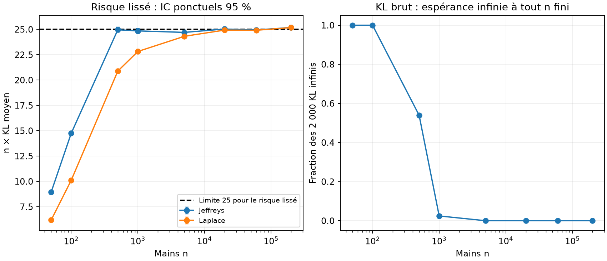

# Rapport scientifique — audit v2 du Blackjack hybride

Alessandro Daouk et Wassim Ghnaya. Audit et campagnes v2 réalisés le 30 octobre 2026,
avec l'assistance d'outils d'IA.
Ce rapport décrit les nouvelles mesures et leur portée ; les fondements mathématiques
sont démontrés dans [modele1.pdf](modele1.pdf) et [modele2.pdf](modele2.pdf).

Chaque conclusion porte l'une des quatre étiquettes suivantes :
**[démontré]** sous les hypothèses énoncées, **[observé]** sur les graines et budgets
indiqués, **[plausible]** mais non testé, **[non démontré]** ou infirmé dans ce cadre.

## 1. Question et réponse courte

**Question.** Dans quelles conditions une estimation probabiliste préalable de la valeur
de l'action terminale STAND améliore-t-elle l'efficacité d'un Q-learning tabulaire, et
cet avantage persiste-t-il lorsque l'on compte le coût d'obtention de l'estimation ?

**Réponse.**

1. À 20 000 mains supervisées et 100 000 épisodes, l'hybride logistique dépasse le
   Q-learning standard réglé de **+0,00214 récompense par partie**, IC 95 %
   [+0,00188 ; +0,00240], sur 28 jeux supervisés indépendants **[observé]**. La borne
   inférieure dépasse la différence pratique minimale de 0,001 fixée avant les mesures.
2. L'avantage dépend du budget. Il est très grand aux petits budgets RL (+0,05 à 1 000
   épisodes), décroît avec le nombre d'épisodes, et **s'inverse** lorsque le modèle du
   croupier est estimé sur 1 000 mains seulement : à 200 000 épisodes, l'hybride perd
   0,0020 [0,0006 ; 0,0033] par partie **[observé]**. L'erreur asymptotique du modèle
   (regret limite de 0,0027 à 0,0030 selon l'estimateur) dépasse alors l'erreur d'apprentissage du standard.
3. Mesuré en secondes réelles et en cartes distribuées, coût d'acquisition inclus,
   l'avantage persiste avec 20 000 mains pour des budgets de 2 à 20 s, et sur une partie
   de cette plage avec 5 000 ou 60 000 mains **[observé]** ; il disparaît ou s'inverse
   si l'acquisition consomme presque tout le budget
   (60 000 mains pour 1 s) ou si le modèle est trop imprécis (1 000 mains, 10–20 s).
   Ces secondes sont propres à une machine et à une implémentation.
4. La régression logistique et les fréquences sont **équivalentes à ±0,001** sur le gain
   final (TOST, p < 10⁻¹⁷ sur 9 grappes ; 17 paires sur 18 identiques) **[observé]**.
   La logistique coûte en revanche environ trois fois plus de temps d'acquisition à
   20 000 ou 60 000 mains (dix fois plus à 1 000), à cause de la sélection de C. Ce résultat négatif sur la valeur propre du classifieur est
   conforme à la théorie du modèle saturé **[démontré]**.
5. Avec des cartes équiprobables (variante E6), l'avantage subsiste aux petits budgets
   mais n'est plus établi à 100 000 épisodes (+0,00032 [−0,00012 ; +0,00076]) : son
   amplitude dépend de l'environnement **[observé]**.
6. Les mécanismes théoriques de réduction de variance et de biais ne sont **pas
   démontrés** comme garanties générales ; seule la stabilité des décisions sous une
   erreur bornée de STAND l'est (bornes 2η et locale).

## 2. Cadre

Environnement `Blackjack-v1` de Gymnasium 1.4.0, `natural=False`, `sab=False`, cartes
avec remise (1 à 9 : 1/13 chacune ; 10 : 4/13), croupier s'arrêtant sur tout 17.
États `(total, carte visible, as utilisable)` : 280 états de décision atteignables,
au plus 20 décisions par partie, graphe acyclique, γ = 1. Gain optimal exact
J* = −0,046556 : la meilleure politique perd en moyenne.

Méthodes comparées, toutes évaluées par leur gain exact J, calculé par un oracle
indépendant de l'apprentissage :

| Bras | STAND | Q-learning | ε_min | ω |
|---|---|---|---:|---:|
| Logistique | régression multinomiale, C choisi sur validation | HIT seul | 1 | 1 |
| Fréquences | proportions empiriques sur les mêmes mains | HIT seul | 1 | 1 |
| Jeffreys | fréquences lissées, α = 1/2 | HIT seul | 1 | 1 |
| STAND exacte | loi vraie du croupier (**oracle privilégié**) | HIT seul | 1 | 1 |
| Standard réglé | apprise | HIT et STAND | 0,4 | 1 |
| Standard commun | apprise | HIT et STAND | 1 | 1 |

Les hyperparamètres « réglés » sont ceux de la campagne historique (`src/tune.py`,
graines 100 à 102, réglage de l'hybride fait avec STAND exacte). Ils n'ont pas été
modifiés. Le bras « standard commun » contrôle l'effet d'une exploration différente.

## 3. Rappel théorique et corrections

Les démonstrations sont dans les PDF ; seules leurs conclusions sont reprises ici.

- **[démontré]** La régression one-hot est saturée : sans pénalité elle reproduit les
  fréquences ; avec la pénalité de scikit-learn 1.9.1 (‖W‖²/(2Cn), biais non pénalisé),
  l'écart aux fréquences vaut −W/(C·N_d) et est d'ordre 1/N_d.
- **[démontré]** L'espérance du KL des fréquences brutes est **infinie** à toute taille
  finie, car une case vide a une probabilité positive. L'ancienne loi « 25/n » décrit
  la moyenne du terme quadratique et l'espérance exacte des estimateurs lissés
  (Jeffreys, Laplace), pas celle des fréquences brutes.
- **[démontré]** Erreur de STAND : |V̂ − V| ≤ 2 TV ≤ √(2 KL) par carte visible ; l'erreur
  sur Q*_HIT est au plus η = ‖V̂ − V‖∞ ; le regret de la politique limite est au plus
  2η (et non 36η) ; une borne locale pondérée par l'occupation est souvent bien plus fine.
- **[démontré]** Sous visitation infinie, pas 1/N^ω (½ < ω ≤ 1) et bruit borné,
  l'hybride converge vers l'optimum **du modèle estimé**, pas vers l'optimum vrai.
- **[plausible]** Fixer STAND supprime le bruit de cette cible et une partie du biais
  de maximisation ; cela ne garantit ni une variance plus faible de toutes les cibles,
  ni un facteur fixe de complexité d'échantillonnage.

## 4. Protocole

Le protocole v2 ([protocole_v2.md](protocole_v2.md)) a été écrit avant les mesures ;
l'addendum ([protocole_v2_addendum.md](protocole_v2_addendum.md)) fixe la taille de
l'échantillon à partir d'un pilote exécuté sur des graines de validation ; les
déviations sont listées dans [protocole_v2_deviations.md](protocole_v2_deviations.md).
Les résultats historiques étaient connus : ce n'est pas une préinscription externe.

- **Unité de réplication** : un jeu supervisé indépendant (graine 41000 + 10i), avec
  ses propres validation et test. Deux graines RL par jeu (51000 + 10i + j). Les
  différences appariées entre méthodes sont moyennées sur les deux graines RL d'un jeu,
  puis les 28 (ou 9) moyennes de jeux forment l'échantillon. Les tailles 1 000 à 60 000
  sont des préfixes d'un même jeu : elles ne sont pas indépendantes entre elles.
- **Critère principal** : J(logistique) − J(standard réglé) à 20 000 mains et
  100 000 épisodes, 28 jeux ; différence pratique minimale 0,001 ; précision visée ±0,0005.
- **Secondaire** (9 premiers jeux, désignés avant les mesures) : quatre tailles, douze
  budgets de 0 à 200 000 épisodes, ablations, temps d'atteinte de seuils de regret.
- **Statistiques** : IC de Student sur les grappes, bootstrap des grappes (10 000
  tirages), médiane, étendue et retrait d'une grappe ; TOST à ±0,001 pour toute
  conclusion d'équivalence. Les contrastes secondaires ne sont pas corrigés pour la
  multiplicité et sont donnés à titre descriptif.
- **Coûts** : temps muraux mesurés séquentiellement, un thread numérique, ordre des
  méthodes mélangé, chauffe préalable ; cartes réellement distribuées ; évaluations
  exactes chronométrées à part et exclues du temps RL.

Les données de test supervisé ne servent qu'à documenter la qualité des estimateurs ;
aucun résultat v2 n'a servi à choisir un modèle ou un hyperparamètre.

## 5. Résultats

Toutes les valeurs ci-dessous sont régénérées par `src.audit.analyze` à partir de
`results/v2/final/` et se trouvent dans [results/v2/analysis/](../results/v2/analysis/).

### 5.1 Réplication historique et contrôles de l'oracle (E1)

La réplication relance, depuis les modules historiques inchangés, les 160 entraînements
de la comparaison CONFIG/TUNED, les 80 entraînements de l'ablation des estimateurs et
l'entraînement du modèle 1 livré ([results/v2/replication/](../results/v2/replication/)).
**[observé]** Les 240 gains exacts finaux et les 12 000 points des courbes historiques sont
reproduits avec un écart maximal de 0,0 (tolérance prévue 10⁻⁹) ; les probabilités du
modèle 1 réentraîné sont identiques à celles du modèle livré (écart 0,0, tolérance 10⁻⁷).
Les chiffres historiques sont donc reproduits à l'identique : écart moyen à l'optimum
après 100 000 épisodes de 0,002904 pour le standard TUNED, 0,000791 pour l'hybride
supervisé et 0,000815 pour l'hybride à STAND exacte ; différence logistique moins
fréquences dans l'ablation +0,0000158 [−0,0000197 ; +0,0000513]. La réplication
historique a pris 9,7 minutes avec six processus. Le réglage historique (108
entraînements) et le notebook de Wassim Ghnaya n'ont pas été réexécutés.

Cette réplication établit le déterminisme du code, pas la validité des conclusions :
toutes ces campagnes utilisent un unique prédicteur et des graines connues. Le
contraste principal v2 (§5.2) en est la réplication indépendante.

Contrôles Monte-Carlo de l'oracle indépendant (100 000 parties par politique, graines
35000 à 35004) :

| Politique | J exact | Moyenne Monte-Carlo | IC 95 % | z |
|---|---:|---:|---:|---:|
| Toujours STAND | −0,18637 | −0,18672 | [−0,19264 ; −0,18080] | −0,12 |
| Toujours HIT | −1 | −1 | — | — |
| Aléatoire ½ | −0,39590 | −0,39149 | [−0,39704 ; −0,38594] | +1,56 |
| HIT si total < 17 | −0,07929 | −0,08370 | [−0,08954 ; −0,07786] | −1,48 |
| Optimale | −0,04656 | −0,04733 | [−0,05322 ; −0,04144] | −0,26 |

Les cinq écarts restent dans ±2 erreurs-types **[observé]**. L'oracle indépendant
reproduit J* et les gains de politiques aléatoires de l'oracle historique à 10⁻¹⁴ près,
et coïncide avec Gymnasium sur toutes les transitions HIT atteignables (tests).
Même avec 100 000 parties, l'intervalle Monte-Carlo de la politique optimale (largeur
0,012) est plus de cinq fois plus large que l'écart moyen entre l'hybride et le standard :
c'est la raison de l'évaluation exacte.

### 5.2 Critère principal

| Mesure, 20 000 mains, 100 000 épisodes | Valeur |
|---|---:|
| J(logistique) − J(standard réglé), moyenne sur 28 jeux | **+0,0021367** |
| IC 95 % Student | [+0,0018777 ; +0,0023957] |
| IC 95 % bootstrap des grappes | [+0,0019019 ; +0,0023870] |
| Médiane, étendue des 28 différences | +0,0020079 ; [+0,0007825 ; +0,0036396] |
| Moyenne après retrait d'une grappe | [+0,0020811 ; +0,0021869] |
| Demi-largeur réalisée / visée | 0,000259 / 0,0005 |
| Paires RL où l'hybride est meilleur | 56 / 56 |

Le gain moyen absolu vaut −0,047386 [−0,047490 ; −0,047282] pour l'hybride logistique
et −0,049523 [−0,049814 ; −0,049232] pour le standard réglé. Le pilote prévoyait une
dispersion plus grande que celle observée ; l'intervalle est donc plus étroit que visé.
Ce résultat réplique, sur des données supervisées indépendantes et un prédicteur
réentraîné à chaque grappe, la conclusion historique obtenue avec un prédicteur unique.

### 5.3 Efficacité en épisodes RL (E2)

Regret moyen J* − J sur les 9 grappes secondaires, 20 000 mains pour les hybrides :

| Épisodes | 1 000 | 5 000 | 10 000 | 20 000 | 40 000 | 100 000 | 200 000 |
|---|---:|---:|---:|---:|---:|---:|---:|
| STAND exacte (oracle) | 0,0367 | 0,0135 | 0,0064 | 0,0027 | 0,0012 | 0,0008 | 0,0003 |
| Logistique | 0,0365 | 0,0135 | 0,0065 | 0,0038 | 0,0016 | 0,0008 | 0,0006 |
| Fréquences | 0,0365 | 0,0134 | 0,0065 | 0,0036 | 0,0016 | 0,0008 | 0,0005 |
| Standard réglé (ε 0,4) | 0,0861 | 0,0343 | 0,0219 | 0,0123 | 0,0073 | 0,0030 | 0,0014 |
| Standard commun (ε 1) | 0,0827 | 0,0345 | 0,0235 | 0,0125 | 0,0070 | 0,0028 | 0,0014 |

Temps d'atteinte, premier point de la grille sous le seuil ; les échecs sont censurés
à 200 000 épisodes et ne sont pas comptés comme des réussites :

| Seuil de regret | Logistique 20 000 mains : réussites, médiane | Standard réglé : réussites, médiane parmi réussites |
|---|---|---|
| 0,01 | 18/18, 10 000 | 18/18, 40 000 |
| 0,005 | 18/18, 20 000 | 18/18, 60 000 |
| 0,002 | 18/18, 40 000 | 13/18, 200 000 |
| 0,001 | 17/18, 100 000 | 7/18, 200 000 |

**[observé]** Pour atteindre un regret de 0,002, l'hybride a besoin d'environ
40 000 épisodes et le standard d'au moins 200 000 dans 13 runs sur 18, et de plus de
200 000 dans les cinq autres. Le rapport des budgets dépend du seuil et de la taille
supervisée ; il ne constitue pas un facteur universel de vitesse. La grille est
grossière (100 000 puis 200 000) et le regret n'est pas monotone : un run de
l'hybride franchit 0,001 puis repasse au-dessus au dernier point.

### 5.4 Surface budget supervisé × budget RL (E4)

Différence J(hybride) − J(standard réglé), 9 grappes, IC 95 % entre crochets :

| Mains | 1 000 épisodes | 20 000 | 100 000 | 200 000 |
|---:|---:|---:|---:|---:|
| 1 000, logistique | +0,0492 | +0,0064 [+0,0043 ; +0,0085] | −0,0010 [−0,0024 ; +0,0005] | **−0,0020 [−0,0033 ; −0,0006]** |
| 1 000, fréquences | +0,0493 | +0,0073 | −0,0006 [−0,0021 ; +0,0009] | **−0,0020 [−0,0035 ; −0,0005]** |
| 5 000, logistique | +0,0487 | +0,0085 | +0,0017 [+0,0009 ; +0,0025] | +0,0004 [−0,0000 ; +0,0009] |
| 20 000, logistique | +0,0497 | +0,0085 | +0,0022 [+0,0017 ; +0,0027] | +0,0008 [+0,0004 ; +0,0013] |
| 60 000, logistique | +0,0496 | +0,0093 | +0,0022 [+0,0017 ; +0,0026] | +0,0011 [+0,0007 ; +0,0015] |

**[observé]** L'hybride gagne largement tant que le budget RL est petit, quelle que soit
la taille supervisée testée. Avec 1 000 mains, il perd dès que le standard dispose
d'assez d'épisodes ; avec 5 000 mains, l'avantage à 200 000 épisodes n'est plus établi.
Le mécanisme est cohérent avec la théorie : le regret limite de la politique du modèle
estimé vaut en moyenne 0,0030 (1 000 mains), 0,0007 (5 000), 0,00013 (20 000) et
0,000012 (60 000). L'hybride ne peut pas descendre durablement sous ce plancher, alors
que le standard converge vers l'optimum vrai.

### 5.5 Coût de bout en bout (E3)

Coûts mesurés (moyennes sur les jeux, en secondes sur un Intel i7-1255U, un thread) :

| Poste | 1 000 mains | 5 000 | 20 000 | 60 000 |
|---|---:|---:|---:|---:|
| Simulation des mains d'entraînement | 0,015 | 0,076 | 0,307 | 0,919 |
| Sélection de C (5 ajustements + scores) | 0,058 | 0,165 | 0,634 | 2,018 |
| Ajustement retenu seul | 0,009 | 0,032 | 0,128 | 0,414 |
| Fréquences | 0,0001 | 0,0001 | 0,0003 | 0,0009 |
| Acquisition logistique complète (avec validation) | 0,165 | 0,332 | 1,031 | 3,028 |
| Production logistique, C déjà fixé | 0,025 | 0,109 | 0,435 | 1,333 |
| Acquisition fréquences | 0,016 | 0,077 | 0,307 | 0,920 |
| Cartes d'entraînement | 2 901 | 14 522 | 58 120 | 174 279 |

Construction de la table STAND : environ 0,1 ms ; chargement d'une table archivée :
0,25 ms. Un épisode RL coûte 0,048 ms (4,88 s pour 100 000 épisodes, écart-type
0,12 s entre runs) et distribue 5,33 cartes ; une main de croupier coûte 0,015 ms et
2,90 cartes. **Une main de croupier n'est donc équivalente à une partie ni en temps
(≈ 0,32 partie) ni en cartes (≈ 0,55 partie)** : l'ancien décompte « 60 000 mains =
60 000 parties » pénalisait l'hybride au-delà de son coût réel dans cette implémentation.
L'évaluation exacte d'une politique, hors du coût d'apprentissage, prend environ 0,3 ms.

Contrastes au même coût total (dernier point de la grille dont le coût mesuré respecte
le budget ; acquisition incluse pour l'hybride ; pas d'interpolation) :

| Budget | 1 000 mains, logistique | 20 000 mains, logistique | 20 000 mains, fréquences | 60 000 mains, fréquences |
|---|---:|---:|---:|---:|
| 0,5 s | +0,0081 [+0,0036 ; +0,0127] | inaccessible | −0,0010 [−0,0075 ; +0,0055] | inaccessible |
| 1 s | +0,0051 [+0,0011 ; +0,0091] | inaccessible | +0,0076 [+0,0039 ; +0,0113] | **−0,0260 [−0,0407 ; −0,0113]** |
| 2 s | +0,0021 [+0,0004 ; +0,0038] | +0,0024 [+0,0006 ; +0,0043] | +0,0043 [+0,0029 ; +0,0057] | +0,0049 [+0,0035 ; +0,0064] |
| 5 s | −0,0001 [−0,0017 ; +0,0014] | +0,0028 [+0,0020 ; +0,0035] | +0,0028 [+0,0021 ; +0,0034] | +0,0029 [+0,0023 ; +0,0036] |
| 10 s | **−0,0018 [−0,0031 ; −0,0005]** | +0,0009 [+0,0003 ; +0,0016] | +0,0012 [+0,0005 ; +0,0019] | +0,0010 [+0,0003 ; +0,0016] |
| 20 s | **−0,0020 [−0,0033 ; −0,0006]** | +0,0008 [+0,0004 ; +0,0013] | +0,0009 [+0,0005 ; +0,0012] | +0,0011 [+0,0007 ; +0,0015] |

« Inaccessible » signifie que l'acquisition seule dépasse le budget pour au moins une
paire. Au-delà d'environ 10 s, la grille des deux bras s'arrête à 200 000 épisodes :
le budget n'est plus entièrement utilisé et le contraste devient celui à épisodes égaux.

En cartes distribuées, la logistique à 20 000 mains (avec les 17 400 cartes de
validation nécessaires au choix de C) ne bat pas le standard à 100 000 cartes
(−0,0032 [−0,0077 ; +0,0012]), alors que les fréquences le battent
(+0,0085 [+0,0051 ; +0,0119]) ; à partir de 250 000 cartes, les deux hybrides gagnent.

**Conventions de coût.** (a) *Production*, C déjà fixé : simulation + ajustement retenu
+ table + RL. (b) *Acquisition avec sélection* : (a) + validation + tous les ajustements
candidats ; c'est la convention des figures. (c) *Validation scientifique* : (b) + test
supervisé (0,18 s et 34 900 cartes à 12 000 mains) + métriques ; ce coût documente la
qualité et n'est pas requis pour produire un agent. (d) *Réutilisation* d'une table déjà
apprise : 0,25 ms de chargement, l'acquisition étant amortie sur M agents. Le réglage
historique des hyperparamètres RL (108 entraînements de 100 000 épisodes, soit environ
8,8 minutes au rythme mesuré ici) n'est imputé à aucune méthode ; il a été fait avec
STAND exacte pour l'hybride. Mémoire : pic RSS du processus 184 Mio, imports et
ajustements compris ; tables Q, compteurs et visites : 23 Kio. Aucune mesure d'énergie
fiable n'était disponible ; aucune n'est rapportée.

**[observé]** Le compromis qualité–coût dépend de la ressource rare et du budget ;
la conclusion est propre à cette implémentation, où le simulateur du croupier est une
boucle Python et l'environnement RL passe par les enveloppes de Gymnasium.

### 5.6 Ablations mécanistiques (E5)

Contrastes à 20 000 mains et 100 000 épisodes, 9 grappes (logistique moins référence) :

| Référence | Différence et IC 95 % | IC 90 % | p TOST (±0,001) | Paires + / = / − |
|---|---:|---:|---:|---:|
| Fréquences | −0,0000034 [−0,0000111 ; +0,0000044] | [−0,0000096 ; +0,0000029] | < 10⁻¹⁷ | 0 / 17 / 1 |
| Jeffreys | identique aux fréquences | | < 10⁻¹⁷ | 0 / 17 / 1 |
| STAND exacte | −0,0000396 [−0,0002922 ; +0,0002130] | [−0,0002433 ; +0,0001641] | 1,1·10⁻⁵ | 7 / 5 / 6 |
| Standard commun (ε 1) | +0,0020450 [+0,0015512 ; +0,0025387] | | | 18 / 0 / 0 |
| Hybride ε_min 0,05 | +0,0012757 [+0,0005438 ; +0,0020076] | | | 18 / 0 / 0 |
| Hybride ω 0,8 | +0,0009273 [+0,0002019 ; +0,0016526] | | | 14 / 0 / 4 |
| STAND bruitée ρ = 0,05 | +0,0030734 [+0,0024683 ; +0,0036785] | | | 18 / 0 / 0 |
| STAND bruitée ρ = 0,20 | +0,0297556 [+0,0286987 ; +0,0308124] | | | 18 / 0 / 0 |

- **Estimateur [observé].** Logistique, fréquences et Jeffreys donnent des politiques
  presque toujours identiques ; l'équivalence à ±0,001 est établie par TOST. À
  100 000 épisodes, l'hybride logistique n'est pas non plus distinguable de l'hybride
  à STAND exacte (équivalence à ±0,001). À 200 000 épisodes, le regret moyen de l'oracle
  est plus faible (0,0003 contre 0,0006) ; ce contraste n'a pas été testé.
- **Échantillonnage direct [démontré et vérifié].** Estimer STAND par la moyenne directe
  des gains R(p, D_i) sur les mêmes mains est algébriquement identique aux fréquences :
  écart maximal mesuré 2,2·10⁻¹⁶. Ce n'est pas une méthode supplémentaire.
- **Erreur de modèle → politique [observé, lien causal par intervention].** Mélanger
  la vraie loi avec une masse ρ sur BUST, à données RL identiques, augmente le regret
  limite de 0 à 0,0034 (ρ = 0,05) et 0,0317 (ρ = 0,20) et le regret final de 0,0037 et
  0,0307. L'hybride n'est utile que si l'erreur de STAND est petite devant les marges
  de décision.
- **Exploration [observé].** ε_min = 1 rend la politique de comportement uniforme et
  indépendante de Q ; c'est possible parce que la cible du Q-learning est hors
  politique. Conséquence expérimentale importante : **tous les bras à ε_min = 1 qui
  partagent une graine voient exactement les mêmes parties** (mêmes cartes, mêmes
  décisions), ce qui rend les contrastes entre estimateurs de STAND parfaitement
  appariés. Avec ε_min = 0,05, l'hybride visite moins les états rares (minimum 12
  visites HIT par état en moyenne contre 33) et perd 0,0013 par partie. Le standard commun (ε 1)
  et le standard réglé (ε 0,4) ont des regrets voisins à 100 000 épisodes (0,0028 et
  0,0030 ; écart des contrastes appariés 0,00014, non testé) : la comparaison historique n'est donc pas due à un réglage plus
  favorable de l'exploration de l'hybride.
- **Pas d'apprentissage [observé].** ω = 0,8 dégrade l'hybride (−0,0009), comme le
  réglage historique l'indiquait ; aucune valeur n'a été choisie sur ces résultats.
- **Bornes [observé].** À 20 000 mains, η ≈ 0,053, donc la borne globale 2η ≈ 0,105 est
  inutilisable ; la borne locale pondérée par l'occupation vaut 0,0012 pour un regret
  limite réel de 0,00013 : environ 90 fois plus fine que 2η mais encore 9 fois trop large.
  La borne pour un agent fini (2η + δ·E[T]) vaut 0,29 en moyenne pour un regret réel de
  0,0006 : elle est vraie mais non informative, car l'erreur maximale sur Q_HIT (≈ 0,12)
  se situe dans des états rarement visités. L'identité regret = occupation × désavantage
  est vérifiée à 1,7·10⁻¹⁷ près sur les 418 agents.
- **États sensibles [observé].** Pour le prédicteur livré, la politique limite ne
  diffère de l'optimum que dans l'état (12, 4, sans as), visité avec probabilité 0,0088
  par partie ; cinq états seulement sont ambigus selon la borne locale, contre 24 selon
  la borne globale. Un état sur 280 n'a pas le poids d'une décision réellement rencontrée.

### 5.7 Statistiques des probabilités catégorielles

Simulations multinomiales directes de la loi jointe (2 000 répétitions par taille,
instrument mathématique utilisant la loi exacte, sans entraînement d'agent) :

| n mains | KL brut infini | n × KL Jeffreys, IC 95 % | n × KL Laplace |
|---:|---:|---:|---:|
| 50 | 2 000 / 2 000 | 8,95 [8,85 ; 9,05] | 6,19 |
| 500 | 1 079 / 2 000 | 24,96 [24,72 ; 25,21] | 20,88 |
| 1 000 | 49 / 2 000 | 24,85 [24,62 ; 25,09] | 22,82 |
| 5 000 | 0 / 2 000 | 24,71 [24,48 ; 24,93] | 24,32 |
| 60 000 | 0 / 2 000 | 24,95 [24,73 ; 25,16] | 24,92 |
| 200 000 | 0 / 2 000 | 25,19 [24,97 ; 25,41] | 25,18 |

**[démontré et observé]** Le risque lissé tend vers 25/n ; aux petites tailles il est
nettement inférieur (le lissage contracte vers l'uniforme). Pour les fréquences brutes,
aucune moyenne finie n'est rapportée : l'absence de zéro observé à n ≥ 5 000 ne rend pas
l'espérance finie. La statistique de Pearson à 1 000 tirages pour la carte 6 a pour
moyenne 4,98 et variance 10,80 (limites χ²₅ : 5 et 10) : le terme principal du
développement est bien aléatoire, pas une constante.

Le prédicteur livré a pour objectif scikit-learn vérifié dans le source installé ;
le résidu de la relation stationnaire est 1,5·10⁻⁷ et le gradient normalisé du biais
7,9·10⁻⁹. Sur les 55 sélections de C, la valeur 0,1 est retenue 28 fois. Parmi les
candidats C ≥ 0,1, les log-loss de validation diffèrent d'au plus 4·10⁻⁴ nat à 20 000
mains et 8·10⁻⁵ nat à 60 000 : le choix de C est instable mais sans conséquence
mesurable sur le gain. Seul C = 0,01 est nettement moins bon aux petites tailles.

### 5.8 Robustesse : cartes uniformes (E6)

Variante contrôlée du MDP : les dix valeurs de cartes deviennent équiprobables (1/10
au lieu de 4/13 pour le 10), avec les mêmes règles, états et gains. L'oracle est
recalculé pour cette loi (J* = −0,031375) et contrôlé par 100 000 parties
Monte-Carlo : −0,0271 [−0,0329 ; −0,0213], intervalle qui contient J*. Neuf jeux de
20 000 mains (graines 71000 + 10i), deux graines RL par jeu (81000 + 10i + j). Les
hyperparamètres sont ceux de Blackjack-v1, sans nouveau réglage ; la logistique n'est
pas incluse, les fréquences et Jeffreys suffisant à tester l'hypothèse.

**[observé]** Au contraste prévu (100 000 épisodes), l'hybride à fréquences n'est pas
nettement meilleur que le standard : +0,00032 [−0,00012 ; +0,00076], et le TOST conclut
même à l'équivalence à ±0,001 (p = 0,004). Les deux estimateurs donnent des gains
identiques. La description par budget, ajoutée après lecture de ce résultat (déviation
D3), montre le même profil qu'avec les cartes de Blackjack-v1 mais une convergence plus
rapide du standard :

| Épisodes | 1 000 | 5 000 | 20 000 | 60 000 | 100 000 | 200 000 |
|---|---:|---:|---:|---:|---:|---:|
| Regret, hybride fréquences | 0,0524 | 0,0073 | 0,0028 | 0,0007 | 0,0006 | 0,0003 |
| Regret, standard réglé | 0,1536 | 0,0370 | 0,0056 | 0,0014 | 0,0009 | 0,0005 |
| Différence (IC 95 %, non simultané) | +0,101 [+0,083 ; +0,119] | +0,030 [+0,020 ; +0,039] | +0,0027 [+0,0006 ; +0,0048] | +0,0007 [−0,0000 ; +0,0015] | +0,0003 [−0,0001 ; +0,0008] | +0,0002 [+0,0001 ; +0,0004] |

L'avantage aux petits budgets est donc robuste à ce changement de loi ; son amplitude
au budget de 100 000 épisodes ne l'est pas, ce qui interdit de présenter l'écart mesuré
sur Blackjack-v1 comme une constante de la méthode. Pourquoi le standard converge plus
vite ici n'a pas été étudié **[non démontré]**. Le regret de l'hybride n'est pas
monotone au tout début (0,044 avant apprentissage, 0,081 à 500 épisodes) : les premières
cibles de HIT modifient des décisions initialement correctes. Cette variante reste une
robustesse locale dans la même famille de jeux, pas une validation de généralisation.

## 6. Discussion

**Réponse à la question centrale.** Une estimation préalable de STAND améliore
nettement l'efficacité en épisodes RL lorsque (i) l'erreur de l'estimation est petite
devant les marges de décision des états fréquemment visités, et (ii) le budget RL est
trop court pour que le standard ait déjà convergé. L'avantage persiste après prise en
compte du coût d'acquisition si les mains de croupier sont bon marché par rapport aux
parties, ce qui est le cas ici en temps comme en cartes. Il disparaît quand l'erreur du
modèle impose un plancher de regret supérieur à l'erreur résiduelle du standard
(1 000 mains et budgets longs), ou quand l'acquisition consomme le budget.

**Ce qui est une contribution et ce qui ne l'est pas.** Combiner un estimateur
supervisé et un Q-learning n'est pas une innovation algorithmique : l'idée relève de
l'utilisation de connaissances partielles du modèle, des après-états et de la
planification avec modèle (voir [etat_de_l_art.md](etat_de_l_art.md)). La logistique
n'apporte rien sur les fréquences dans ce problème à une variable. L'apport défendable
est une étude de cas contrôlée : bornes de regret adaptées à une seule récompense
terminale perturbée, oracle exact indépendant, plan imbriqué propageant la variabilité
des données supervisées, coûts mesurés en unités explicites, régions de perte de
l'hybride identifiées, et résultats négatifs conservés.

## 7. Menaces à la validité

- **Validité externe.** Un seul MDP à deux actions, paquet infini, une action
  terminale dont la loi ne dépend que d'une variable. La variante uniforme modifie la
  loi des cartes mais conserve la structure ; elle ne valide aucune généralisation.
  Dans un paquet fini, la carte visible ne suffit plus et un modèle à plusieurs
  variables serait nécessaire.
- **Hyperparamètres.** Les réglages historiques ont été obtenus sur trois graines,
  avec STAND exacte pour l'hybride ; ils pourraient ne pas être optimaux aux autres
  tailles. Aucun nouveau réglage n'a été fait pour éviter toute sélection sur le test.
- **Temps mesurés.** Ordinateur portable non isolé, une seule session, une seule
  implémentation ; les ratios temps main/partie dépendent du code (boucle Python contre
  enveloppes Gymnasium). Les cartes sont une unité plus stable mais ne mesurent pas le
  coût de calcul de l'apprentissage.
- **Grille de budgets.** Les temps d'atteinte sont limités par la résolution de la grille
  (100 000 puis 200 000 épisodes) et censurés à 200 000.
- **Précision secondaire.** Les analyses secondaires reposent sur 9 grappes ; leurs
  intervalles ne sont pas simultanés. Les tailles supervisées sont des préfixes d'un
  même jeu et ne constituent pas des répétitions indépendantes entre elles.
- **Pilote et protocole.** Les résultats historiques étaient connus en écrivant le
  protocole ; le test final v2 n'a toutefois servi à aucun choix.

## 8. Conclusion

L'hybride est une manière efficace, dans ce Blackjack, d'utiliser une connaissance
partielle du modèle : il réduit fortement le nombre d'épisodes RL nécessaires, et ce
gain survit au coût réel d'acquisition lorsque l'estimation est assez précise. Il n'est
ni universellement meilleur ni indépendant de la qualité du modèle : avec trop peu de
données supervisées, il converge vers une politique sous-optimale que le Q-learning
standard finit par dépasser. Le classifieur logistique n'est pas nécessaire ; une table
de fréquences fournit la même information pour un coût moindre.
