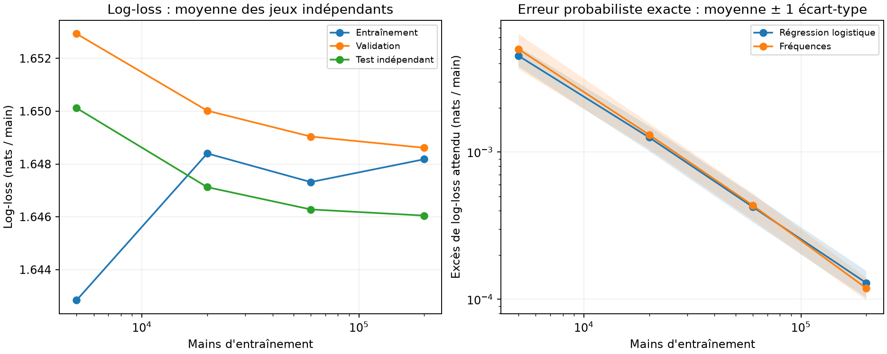

# Taille des données et généralisation

> Rapport généré par la version historique du projet ; ses mesures sont inchangées. Certaines interprétations ont été corrigées depuis : en cas de désaccord, le [README](../../../README.md) et le [rapport scientifique](../../../docs/rapport_scientifique.md) font foi.

C choisi sur validation ; test indépendant et référence analytique consultés après sélection.
Les tailles partagent des préfixes d'un même jeu dans chaque répétition ; les répétitions sont indépendantes.
Les modèles livrés ne sont pas remplacés par cette étude de sensibilité.

| Méthode | Mains train | Log-loss train | Log-loss test | Excès exact moyen | Écart-type de l'excès |
|---|---:|---:|---:|---:|---:|
| logistic | 5000 | 1.642841 | 1.650119 | 0.00450719 | 0.00069739 |
| logistic | 20000 | 1.648400 | 1.647124 | 0.00125679 | 0.00024259 |
| logistic | 60000 | 1.647317 | 1.646280 | 0.00042387 | 0.00009005 |
| logistic | 200000 | 1.648181 | 1.646047 | 0.00012910 | 0.00002693 |
| frequencies | 5000 | 1.642075 | 1.650613 | 0.00500741 | 0.00135564 |
| frequencies | 20000 | 1.648361 | 1.647191 | 0.00131003 | 0.00026180 |
| frequencies | 60000 | 1.647313 | 1.646295 | 0.00043444 | 0.00008903 |
| frequencies | 200000 | 1.648169 | 1.646032 | 0.00011893 | 0.00002051 |

## Interprétation et limites

L'excès exact est la divergence KL pondérée par la distribution des cartes visibles.
Il évite le bruit d'un test fini pour mesurer la qualité probabiliste. Les tailles de données
ne sont pas des répétitions indépendantes ; les statistiques sont calculées entre jeux à taille fixée.
Seulement 5 jeux indépendants : les IC de Student sont approximatifs.
La validation a servi à sélectionner C : son score est optimiste. Le test ne sert à aucun réglage.
Les conclusions concernent ce simulateur à paquet infini, pas d'autres règles de blackjack.
Cette étude ne propage pas la variabilité des jeux supervisés à de nouveaux entraînements RL.

`runs.csv` contient les métriques par jeu, `fits.json` les graines, empreintes, choix de C et probabilités.
`summary.json` contient les agrégats et la provenance. Reproduction : `python -m src.supervised.learning_curve`.
