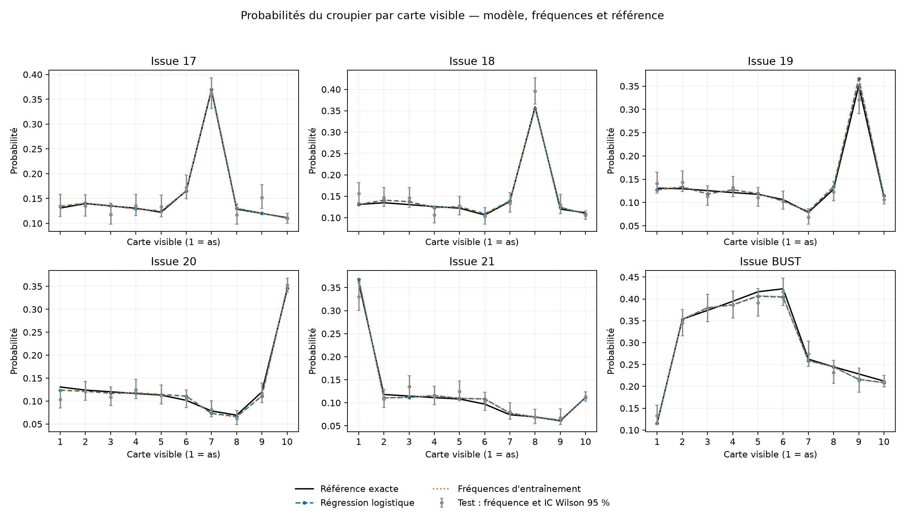
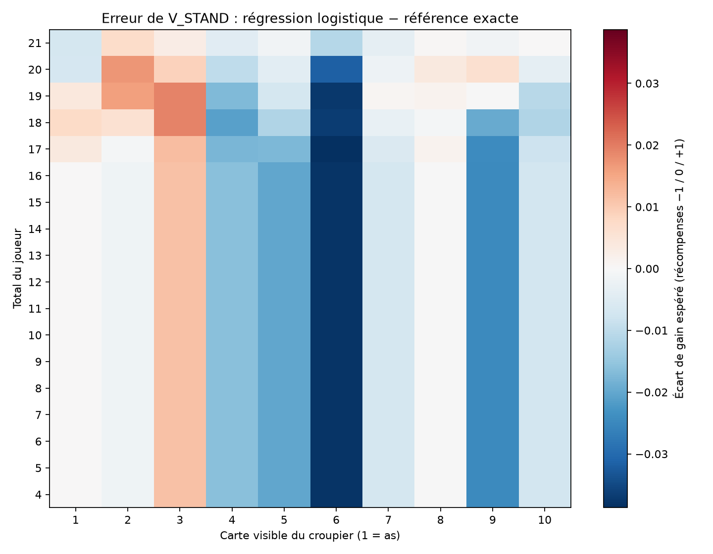

# Première expérience supervisée

Prédicteur du résultat du croupier dans Blackjack-v1, natural=False, sab=False.
Une carte visible en entrée ; six probabilités en sortie. Aucun état caché en entrée.

## Protocole

- train : 60,000 mains, graine 42.
- validation : 12,000 mains, graine 43.
- test : 12,000 mains, graine 123.
- C choisi sur validation : 0.1, parmi 0.01, 0.1, 1, 10 et 100.
- La validation n'est pas réutilisée pour l'apprentissage. Le test ne sert à aucun choix.
- La référence exacte est réservée à l'évaluation, sans génération de labels d'entraînement.

## Résultats

**Régression logistique** : log-loss test 1.651587 ; Brier 0.778452 ; accuracy 36.49%.

**Fréquences d'entraînement** : log-loss test 1.651642 ; Brier 0.778478 ; accuracy 36.49%.

**Référence exacte** : log-loss test 1.651709 ; Brier 0.778430 ; accuracy 36.49%.

Erreur maximale d'une probabilité du modèle face à la référence : 0.019042.
Erreur maximale sur V_STAND : 0.038708 unité de récompense.
Excès de log-loss espérée exact : 0.000429 pour le modèle, 0.000449 pour les fréquences.

L'excès exact est la divergence KL moyenne, pondérée par la vraie distribution des cartes visibles.
Il mesure l'écart au prédicteur idéal sans bruit d'un jeu de test fini.

Différence appariée de log-loss test (modèle − fréquences) : -0.000055.
Intervalle normal approximatif à 95 % : [-0.000125, +0.000014].
L'intervalle contient zéro : ce test ne met pas en évidence d'avantage net de log-loss.
Cet intervalle ne mesure que la variabilité du test pour ces deux modèles fixés.

## Lecture et limites

Le problème n'a que dix valeurs d'entrée. La baseline de fréquences estime directement
les mêmes dix distributions ; une supériorité nette du classificateur n'est pas acquise.
Une faible accuracy est compatible avec des probabilités fiables : l'issue de chaque main est aléatoire.
La référence exacte minimise la log-loss en espérance, mais pas nécessairement sur chaque test fini.

Il s'agit d'un premier entraînement avec une seule graine d'apprentissage. Répéter les
entraînements sur d'autres graines sera nécessaire pour une conclusion générale.
Ces métriques ne démontrent pas un gain de performance de l'agent RL : celui-ci doit
être réentraîné avec cette V_STAND, puis comparé à budgets équivalents sur plusieurs graines.

Le Brier est la somme des six erreurs quadratiques, moyennée sur les mains, sans division par six.
L'erreur moyenne sur STAND utilise un poids uniforme sur les 180 couples total/carte
(totaux 4..21, cartes 1..10), sans prétendre reproduire leur fréquence dans les parties.

## Fichiers

- `metrics.csv` : métriques test et erreurs face à la référence exacte.
- `validation.csv` : choix de C.
- `calibration.csv` : les 60 probabilités, fréquences de test et références.
- `calibration.png` : comparaison par issue, IC de Wilson à 95 % point par point.
- `stand_error.png` : carte des erreurs de gain espéré de STAND.
- `evaluation.json` : résultats, graine de test et empreinte du modèle.

Les paramètres, versions, graines, empreintes des jeux et fréquences d'apprentissage
sont enregistrés dans `models/supervised/metadata.json`.

