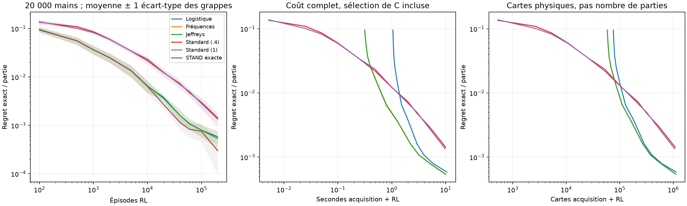
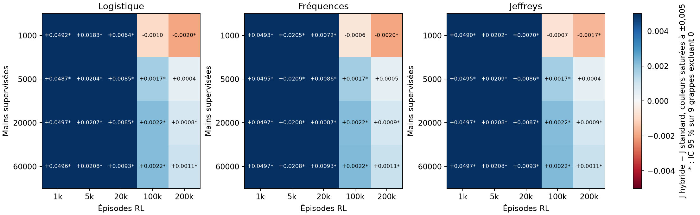
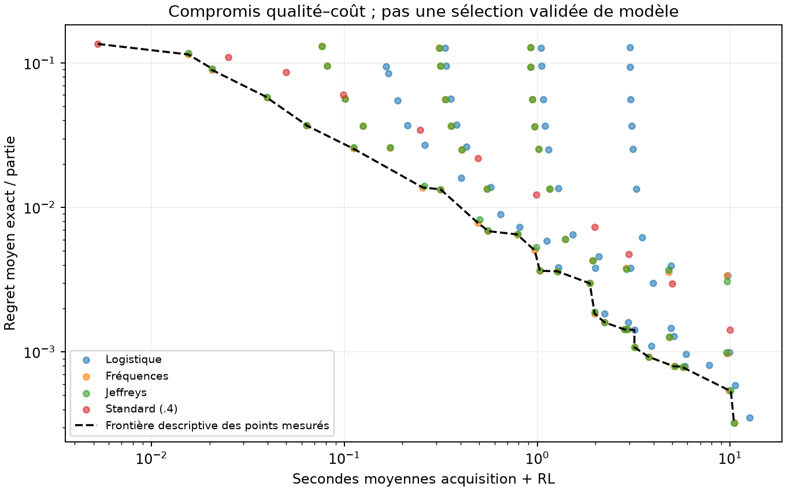

# Mesures v2 — rapport généré depuis les résultats bruts

Les intervalles entre crochets sont des IC de Student approximatifs à 95 % sur les grappes indépendantes.
Les comparaisons secondaires sont descriptives et leurs intervalles ne sont pas simultanés.

## Contraste principal préspécifié

20 000 mains, 100 000 épisodes : J(logistique) − J(standard TUNED) = **+0.0021367 [+0.0018777 ; +0.0023957]**.
28 jeux indépendants, 56 paires RL. Marge d'intérêt pratique : 0,001 par partie.
Demi-largeur réalisée : 0.0002590, objectif pilote : 0,0005.
Bootstrap des grappes : [+0.0019019 ; +0.0023870].
Médiane des différences de grappes : +0.0020079 ; étendue : [+0.0007825 ; +0.0036396].
Moyennes après retrait d'une grappe : [0.00208106542282925, 0.002186883306772086].
Effet standardisé d_z (moyenne / écart-type des grappes) : 3.199.

| Méthode (20 000 mains si estimée) | J moyen et IC 95 % | Grappes |
|---|---:|---:|
| epsilon_low | -0.0486292 [-0.0493038 ; -0.0479545] | 9 |
| exact | -0.0473139 [-0.0475428 ; -0.0470849] | 9 |
| frequencies | -0.0473501 [-0.0475195 ; -0.0471807] | 9 |
| jeffreys | -0.0473501 [-0.0475195 ; -0.0471807] | 9 |
| logistic | -0.0473858 [-0.0474896 ; -0.0472820] | 28 |
| noise_005 | -0.0504269 [-0.0509436 ; -0.0499102] | 9 |
| noise_020 | -0.0771091 [-0.0782229 ; -0.0759952] | 9 |
| omega_08 | -0.0482807 [-0.0489708 ; -0.0475906] | 9 |
| standard | -0.0495225 [-0.0498136 ; -0.0492315] | 28 |
| standard_common | -0.0493984 [-0.0499106 ; -0.0488863] | 9 |

## Contrastes secondaires à 100 000 épisodes

TOST : p du test d’équivalence à la marge ±0,001 fixée avant les mesures ; p < 0,05 équivaut
à un IC à 90 % inclus dans la marge. Un p élevé ne prouve ni différence ni équivalence.

| Logistique moins référence | Différence et IC 95 % | IC 90 % | p TOST | Paires meilleures / égales / moins bonnes |
|---|---:|---:|---:|---:|
| logistic_minus_frequencies | -0.0000034 [-0.0000111 ; +0.0000044] | [-0.0000096 ; +0.0000029] | 9.16e-18 | 0 / 17 / 1 |
| logistic_minus_jeffreys | -0.0000034 [-0.0000111 ; +0.0000044] | [-0.0000096 ; +0.0000029] | 9.16e-18 | 0 / 17 / 1 |
| logistic_minus_exact | -0.0000396 [-0.0002922 ; +0.0002130] | [-0.0002433 ; +0.0001641] | 1.12e-05 | 7 / 5 / 6 |
| logistic_minus_standard | +0.0021835 [+0.0016741 ; +0.0026930] | [+0.0017727 ; +0.0025944] | 1 | 18 / 0 / 0 |
| logistic_minus_standard_common | +0.0020450 [+0.0015512 ; +0.0025387] | [+0.0016468 ; +0.0024431] | 0.999 | 18 / 0 / 0 |
| logistic_minus_epsilon_low | +0.0012757 [+0.0005438 ; +0.0020076] | [+0.0006855 ; +0.0018659] | 0.795 | 18 / 0 / 0 |
| logistic_minus_omega_08 | +0.0009273 [+0.0002019 ; +0.0016526] | [+0.0003423 ; +0.0015122] | 0.411 | 14 / 0 / 4 |
| logistic_minus_noise_005 | +0.0030734 [+0.0024683 ; +0.0036785] | [+0.0025855 ; +0.0035614] | 1 | 18 / 0 / 0 |
| logistic_minus_noise_020 | +0.0297556 [+0.0286987 ; +0.0308124] | [+0.0289034 ; +0.0306078] | 1 | 18 / 0 / 0 |



Les bandes de la première figure sont ±1 écart-type des moyennes de grappes, pas des IC.
Les courbes Fréquences et Jeffreys sont presque confondues ; la première est masquée par la seconde.
Le coût des deux autres panneaux inclut l’acquisition du prédicteur et la sélection de C ;
les évaluations scientifiques sont exclues. Le bras exact est privilégié et omis des coûts.





Les points de la frontière sont des moyennes de configurations préétablies. Les relier ne
prouve pas qu’une configuration interpolée existe, ni que la meilleure a été validée.

## Coûts appariés à 20 000 mains

Dernier checkpoint dont le coût observé respecte le budget, sans interpolation et sans
choisir rétrospectivement le checkpoint de meilleur J. Une grille arrivée à 200 000 épisodes
n’est pas extrapolée : du budget peut rester inutilisé. La sélection des checkpoints dépend
du temps mesuré ; les secondes restent propres à cette machine et à cette session.

| Ressource | Budget | Méthode − standard | Différence et IC 95 % |
|---|---:|---|---:|
| reused_total_seconds | 0.5 | logistic | +0.0181614 [+0.0136472 ; +0.0226757] |
| reused_total_seconds | 0.5 | frequencies | +0.0181436 [+0.0136159 ; +0.0226713] |
| reused_total_seconds | 1 | logistic | +0.0103175 [+0.0067967 ; +0.0138383] |
| reused_total_seconds | 1 | frequencies | +0.0102403 [+0.0066409 ; +0.0138398] |
| reused_total_seconds | 2 | logistic | +0.0066102 [+0.0053027 ; +0.0079176] |
| reused_total_seconds | 2 | frequencies | +0.0064393 [+0.0050040 ; +0.0078746] |
| reused_total_seconds | 5 | logistic | +0.0030506 [+0.0025041 ; +0.0035971] |
| reused_total_seconds | 5 | frequencies | +0.0029999 [+0.0024274 ; +0.0035723] |
| reused_total_seconds | 10 | logistic | +0.0011515 [+0.0003950 ; +0.0019079] |
| reused_total_seconds | 10 | frequencies | +0.0012180 [+0.0005402 ; +0.0018958] |
| total_cards | 100000 | logistic | -0.0032490 [-0.0076724 ; +0.0011743] |
| total_cards | 100000 | frequencies | +0.0085103 [+0.0051313 ; +0.0118892] |
| total_cards | 250000 | logistic | +0.0035417 [+0.0026103 ; +0.0044732] |
| total_cards | 250000 | frequencies | +0.0037212 [+0.0028136 ; +0.0046287] |
| total_cards | 500000 | logistic | +0.0036613 [+0.0030645 ; +0.0042581] |
| total_cards | 500000 | frequencies | +0.0036810 [+0.0030982 ; +0.0042638] |
| total_cards | 1e+06 | logistic | +0.0021835 [+0.0016741 ; +0.0026930] |
| total_cards | 1e+06 | frequencies | +0.0021869 [+0.0016776 ; +0.0026962] |
| total_seconds | 0.5 | frequencies | -0.0009863 [-0.0074672 ; +0.0054946] |
| total_seconds | 1 | frequencies | +0.0076123 [+0.0039437 ; +0.0112809] |
| total_seconds | 2 | logistic | +0.0024484 [+0.0005651 ; +0.0043316] |
| total_seconds | 2 | frequencies | +0.0043102 [+0.0029050 ; +0.0057153] |
| total_seconds | 5 | logistic | +0.0027518 [+0.0020115 ; +0.0034922] |
| total_seconds | 5 | frequencies | +0.0027579 [+0.0021138 ; +0.0034020] |
| total_seconds | 10 | logistic | +0.0009387 [+0.0003075 ; +0.0015699] |
| total_seconds | 10 | frequencies | +0.0011901 [+0.0005089 ; +0.0018713] |
| total_seconds | 20 | logistic | +0.0008419 [+0.0004022 ; +0.0012816] |
| total_seconds | 20 | frequencies | +0.0008849 [+0.0005207 ; +0.0012490] |

## Coûts des étapes

Moyennes entre jeux, tailles 20 000. Pas de somme implicite entre mains et parties.

| Poste | Secondes moyennes |
|---|---:|
| train_generation_seconds | 0.306462 |
| validation_generation_seconds | 0.091182 |
| test_generation_seconds | 0.183440 |
| selected_fit_seconds | 0.128485 |
| selection_seconds | 0.633655 |
| frequency_seconds | 0.000308 |
| smoothing_seconds | 0.000013 |
| direct_stand_seconds | 0.001724 |
| stand_build_logistic_seconds | 0.000126 |
| metrics_seconds | 0.017421 |

Pic RSS du processus : 184.1 Mio ; tableaux RL instrumentés : 23232 octets.
Le RSS inclut imports, fits et mémoire retenue : il ne mesure pas la mémoire exclusive d’un agent.
Pas de mesure d’énergie. Le coût de recherche RL historique (108 runs) est séparé du coût
d’entraînement d’un agent ; aucune seconde historique absente n’est inventée.

## Atteinte du regret 0,002

| Méthode | Réussites avant 200k | Médiane épisodes parmi réussites | Médiane cartes parmi réussites |
|---|---:|---:|---:|
| exact | 18/18 | 40000.0 | 212393.5 |
| standard | 13/18 | 200000.0 | 1084223.0 |
| frequencies | 18/18 | 40000.0 | 270608.5 |
| jeffreys | 18/18 | 40000.0 | 270608.5 |
| logistic | 18/18 | 40000.0 | 288054.5 |

Les échecs sont censurés, pas transformés en réussites à 200k. Les médianes conditionnelles
ne décrivent pas tous les runs. `threshold_runs.csv` conserve les rechutes au dernier point.

## Contrôles

Erreur maximale de l’identité de regret pondérée par occupation : 1.65e-17.
Les bornes de politique limite ne sont pas appliquées sans terme d’erreur aux tables finies.
Les erreurs HIT finies et les bornes correspondantes sont dans `finite_value_errors.csv`.

## Variante à cartes uniformes

J optimal de la variante : -0.03137536.
Fréquences − standard : +0.0003190 [-0.0001245 ; +0.0007625].
Jeffreys − standard : +0.0003190 [-0.0001245 ; +0.0007625].
TOST à ±0,001 (fréquences − standard) : p = 0.00381.

Description par budget, ajoutée après lecture du contraste préétabli (IC non simultanés) :

| Épisodes | Regret fréquences | Regret standard | Fréquences − standard |
|---:|---:|---:|---:|
| 100 | 0.07536 | 0.32790 | +0.2525459 [+0.2443590 ; +0.2607327] |
| 500 | 0.08056 | 0.21236 | +0.1317981 [+0.1163252 ; +0.1472710] |
| 1000 | 0.05241 | 0.15357 | +0.1011606 [+0.0833928 ; +0.1189285] |
| 2000 | 0.02609 | 0.08730 | +0.0612128 [+0.0499648 ; +0.0724609] |
| 5000 | 0.00729 | 0.03702 | +0.0297273 [+0.0204080 ; +0.0390466] |
| 10000 | 0.00368 | 0.01396 | +0.0102742 [+0.0065614 ; +0.0139869] |
| 20000 | 0.00284 | 0.00558 | +0.0027468 [+0.0006447 ; +0.0048489] |
| 40000 | 0.00145 | 0.00230 | +0.0008483 [-0.0001844 ; +0.0018810] |
| 60000 | 0.00071 | 0.00144 | +0.0007219 [-0.0000399 ; +0.0014837] |
| 100000 | 0.00060 | 0.00092 | +0.0003190 [-0.0001245 ; +0.0007625] |
| 200000 | 0.00028 | 0.00052 | +0.0002329 [+0.0000507 ; +0.0004150] |

Les modèles sont réentraînés ; il s’agit d’une robustesse locale, pas d’un transfert sans apprentissage.

## Réplication historique

Résultats des contrôles :

```json
{
  "checks": {
    "config_vs_tuned/runs.csv": {
      "rows": 160,
      "max_absolute_difference": 0.0,
      "matched_indices": true,
      "tolerance_1e-9_passed": true
    },
    "config_vs_tuned/learning_curves.csv": {
      "rows": 8000,
      "max_absolute_difference": 0.0,
      "matched_indices": true,
      "tolerance_1e-9_passed": true
    },
    "frequencies_ablation/runs.csv": {
      "rows": 80,
      "max_absolute_difference": 0.0,
      "matched_indices": true,
      "tolerance_1e-9_passed": true
    },
    "frequencies_ablation/learning_curves.csv": {
      "rows": 4000,
      "max_absolute_difference": 0.0,
      "matched_indices": true,
      "tolerance_1e-9_passed": true
    },
    "supervised_max_probability_difference": 0.0,
    "supervised_tolerance_1e-7_passed": true
  },
  "all_checks_passed": true,
  "wall_seconds": 583.1638424780003,
  "scope": "160 CONFIG/TUNED + 80 ablation + modele supervise ; tuning 108 runs et notebook non reexecutes"
}
```

## Données et portée

`summary.json`, `surface.json`, `cost_contrasts.json` et les CSV donnent les estimations complètes.
Les graines supervisées sont l’unité indépendante. Les budgets d’un même run et les méthodes
appariées ne sont pas indépendants. La petite taille des analyses secondaires limite la précision.
Un IC contenant zéro ne prouve pas l’équivalence. Aucun modèle livré n’est choisi sur ces résultats.
